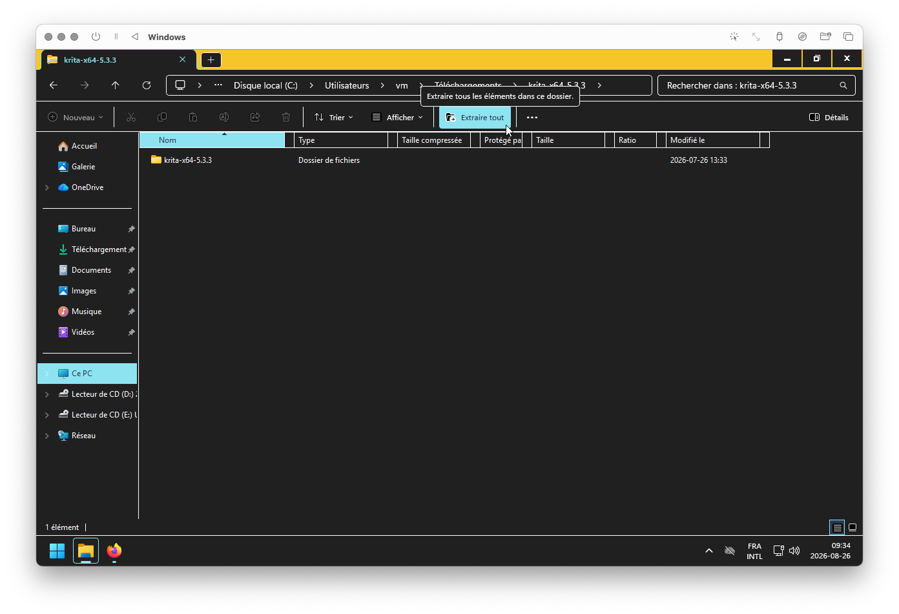
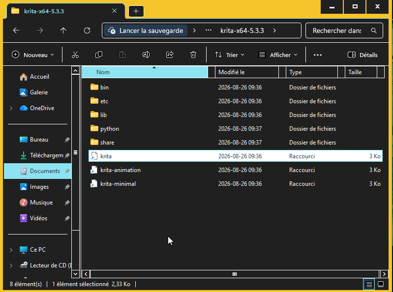

# Installation Krita

Cette page couvre l'installation de la version **portable (Windows)** de Krita — pas d'installation système, une simple décompression.

## Téléchargement

Récupérer la version compatible Windows sur la [page de téléchargement de Krita](https://krita.org/fr/download/).

## Décompression

Extraire l'archive, puis déplacer le dossier extrait à un **endroit stable** où vous saurez retrouver l'exécutable (par exemple `C:\outils\`). Ne le laissez pas dans Téléchargements : vous devrez le retrouver à chaque lancement.

## Lancer l'application

Ouvrir le dossier extrait et double-cliquer `krita.exe` (l'exécutable du programme).

## Écran d'accueil

Il est normal que le premier lancement prenne **un peu de temps**. Vous devriez ensuite tomber sur l'écran d'accueil.

## Autovalidation — installation terminée ?

- [ ] Version **portable Windows** téléchargée depuis [krita.org](https://krita.org/fr/download/)
- [ ] Archive extraite
- [ ] Dossier déplacé à un **endroit stable** (ex. `C:\outils\`) — pas dans Téléchargements
- [ ] Krita lancé (`krita.exe`) — le premier lancement peut être long
- [ ] Écran d'accueil atteint et **capturé** pour le journal de bord

## Pour aller plus loin

-  <!-- start-replace-cite key="tutoriels/krita/krita-installation" -->[Krita — l'installation](../../../../05-mediagraphie/tutoriels/krita/krita-installation/ "Le chapitre du manuel Krita sur l'installation : télécharger, installer et mettre à jour selon les plateformes — Windows, macOS et Linux.")<!-- end-replace-cite --> — le chapitre du manuel officiel : autres plateformes (macOS, Linux) et mises à jour.
