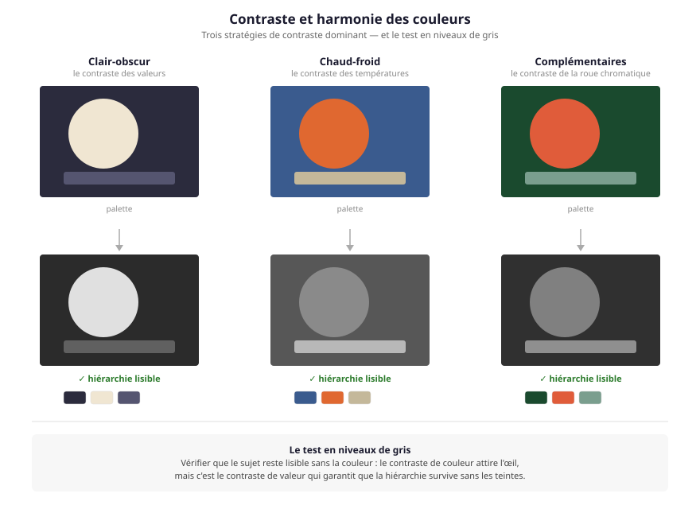
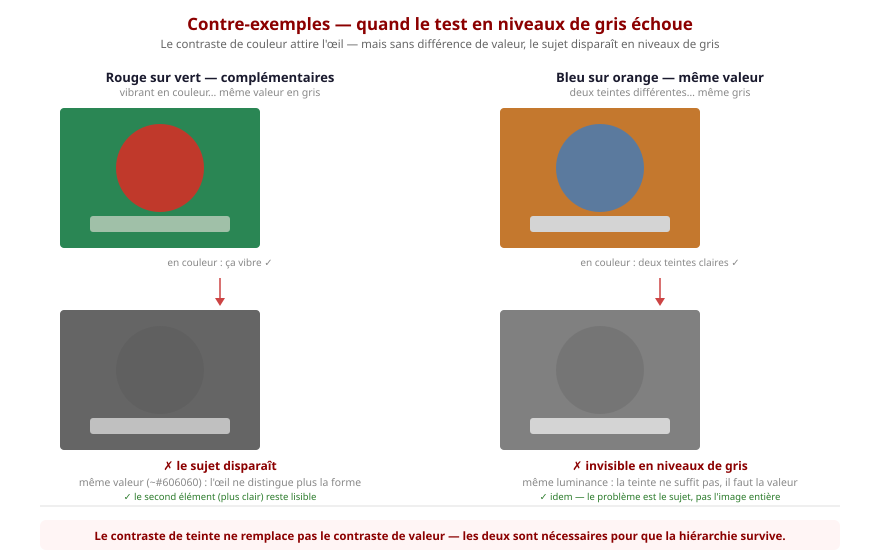
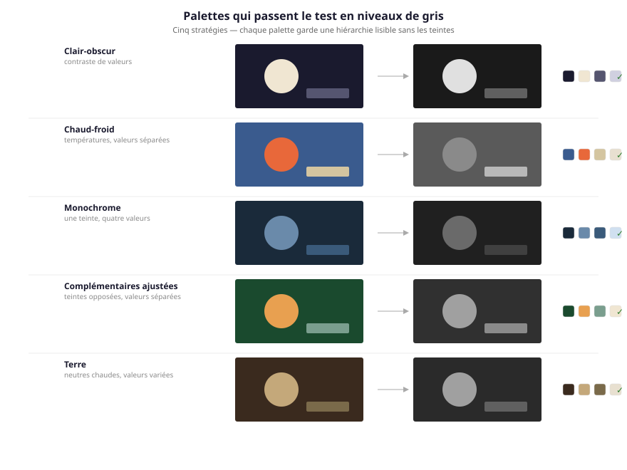
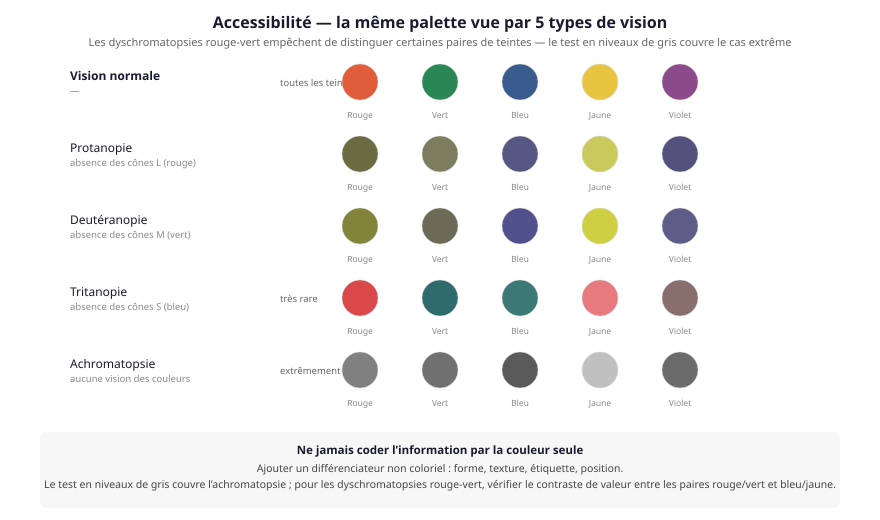

# Exercice — Contraste et harmonie des couleurs

> **Concept** : Les niveaux et les sept contrastes d'Itten : faire ressortir ce qui compte.

Choisir une palette (2 à 4 couleurs) et appliquer **un** contraste dominant : clair-obscur, chaud-froid ou complémentaires. Vérifier la hiérarchie en passant l'image en niveaux de gris.

**Pourquoi ?** Le contraste guide l'œil du spectateur : affiches, interfaces, photos de presse — c'est ce qui fait qu'on regarde ce qu'il faut regarder.

**Le piège** : deux teintes différentes peuvent avoir la **même valeur** — en couleur, ça vibre ; en gris, le sujet s'efface. C'est pour ça qu'on vérifie toujours en niveaux de gris.

## Exemples de palettes

## Accessibilité — le daltonisme

**Ne jamais coder l'information par la couleur seule** — ajouter un différenciateur non coloriel (forme, texture, étiquette, position). Le test en niveaux de gris couvre l'achromatopsie ; pour les dyschromatopsies rouge-vert (protanopie, deutéranopie), vérifier aussi le contraste de valeur entre les paires rouge/vert et bleu/jaune.

## Documentation

Lire la documentation **avant de commencer** — le concept passe avant l'outil.

| Documentation | Support | Langue |
|---|---|---|
| <!-- start-replace-cite key="tutoriels/krita/rattus-librorum/rattus-yt-lumiere-2-directe" -->[Tuto – Comprendre la Lumière #2 – Lumière Directe (Krita – Débutant)](../../../../05-mediagraphie/tutoriels/krita/rattus-librorum/rattus-yt-lumiere-2-directe/ "La lumière #2 — la lumière directe : direction, ombres portées, volume des formes. Durée : 5 min 51 s.")<!-- end-replace-cite --> | Krita (vidéo 5 min) | FR |
| <!-- start-replace-cite key="tutoriels/krita/krita-filtres" -->[Krita — les filtres](../../../../05-mediagraphie/tutoriels/krita/krita-filtres/ "La référence des filtres de Krita : flous, corrections colorimétriques, déformations, effets — appliqués en destructif ou par calque de filtre.")<!-- end-replace-cite --> | Krita | FR |
| <!-- start-replace-cite key="tutoriels/krita/krita-premiers-pas" -->[Krita — concepts de base](../../../../05-mediagraphie/tutoriels/krita/krita-premiers-pas/ "Les concepts de base du manuel Krita : démarrer le logiciel, le document (taille, PPI), la navigation du canvas et l'esprit d'un outil pensé pour les artistes.")<!-- end-replace-cite --> | Krita | FR |
| [Krita — coloriage à plat](https://docs.krita.org/fr/tutorials/flat-coloring.html) | Krita | FR |
| <!-- start-replace-cite key="tutoriels/krita/krita-masques-gamut" -->[Krita — les masques de gamut](../../../../05-mediagraphie/tutoriels/krita/krita-masques-gamut/ "Le chapitre du manuel Krita sur les masques de gamut : contraindre sa palette à une harmonie — choisir ses couleurs dans un volume limité pour garder l'accord.")<!-- end-replace-cite --> | Krita | FR |

## Logiciels

- Krita

## Autovalidation

- [ ] Une palette de 2 à 4 couleurs est choisie et justifiée
- [ ] Un contraste dominant est appliqué (clair-obscur, chaud-froid ou complémentaires)
- [ ] La hiérarchie est vérifiée en niveaux de gris — le sujet reste lisible
- [ ] Les ajustements (niveaux, courbes) sont faits sans détruire la source
- [ ] Documenté au [journal de bord](../../../../07-journal-de-bord/) : la palette, le contraste choisi, avant/après.

## Pour aller plus loin

Appliquer les mêmes contrastes avec le [masque de gamut](../../../../05-mediagraphie/tutoriels/krita/krita-masques-gamut/) pour contraindre la palette et garder l'harmonie.
