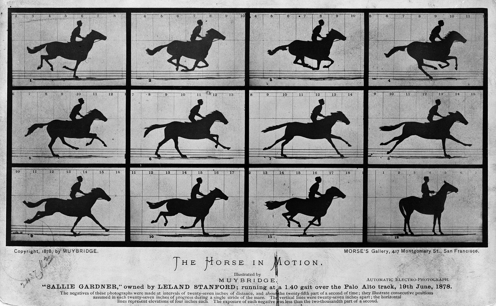
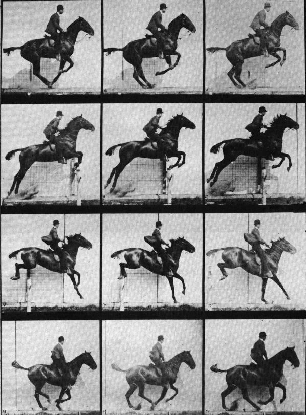
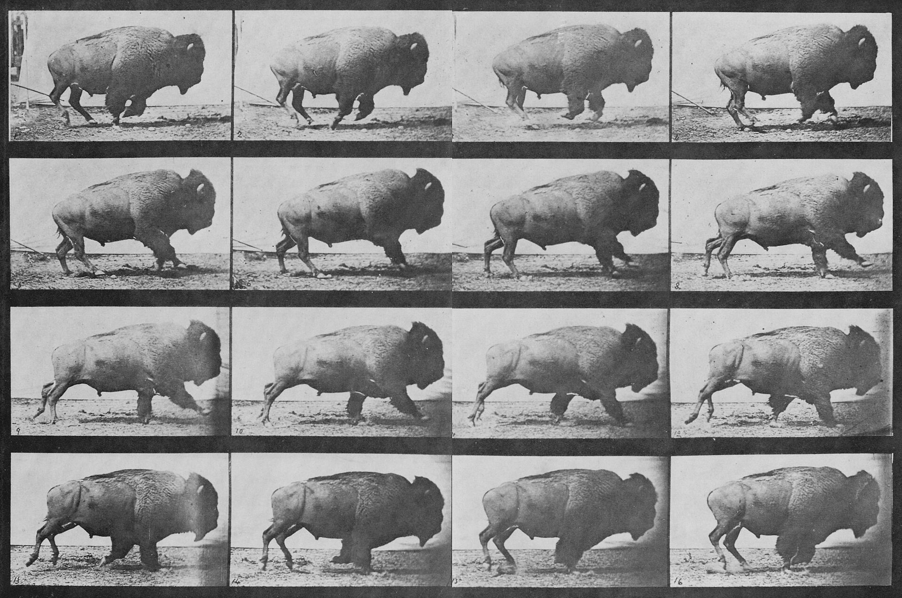

# Exercice — Animation image par image

> **Concept** : Le stop motion et les planches de Muybridge : une photo à la fois — la patience comme outil.

Animer 5 à 10 secondes en image par image : papier, objets, pixels — ou **découper une planche de Muybridge** (cheval, bison) en frames. 8 à 12 images par seconde suffisent pour commencer.

**Pourquoi ?** Le stop motion est une technique vivante : films d'animation, clips, publicités — la patience comme outil créatif.

## L'exercice en images

*Chaque trame est dessinée une par une (la balle à une hauteur différente), puis défile — 12 images par seconde suffisent pour lire le mouvement.*

## Les planches de Muybridge — découper le mouvement

Avant le cinéma, **Eadweard Muybridge** décomposait déjà le mouvement en photographies successives (1878). Choisir une **planche** ci-dessous, puis la **découper image par image** : chaque photo devient **une frame**, à raison d'une par image.

| Planche | Sujet |
|---|---|
|  | **Le cheval au trot** — la séquence fondatrice (1878) |
|  | **Le cheval qui saute** — un obstacle franchi |
|  | **Le bison** — un autre animal, un autre galop |

**La marche à suivre**

1. Choisir une planche et repérer les images qu'elle contient (une rangée, ou plusieurs).
2. **Découper** chaque image — dans Krita : importer la planche, puis rogner/détourer chaque vue.
3. Placer chaque image sur **une seule frame** de la chronologie (une image = une frame).
4. Ajuster la cadence (12 i/s pour une lecture fluide) et **boucler**.
5. Comparer : le mouvement se lit-il ? Quelles images sont en trop, lesquelles manquent ?

> **Astuce** — Une planche complète donne souvent 12 à 24 images : de quoi faire une boucle courte. On peut aussi **redessiner** chaque pose plutôt que la découper.

*Planches : Eadweard Muybridge (1878), [Wikimedia Commons](https://commons.wikimedia.org/) — **domaine public**.*

## Documentation

Lire la documentation **avant de commencer** — le concept passe avant l'outil.

| Documentation | Support | Langue |
|---|---|---|
| [Animation en volume (Wikipédia)](https://fr.wikipedia.org/wiki/Animation_en_volume) | — | FR |
| <!-- start-replace-cite key="tutoriels/krita/krita-animation-2d" -->[Krita — l'animation 2D](../../../../05-mediagraphie/tutoriels/krita/krita-animation-2d/ "Le chapitre du manuel Krita sur l'animation : le flux de production image par image et les calques d'animation — créer une boucle animée dans Krita.")<!-- end-replace-cite --> | Krita | FR |
| [Norman McLaren — processus créatif (ONF)](https://www.nfb.ca/film/creative_process_norman_mclaren) | — | FR |

## Logiciels

- Téléphone + trépied bricolé
- Glaxnimate (import d'images)
- Blender (séquence d'images)
- Krita (animation image par image)

## Autovalidation

- [ ] La caméra est stable (trépied bricolé, surface fixe) — rien ne bouge sauf l'animation
- [ ] 8 à 12 images par seconde : 5 à 10 secondes capturées
- [ ] Les images sont importées et assemblées (Glaxnimate ou Blender)
- [ ] Le rythme est vérifié : le mouvement se lit
- [ ] L'export est déposé au journal avec le décompte d'images

## Corpus d'œuvres

- [The Horse in Motion — Eadweard Muybridge](../../../../05-mediagraphie/videos/the-horse-in-motion/) — la **planche fondatrice** : découper les images et les faire défiler, une par frame.
- [Eadweard Muybridge](../../../../05-mediagraphie/personnes/eadweard-muybridge/) — le photographe qui a décomposé le mouvement avant le cinéma.
- [Fantasmagorie](../../../../05-mediagraphie/videos/fantasmagorie/) — le premier dessin animé conservé : tout y est **image par image**.
- [Le Mouvement image par image](../../../../05-mediagraphie/videos/mclaren-mouvement-image-par-image/) — la leçon filmée de McLaren sur la **décomposition du mouvement**.
- [Le merle](../../../../05-mediagraphie/videos/merle/) — **cycles et boucles** en papier découpé : le mouvement réduit à l'essentiel.

## Pour aller plus loin

Augmenter la cadence à 12 ips et refaire une séquence plus longue — la fluidité change tout.
