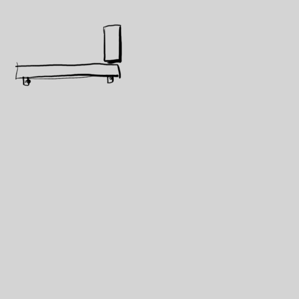

# Exercice — La brique qui tombe

> **Concept** : La chute et le poids : accélération, impact, rebond.

Animer une brique qui tombe d'une étagère : la chute accélère, l'impact est net, la brique rebondit une ou deux fois puis se stabilise.

**Pourquoi ?** La chute est l'exercice le plus simple pour comprendre l'**accélération** (le poids accélère vers le bas) et l'**impact** — la base du timing et du poids.

## L'exercice en images

*Animation de [Styxcolor](https://krita-artists.org/t/a-beginners-journey-to-animator-island/70031) (Krita Artists), exercice 3 d'[Animator Island](https://www.animatorisland.com/51-great-animation-exercises-to-master/) — crédit et source conservés ; licence non explicitement précisée sur le fil.*

## Documentation

Lire la documentation **avant de commencer** — le concept passe avant l'outil.

| Documentation | Support | Langue |
|---|---|---|
| <!-- start-replace-cite key="tutoriels/krita/krita-animation-2d" -->[Krita — l'animation 2D](../../../../05-mediagraphie/tutoriels/krita/krita-animation-2d/ "Le chapitre du manuel Krita sur l'animation : le flux de production image par image et les calques d'animation — créer une boucle animée dans Krita.")<!-- end-replace-cite --> | Krita | FR |
| <!-- start-replace-cite key="tutoriels/krita/krita-animation-timeline" -->[Krita — la chronologie d'animation](../../../../05-mediagraphie/tutoriels/krita/krita-animation-timeline/ "La référence de la chronologie d'animation de Krita : images clés, images dupliquées et clonées, tenues, sélection et cache — le cœur de l'animation image par…")<!-- end-replace-cite --> | Krita | FR |
| <!-- start-replace-cite key="tutoriels/krita/krita-onion-skin" -->[Krita — le panneau Pelures d'oignon](../../../../05-mediagraphie/tutoriels/krita/krita-onion-skin/ "La référence du panneau Pelures d'oignon de Krita : voir les trames voisines pour animer, régler leur nombre, leur opacité et leurs couleurs.")<!-- end-replace-cite --> | Krita | FR |

## Inspiration

- [51 Great Animation Exercises to Master — Animator Island](../../../../05-mediagraphie/sites/animator-island-51-exercices/) — l'exercice n° 3.
- [A beginner's journey to Animator Island — Krita Artists](../../../../05-mediagraphie/sites/krita-artists-styxcolor-animator-island/) — la réalisation de Styxcolor, dans Krita.

## Logiciels

- Krita (animation image par image)

## Autovalidation

- [ ] La brique est dessinée (forme simple, arêtes nettes)
- [ ] La chute **accélère** : les images s'espacent de plus en plus (timing)
- [ ] L'impact est net : la brique s'arrête ou s'aplatit d'un coup
- [ ] Un ou deux petits rebonds, puis l'immobilité
- [ ] Les pelures d'oignon sont utilisées pour vérifier le mouvement
- [ ] Le rendu est déposé au journal avec des captures

## Corpus d'œuvres

- [Le Château de sable](../../../../05-mediagraphie/videos/chateau-de-sable/) — le **volume** manipulé image par image donne le poids et la matière.
- [Le merle](../../../../05-mediagraphie/videos/merle/) — **cycles et rythme** : le poids d'un objet réduit à quelques traits.

## Pour aller plus loin

Refaire la même chute avec un objet **léger** (une feuille, une plume) : la chute ralentit, flotte, oscille — le poids change tout.
