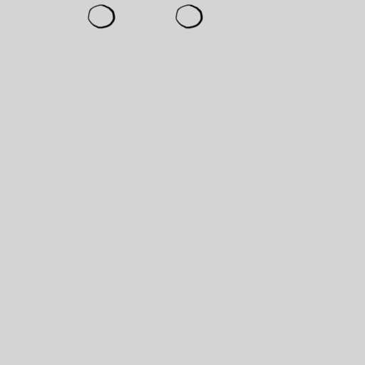
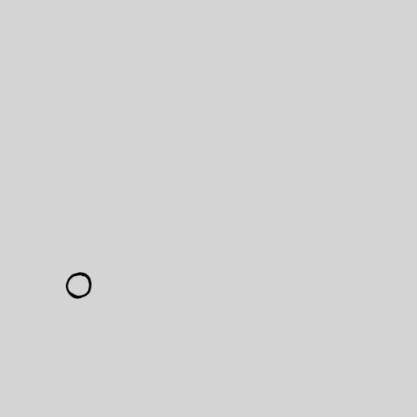

# Exercice — La balle rebondissante

> **Concept** : L'interpolation et le squash & stretch : le premier exercice d'animation.

Animer une balle qui rebondit : keyframes de position, d'écrasement et d'étirement. Le classique absolu — transposable dans n'importe quel outil d'animation.

**Pourquoi ?** Le squash et stretch sont les principes fondamentaux de l'animation (Disney) : tous les mouvements organiques les utilisent.

## L'exercice en images

*La balle qui rebondit **sur place** (exercice 1 d'Animator Island).*

*La balle qui rebondit **en travers de l'écran** (exercice 2).*

*Animations de [Styxcolor](https://krita-artists.org/t/a-beginners-journey-to-animator-island/70031) (Krita Artists), exercices 1 et 2 d'[Animator Island](https://www.animatorisland.com/51-great-animation-exercises-to-master/) — crédit et source conservés ; licence non explicitement précisée sur le fil.*

## Documentation

Lire la documentation **avant de commencer** — le concept passe avant l'outil.

| Documentation | Support | Langue |
|---|---|---|
| [La balle rebondissante (tutoriel officiel)](https://docs.glaxnimate.org/fr/tutorials/bouncy_ball.html) | Glaxnimate | FR |
| <!-- start-replace-cite key="tutoriels/krita/krita-animation-2d" -->[Krita — l'animation 2D](../../../../05-mediagraphie/tutoriels/krita/krita-animation-2d/ "Le chapitre du manuel Krita sur l'animation : le flux de production image par image et les calques d'animation — créer une boucle animée dans Krita.")<!-- end-replace-cite --> | Krita | FR |
| [Manuel Blender (français)](https://docs.blender.org/manual/fr/latest/) | Blender | FR |

## Inspiration

- [51 Great Animation Exercises to Master — Animator Island](../../../../05-mediagraphie/sites/animator-island-51-exercices/) — les exercices n° 1 et 2.
- [A beginner's journey to Animator Island — Krita Artists](../../../../05-mediagraphie/sites/krita-artists-styxcolor-animator-island/) — la réalisation de Styxcolor, dans Krita.

## Logiciels

- Glaxnimate
- Blender
- Krita (animation image par image)
- Animation image par image

## Autovalidation

- [ ] Les keyframes de position sont posées (haut → bas → haut)
- [ ] L'écrasement (squash) est animé à chaque impact
- [ ] L'étirement (stretch) est animé pendant la chute et la remontée
- [ ] Le timing est juste : la balle accélère en tombant, ralentit en montant
- [ ] Le rendu est déposé au journal avec des captures

## Corpus d'œuvres

- [Le Mouvement image par image](../../../../05-mediagraphie/videos/mclaren-mouvement-image-par-image/) — la **décomposition du mouvement**, pose par pose : le rebond expliqué par McLaren.
- [Fantasmagorie](../../../../05-mediagraphie/videos/fantasmagorie/) — la naissance du **mouvement graphique**, image par image.

## Pour aller plus loin

Animer la balle avec un rebond sur un mur latéral (déplacement horizontal + vertical) — deux axes à gérer en même temps.
