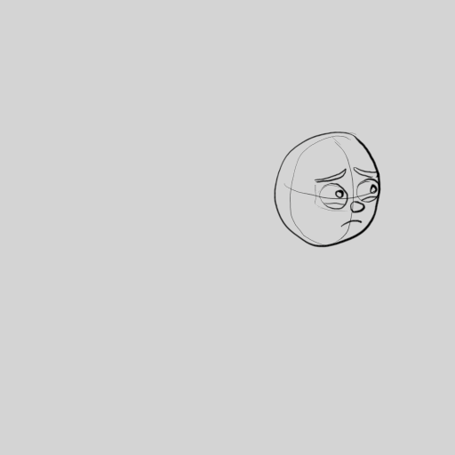
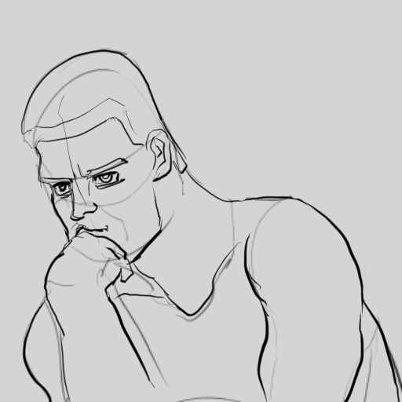

# Exercice — La tête qui se tourne

> **Concept** : Le retournement et l'anticipation : un personnage tourne la tête.

Animer une tête simple qui passe de profil à trois-quarts puis de face. Variante : ajouter une **anticipation** — la tête part légèrement dans le sens opposé avant de tourner.

**Pourquoi ?** Le retournement est l'un des mouvements les plus courants ; l'**anticipation** prépare le spectateur et donne de la vie au mouvement. C'est aussi un excellent exercice d'**acting** : que pense le personnage ?

## L'exercice en images

*Animation de [Styxcolor](https://krita-artists.org/t/a-beginners-journey-to-animator-island/70031) (Krita Artists), exercice 4 d'[Animator Island](https://www.animatorisland.com/51-great-animation-exercises-to-master/) — crédit et source conservés ; licence non explicitement précisée sur le fil.*

*Le personnage qui pense (exercice 7) — le même principe au service de l'intention.*

## Documentation

Lire la documentation **avant de commencer** — le concept passe avant l'outil.

| Documentation | Support | Langue |
|---|---|---|
| <!-- start-replace-cite key="tutoriels/krita/krita-animation-2d" -->[Krita — l'animation 2D](../../../../05-mediagraphie/tutoriels/krita/krita-animation-2d/ "Le chapitre du manuel Krita sur l'animation : le flux de production image par image et les calques d'animation — créer une boucle animée dans Krita.")<!-- end-replace-cite --> | Krita | FR |
| <!-- start-replace-cite key="tutoriels/krita/krita-animation-timeline" -->[Krita — la chronologie d'animation](../../../../05-mediagraphie/tutoriels/krita/krita-animation-timeline/ "La référence de la chronologie d'animation de Krita : images clés, images dupliquées et clonées, tenues, sélection et cache — le cœur de l'animation image par…")<!-- end-replace-cite --> | Krita | FR |
| <!-- start-replace-cite key="tutoriels/krita/krita-onion-skin" -->[Krita — le panneau Pelures d'oignon](../../../../05-mediagraphie/tutoriels/krita/krita-onion-skin/ "La référence du panneau Pelures d'oignon de Krita : voir les trames voisines pour animer, régler leur nombre, leur opacité et leurs couleurs.")<!-- end-replace-cite --> | Krita | FR |

## Inspiration

- [51 Great Animation Exercises to Master — Animator Island](../../../../05-mediagraphie/sites/animator-island-51-exercices/) — les exercices n° 4 à 7.
- [A beginner's journey to Animator Island — Krita Artists](../../../../05-mediagraphie/sites/krita-artists-styxcolor-animator-island/) — la réalisation de Styxcolor, dans Krita.

## Logiciels

- Krita (animation image par image)

## Autovalidation

- [ ] La tête est dessinée simplement (crâne, nez, menton) et reste **lisible** sous tous les angles
- [ ] Le passage profil → trois-quarts → face est cohérent (pas de saut de volume)
- [ ] Les images intermédiaires (intercalage) adoucissent le mouvement
- [ ] L'anticipation est présente (départ léger dans le sens opposé)
- [ ] L'expression raconte quelque chose (curiosité, surprise, réflexion…)
- [ ] Le rendu est déposé au journal avec des captures

## Corpus d'œuvres

- [Gertie the Dinosaur](../../../../05-mediagraphie/videos/gertie-the-dinosaur/) — **cycles** et **personnalité** du personnage : l'intention avant le dessin.
- [Ryan](../../../../05-mediagraphie/videos/ryan/) — l'expression intérieure rendue visible par la **déformation** : jusqu'où peut aller un visage.

## Pour aller plus loin

Faire un **clignement** des yeux (exercice 6 d'Animator Island) pendant le retournement — et un changement d'émotion (voir [Le changement d'émotion](../09-changement-emotion/)).
