# Exercice — Titres et transitions

> **Concept** : Le texte à l'écran et les fondus : sobriété et lisibilité.

Ajouter un **titre** d'ouverture et un **générique** à une animation, puis un **fondu** (opacité animée) — dans Krita.

**Pourquoi ?** Les titres structurent le récit : opening de film, sous-titres, génériques — sobres et lisibles. Le fondu, lui, est la transition la plus utile et la plus sobre.

## L'exercice en images

*Le titre apparaît en fondu, se maintient, puis s'efface — un seul mouvement, lisible.*

## Documentation

Lire la documentation **avant de commencer** — le concept passe avant l'outil.

| Documentation | Support | Langue |
|---|---|---|
| <!-- start-replace-cite key="tutoriels/krita/krita-texte" -->[Krita — le texte](../../../../05-mediagraphie/tutoriels/krita/krita-texte/ "Le chapitre du manuel Krita sur le texte : l'outil texte, les calques vectoriels de texte, les propriétés typographiques — et les limites du texte dans un logi…")<!-- end-replace-cite --> | Krita | FR |
| <!-- start-replace-cite key="tutoriels/krita/krita-animation-curves" -->[Krita — le panneau Courbes d'animation](../../../../05-mediagraphie/tutoriels/krita/krita-animation-curves/ "La référence du panneau Courbes d'animation de Krita : animer l'opacité, la position, la rotation et l'échelle par interpolation — images clés scalaires et cou…")<!-- end-replace-cite --> | Krita | FR |
| <!-- start-replace-cite key="tutoriels/krita/krita-animation-2d" -->[Krita — l'animation 2D](../../../../05-mediagraphie/tutoriels/krita/krita-animation-2d/ "Le chapitre du manuel Krita sur l'animation : le flux de production image par image et les calques d'animation — créer une boucle animée dans Krita.")<!-- end-replace-cite --> | Krita | FR |

## Logiciels

- Krita (outil texte, calques vectoriels, courbes d'opacité, export)

## Autovalidation

- [ ] Un titre d'ouverture et un générique de fin sont ajoutés (outil **texte** de Krita)
- [ ] Le titre est lisible : durée suffisante, contraste, sans effet gratuit
- [ ] Un **fondu** animé (opacité via les courbes d'animation) — justifié, pas décoratif
- [ ] Le texte respecte la zone utile de l'image (marges de sécurité)
- [ ] Documenté au [journal de bord](../../../../07-journal-de-bord/) : les réglages et pourquoi.

## Corpus d'œuvres

- [L'Homme à la caméra](../../../../05-mediagraphie/sites/l-homme-a-la-camera/) — le **montage comme écriture** : où placer un titre, où couper, comment rythmer.

## Pour aller plus loin

Créer un titre **animé** (déplacement par masque de transformation ou images clés) — la sobriété reste la règle.
