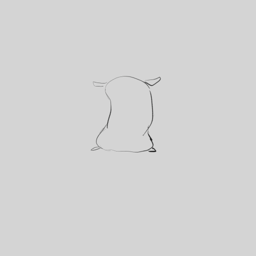
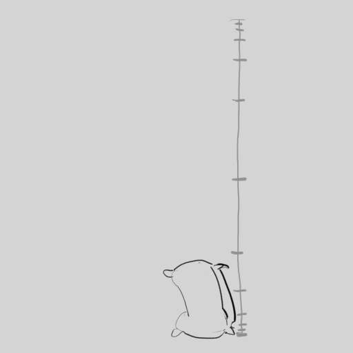
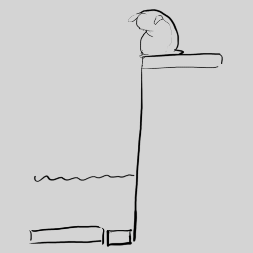
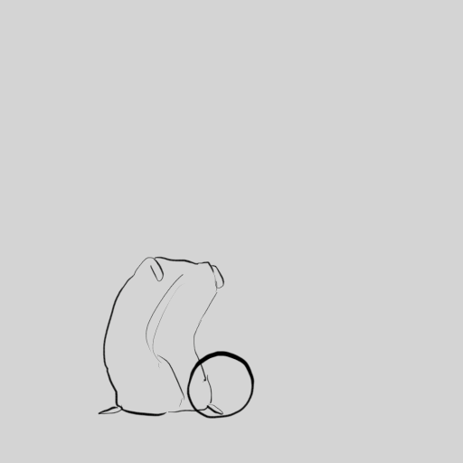

# Exercice — Le sac de farine

> **Concept** : Le volume et le poids : un sac de farine qui vit — vague, saut, chute, coup de pied.

Animer un **sac de farine** (une forme simple, sans visage) qui salue, saute, tombe et botte un ballon. Le sac est le personnage le plus simple qui puisse encore exprimer du poids, de l'élan et des émotions.

**Pourquoi ?** Le sac de farine force à animer le **mouvement pour lui-même** : le poids, l'élasticité, l'overlapping, la déformation — sans se cacher derrière un design. C'est l'exercice classique des studios.

## L'exercice en images

*Le sac qui salue (exercice 8 d'Animator Island).*

*Le sac qui saute (exercice 9).*

*Le sac qui tombe (exercice 10).*

*Le sac qui botte un ballon (exercice 11).*

*Animations de [Styxcolor](https://krita-artists.org/t/a-beginners-journey-to-animator-island/70031) (Krita Artists), exercices 8 à 11 d'[Animator Island](https://www.animatorisland.com/51-great-animation-exercises-to-master/) — crédit et source conservés ; licence non explicitement précisée sur le fil.*

## Documentation

Lire la documentation **avant de commencer** — le concept passe avant l'outil.

| Documentation | Support | Langue |
|---|---|---|
| <!-- start-replace-cite key="tutoriels/krita/krita-animation-2d" -->[Krita — l'animation 2D](../../../../05-mediagraphie/tutoriels/krita/krita-animation-2d/ "Le chapitre du manuel Krita sur l'animation : le flux de production image par image et les calques d'animation — créer une boucle animée dans Krita.")<!-- end-replace-cite --> | Krita | FR |
| <!-- start-replace-cite key="tutoriels/krita/krita-animation-timeline" -->[Krita — la chronologie d'animation](../../../../05-mediagraphie/tutoriels/krita/krita-animation-timeline/ "La référence de la chronologie d'animation de Krita : images clés, images dupliquées et clonées, tenues, sélection et cache — le cœur de l'animation image par…")<!-- end-replace-cite --> | Krita | FR |
| <!-- start-replace-cite key="tutoriels/krita/krita-onion-skin" -->[Krita — le panneau Pelures d'oignon](../../../../05-mediagraphie/tutoriels/krita/krita-onion-skin/ "La référence du panneau Pelures d'oignon de Krita : voir les trames voisines pour animer, régler leur nombre, leur opacité et leurs couleurs.")<!-- end-replace-cite --> | Krita | FR |

## Inspiration

- [51 Great Animation Exercises to Master — Animator Island](../../../../05-mediagraphie/sites/animator-island-51-exercices/) — les exercices n° 8 à 11.
- [A beginner's journey to Animator Island — Krita Artists](../../../../05-mediagraphie/sites/krita-artists-styxcolor-animator-island/) — la réalisation de Styxcolor, dans Krita.

## Logiciels

- Krita (animation image par image)

## Autovalidation

- [ ] Le sac est dessiné comme une forme souple (poids au fond, sommet qui suit)
- [ ] Le **squash & stretch** déforme le sac à l'impact et à l'étirement
- [ ] L'**overlapping** est visible : le haut du sac retarde sur le bas
- [ ] Les 4 mouvements sont traités : vague, saut, chute, coup de pied
- [ ] Le mouvement se lit au journal (export de la boucle)
- [ ] Le rendu est déposé au journal avec des captures

## Corpus d'œuvres

- [Neighbours](../../../../05-mediagraphie/videos/neighbours/) — la **pixilation** : le corps animé image par image — matière, poids et mouvement.
- [Le Château de sable](../../../../05-mediagraphie/videos/chateau-de-sable/) — la **pâte à modeler** : le volume manipulé, un récit sans paroles.

## Pour aller plus loin

Donner au sac une **intention** (il salue quelqu'un, il a peur, il est fatigué) — l'exercice devient une scène d'acting.
