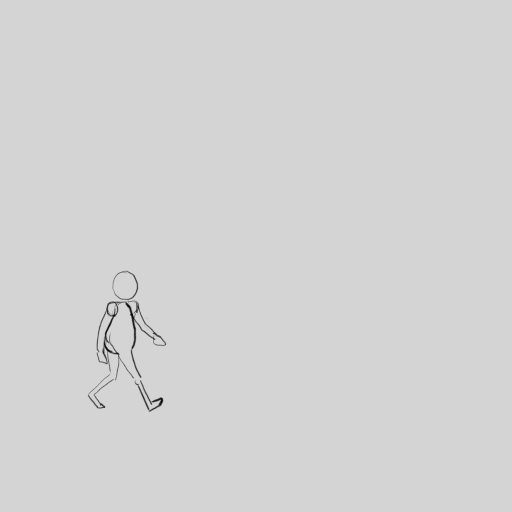

# Exercice — Le cycle de marche

> **Concept** : La marche en boucle : contact, abaissement, passage, montée — le cycle complet.

Animer un **cycle de marche** de profil : les quatre poses clés (contact, abaissement, passage, montée) répétées sur les deux jambes, puis la boucle.

**Pourquoi ?** Le cycle de marche est le socle de l'animation de personnage : il contient à lui seul le poids, l'équilibre, le rythme et l'overlapping. Une fois maîtrisé, il ouvre la course, le saut et l'acting.

## L'exercice en images

*Animation de [Styxcolor](https://krita-artists.org/t/a-beginners-journey-to-animator-island/70031) (Krita Artists), exercice 15 d'[Animator Island](https://www.animatorisland.com/51-great-animation-exercises-to-master/) — crédit et source conservés ; licence non explicitement précisée sur le fil.*

## Dans le corpus — Multimédia libre

- [Les principes de l'animation](/remote/codeberg.org/gllm/multimedia-libre/corpus/03-animation/01-principes-animation/) — les principes de l'animation.
- [L'animation image par image](/remote/codeberg.org/gllm/multimedia-libre/corpus/03-animation/02-image-par-image/) — image par image, pas à pas.

## Documentation

Lire la documentation **avant de commencer** — le concept passe avant l'outil.

| Documentation | Support | Langue |
|---|---|---|
| <!-- start-replace-cite key="tutoriels/krita/krita-animation-2d" -->[Krita — l'animation 2D](../../../../05-mediagraphie/tutoriels/krita/krita-animation-2d/ "Le chapitre du manuel Krita sur l'animation : le flux de production image par image et les calques d'animation — créer une boucle animée dans Krita.")<!-- end-replace-cite --> | Krita | FR |
| <!-- start-replace-cite key="tutoriels/krita/krita-animation-timeline" -->[Krita — la chronologie d'animation](../../../../05-mediagraphie/tutoriels/krita/krita-animation-timeline/ "La référence de la chronologie d'animation de Krita : images clés, images dupliquées et clonées, tenues, sélection et cache — le cœur de l'animation image par…")<!-- end-replace-cite --> | Krita | FR |
| <!-- start-replace-cite key="tutoriels/krita/krita-onion-skin" -->[Krita — le panneau Pelures d'oignon](../../../../05-mediagraphie/tutoriels/krita/krita-onion-skin/ "La référence du panneau Pelures d'oignon de Krita : voir les trames voisines pour animer, régler leur nombre, leur opacité et leurs couleurs.")<!-- end-replace-cite --> | Krita | FR |

## Inspiration

- [51 Great Animation Exercises to Master — Animator Island](../../../../05-mediagraphie/sites/animator-island-51-exercices/) — l'exercice n° 15.
- [A beginner's journey to Animator Island — Krita Artists](../../../../05-mediagraphie/sites/krita-artists-styxcolor-animator-island/) — la réalisation de Styxcolor, dans Krita.

## Logiciels

- Krita (animation image par image)

## Autovalidation

- [ ] Les quatre poses clés sont présentes : contact, abaissement, passage, montée
- [ ] Le bassin monte et descend (rebond du corps) et les épaules tournent
- [ ] Les bras balancent en opposition avec les jambes
- [ ] L'overlapping est visible (cheveux, vêtement, queue…)
- [ ] La boucle est parfaite : la dernière image enchaîne la première
- [ ] Le rendu est déposé au journal avec des captures

## Corpus d'œuvres

- [Walking](../../../../05-mediagraphie/videos/walking/) — l'**étude du mouvement humain** de Ryan Larkin : la marche redessinée, cycles et fluidité.
- [Le Mouvement image par image](../../../../05-mediagraphie/videos/mclaren-mouvement-image-par-image/) — les **cycles** et la **cadence** expliqués par McLaren.

## Pour aller plus loin

Passer au [cycle de course](../14-cycle-de-course/) (plus rapide, plus d'amplitude, phase de suspension) — ou animer la même marche avec un personnage lourd, puis léger.
