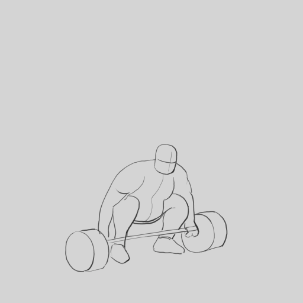

# Exercice — Lever une charge

> **Concept** : L'effort et le poids : soulever un objet lourd — anticipation, appui, relâchement.

Animer un personnage qui soulève un objet lourd : il se prépare (anticipation), s'appuie, tire avec effort, puis relâche. Le poids doit se **sentir**.

**Pourquoi ?** L'effort est un grand exercice de poids et de timing : sans anticipation ni déformation, la charge semble légère et l'animation sonne faux.

## L'exercice en images

*Animation de [Styxcolor](https://krita-artists.org/t/a-beginners-journey-to-animator-island/70031) (Krita Artists), exercice 27 d'[Animator Island](https://www.animatorisland.com/51-great-animation-exercises-to-master/) — crédit et source conservés ; licence non explicitement précisée sur le fil.*

## Documentation

Lire la documentation **avant de commencer** — le concept passe avant l'outil.

| Documentation | Support | Langue |
|---|---|---|
| <!-- start-replace-cite key="tutoriels/krita/krita-animation-2d" -->[Krita — l'animation 2D](../../../../05-mediagraphie/tutoriels/krita/krita-animation-2d/ "Le chapitre du manuel Krita sur l'animation : le flux de production image par image et les calques d'animation — créer une boucle animée dans Krita.")<!-- end-replace-cite --> | Krita | FR |
| <!-- start-replace-cite key="tutoriels/krita/krita-animation-timeline" -->[Krita — la chronologie d'animation](../../../../05-mediagraphie/tutoriels/krita/krita-animation-timeline/ "La référence de la chronologie d'animation de Krita : images clés, images dupliquées et clonées, tenues, sélection et cache — le cœur de l'animation image par…")<!-- end-replace-cite --> | Krita | FR |
| <!-- start-replace-cite key="tutoriels/krita/krita-onion-skin" -->[Krita — le panneau Pelures d'oignon](../../../../05-mediagraphie/tutoriels/krita/krita-onion-skin/ "La référence du panneau Pelures d'oignon de Krita : voir les trames voisines pour animer, régler leur nombre, leur opacité et leurs couleurs.")<!-- end-replace-cite --> | Krita | FR |

## Inspiration

- [51 Great Animation Exercises to Master — Animator Island](../../../../05-mediagraphie/sites/animator-island-51-exercices/) — l'exercice n° 27.
- [A beginner's journey to Animator Island — Krita Artists](../../../../05-mediagraphie/sites/krita-artists-styxcolor-animator-island/) — la réalisation de Styxcolor, dans Krita.

## Logiciels

- Krita (animation image par image)

## Autovalidation

- [ ] L'**anticipation** est présente : le personnage se prépare avant de tirer
- [ ] Le corps se **déforme** sous l'effort (dos courbé, jambes fléchies, visage crispé)
- [ ] Le rythme traduit l'effort : lenteur au départ, accélération, relâchement
- [ ] L'objet semble lourd (il « résiste » et retombe légèrement)
- [ ] L'effort se lit **de loin** (silhouette)
- [ ] Le rendu est déposé au journal avec des captures

## Corpus d'œuvres

- [Neighbours](../../../../05-mediagraphie/videos/neighbours/) — le corps animé image par image : l'**effort** et le **poids** au plus près du réel.
- [Le Château de sable](../../../../05-mediagraphie/videos/chateau-de-sable/) — le **volume** et la matière : une charge qui pèse.

## Pour aller plus loin

Refaire l'exercice avec un objet **léger** (un ballon, une plume) pour comparer — puis avec **deux personnages** qui portent la même charge (tir à la corde, exercice 42).
