# Exercice — Montage simple

> **Concept** : La timeline : ordre des images, tenues, rythme.

Assembler une séquence animée dans la **timeline de Krita** : importer une série d'images, poser les tenues, ajuster l'ordre et le rythme, premier export.

**Pourquoi ?** Le montage fait le film : en animation, c'est l'ordre et la **durée** des images qui créent le rythme. La timeline de Krita est l'équivalent du montage pour l'animation image par image.

## L'exercice en images

*Les images s'assemblent sur la timeline, une séquence se réordonne — l'ordre et la durée créent le rythme.*

## Documentation

Lire la documentation **avant de commencer** — le concept passe avant l'outil.

| Documentation | Support | Langue |
|---|---|---|
| <!-- start-replace-cite key="tutoriels/krita/krita-animation-timeline" -->[Krita — la chronologie d'animation](../../../../05-mediagraphie/tutoriels/krita/krita-animation-timeline/ "La référence de la chronologie d'animation de Krita : images clés, images dupliquées et clonées, tenues, sélection et cache — le cœur de l'animation image par…")<!-- end-replace-cite --> | Krita | FR |
| <!-- start-replace-cite key="tutoriels/krita/krita-animation-2d" -->[Krita — l'animation 2D](../../../../05-mediagraphie/tutoriels/krita/krita-animation-2d/ "Le chapitre du manuel Krita sur l'animation : le flux de production image par image et les calques d'animation — créer une boucle animée dans Krita.")<!-- end-replace-cite --> | Krita | FR |
| <!-- start-replace-cite key="tutoriels/krita/krita-onion-skin" -->[Krita — le panneau Pelures d'oignon](../../../../05-mediagraphie/tutoriels/krita/krita-onion-skin/ "La référence du panneau Pelures d'oignon de Krita : voir les trames voisines pour animer, régler leur nombre, leur opacité et leurs couleurs.")<!-- end-replace-cite --> | Krita | FR |

## Logiciels

- Krita (timeline, tenues, export)
- Optionnel — Kdenlive, Shotcut ou OpenShot pour le montage final (son, titres)

## Autovalidation

- [ ] Les images sont importées dans la **timeline de Krita** (glisser-déposer)
- [ ] Les **tenues** sont posées : la séquence tient en X secondes
- [ ] L'ordre des images raconte quelque chose (pas l'ordre de création)
- [ ] Le rythme est vérifié par la lecture (et les pelures d'oignon)
- [ ] Un premier export est fait et visionné de bout en bout
- [ ] Documenté au [journal de bord](../../../../07-journal-de-bord/) : captures de la timeline, problème → solution.

## Corpus d'œuvres

- [L'Homme à la caméra](../../../../05-mediagraphie/sites/l-homme-a-la-camera/) — le **montage rythmique** : l'ordre des plans crée le sens.
- [L'effet Koulechov](../../../../05-mediagraphie/videos/kuleshov-effect/) — la **juxtaposition** : le montage crée l'émotion.

## Pour aller plus loin

Ajouter une trame sonore dans un éditeur vidéo et couper en fonction du rythme de la musique — le son dicte le montage.
