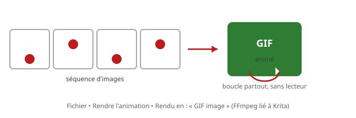

# Exercice — Exporter en GIF

> **Concept** : Rendre une animation en GIF : un fichier léger, qui boucle partout.

Exporter une animation en **GIF animé** depuis Krita : installer et lier FFmpeg, choisir la plage et la cadence, rendre, puis vérifier la boucle et le poids.

**Pourquoi ?** Le GIF est le format animé le plus universel : il se lit dans un navigateur, un message ou une page web — sans lecteur. C'est aussi un excellent format de prévisualisation pour le journal de bord.

## L'exercice en images

*La séquence est rendue en un fichier GIF animé qui boucle — un format léger et universel.*

## Documentation

Lire la documentation **avant de commencer** — le concept passe avant l'outil.

| Documentation | Support | Langue |
|---|---|---|
| <!-- start-replace-cite key="tutoriels/krita/krita-render-animation" -->[Krita — le rendu de l'animation et FFmpeg](../../../../05-mediagraphie/tutoriels/krita/krita-render-animation/ "Le rendu de l'animation dans Krita : exporter en séquence d'images ou en vidéo, et installer FFmpeg (télécharger, décompresser, lier à Krita) pour produire un…")<!-- end-replace-cite --> | Krita | FR |
| <!-- start-replace-cite key="tutoriels/krita/krita-animation-2d" -->[Krita — l'animation 2D](../../../../05-mediagraphie/tutoriels/krita/krita-animation-2d/ "Le chapitre du manuel Krita sur l'animation : le flux de production image par image et les calques d'animation — créer une boucle animée dans Krita.")<!-- end-replace-cite --> | Krita | FR |
| [ffmprovisr — recettes FFmpeg](https://amiaopensource.github.io/ffmprovisr/) | FFmpeg | EN |

## Logiciels

- Krita (**Fichier ‣ Rendre l'animation…**, *Rendu en* : « GIF image »)
- FFmpeg (installé et lié à Krita — voir la fiche)

## Autovalidation

- [ ] FFmpeg est installé et **lié à Krita** (le chemin est renseigné)
- [ ] La plage rendue (première / dernière image) est correcte
- [ ] La cadence et la taille sont raisonnables (12 à 24 i/s, largeur ≤ 1080 px)
- [ ] Le GIF **boucle** proprement : la dernière image rejoint la première sans saut
- [ ] Le poids est raisonnable (quelques Mo — sinon réduire taille ou cadence)
- [ ] Le GIF est déposé au [journal de bord](../../../../07-journal-de-bord/) avec des captures

## Corpus d'œuvres

- [Le merle](../../../../05-mediagraphie/videos/merle/) — une **boucle courte et simple** : le cas idéal du GIF.
- [Le Château de sable](../../../../05-mediagraphie/videos/chateau-de-sable/) — à l'inverse, un récit riche en nuances : à ne **pas** réduire au GIF (256 couleurs).

## Pour aller plus loin

Comparer le même rendu en **GIF** et en **WebM/MP4** (poids, qualité) — n'utiliser le GIF que quand il apporte quelque chose (boucle courte, prévisualisation). Comprendre le format : [Le GIF — avantages, limites, alternatives](../../../../03-savoirs/01-reconnaitre/03-criteres-qualite-fichiers/02-video-animation/02-gif/).
