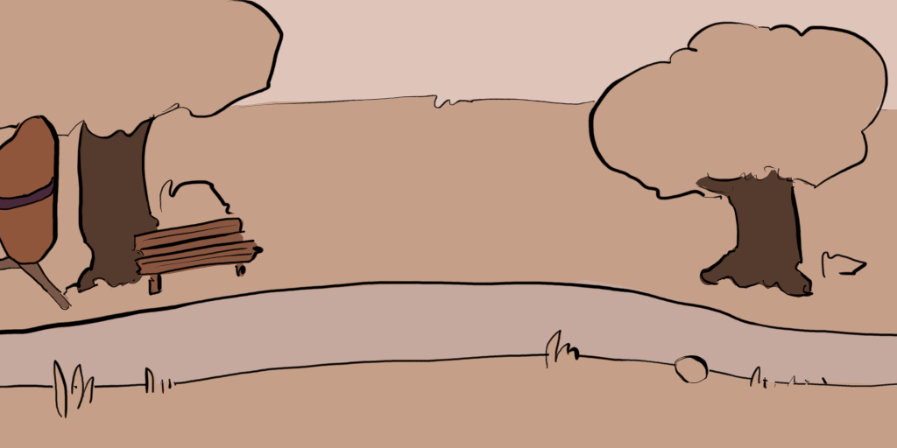

# Exercice — Le cycle de course

> **Concept** : La course en boucle : plus rapide, plus d'amplitude, une phase de suspension.

Animer un **cycle de course** de profil : le corps se penche vers l'avant, l'amplitude est plus grande que la marche, et les deux pieds quittent le sol à la **phase de suspension**.

**Pourquoi ?** La course pousse plus loin tous les principes de la marche : poussée, poids, équilibre, rythme. C'est le test d'un cycle solide.

## L'exercice en images

*Animation de [Styxcolor](https://krita-artists.org/t/a-beginners-journey-to-animator-island/70031) (Krita Artists), exercice 24 d'[Animator Island](https://www.animatorisland.com/51-great-animation-exercises-to-master/) — crédit et source conservés ; licence non explicitement précisée sur le fil.*

## Documentation

Lire la documentation **avant de commencer** — le concept passe avant l'outil.

| Documentation | Support | Langue |
|---|---|---|
| <!-- start-replace-cite key="tutoriels/krita/krita-animation-2d" -->[Krita — l'animation 2D](../../../../05-mediagraphie/tutoriels/krita/krita-animation-2d/ "Le chapitre du manuel Krita sur l'animation : le flux de production image par image et les calques d'animation — créer une boucle animée dans Krita.")<!-- end-replace-cite --> | Krita | FR |
| <!-- start-replace-cite key="tutoriels/krita/krita-animation-timeline" -->[Krita — la chronologie d'animation](../../../../05-mediagraphie/tutoriels/krita/krita-animation-timeline/ "La référence de la chronologie d'animation de Krita : images clés, images dupliquées et clonées, tenues, sélection et cache — le cœur de l'animation image par…")<!-- end-replace-cite --> | Krita | FR |
| <!-- start-replace-cite key="tutoriels/krita/krita-onion-skin" -->[Krita — le panneau Pelures d'oignon](../../../../05-mediagraphie/tutoriels/krita/krita-onion-skin/ "La référence du panneau Pelures d'oignon de Krita : voir les trames voisines pour animer, régler leur nombre, leur opacité et leurs couleurs.")<!-- end-replace-cite --> | Krita | FR |

## Inspiration

- [51 Great Animation Exercises to Master — Animator Island](../../../../05-mediagraphie/sites/animator-island-51-exercices/) — l'exercice n° 24.
- [A beginner's journey to Animator Island — Krita Artists](../../../../05-mediagraphie/sites/krita-artists-styxcolor-animator-island/) — la réalisation de Styxcolor, dans Krita.

## Logiciels

- Krita (animation image par image)

## Autovalidation

- [ ] Le corps est penché vers l'avant et le buste participe au mouvement
- [ ] La **phase de suspension** existe : les deux pieds quittent le sol
- [ ] L'amplitude est plus grande que la marche (foulée, balancement des bras)
- [ ] Le rythme est rapide et régulier (moins d'images entre les poses)
- [ ] La boucle est parfaite : la dernière image enchaîne la première
- [ ] Le rendu est déposé au journal avec des captures

## Corpus d'œuvres

- [Walking](../../../../05-mediagraphie/videos/walking/) — la marche de Larkin : à comparer avec la course (amplitude, suspension).
- [Le Mouvement image par image](../../../../05-mediagraphie/videos/mclaren-mouvement-image-par-image/) — **cycles** et **cadence** : la course au rythme.

## Pour aller plus loin

Faire courir le personnage **en changeant de direction** (exercice 46) — la transition marche/course et le virage ajoutent beaucoup de difficulté.
