# Exercice — Encodage et export

> **Concept** : Rendre l'animation : codec, contenant, débit.

**Rendre l'animation dans Krita** (séquence d'images ou vidéo via FFmpeg), puis comparer les formats d'export (MP4/H.264 et WebM/AV1).

**Pourquoi ?** L'encodage détermine si votre animation se lit bien partout : web, projection, mobile — le bon codec au bon débit. Krita passe par **FFmpeg** pour le rendu vidéo.

## L'exercice en images

*On rend l'animation depuis Krita, puis on compare les formats (MP4/H.264, WebM/AV1) : poids, débit, lecture.*

## Documentation

Lire la documentation **avant de commencer** — le concept passe avant l'outil.

| Documentation | Support | Langue |
|---|---|---|
| <!-- start-replace-cite key="tutoriels/krita/krita-animation-2d" -->[Krita — l'animation 2D](../../../../05-mediagraphie/tutoriels/krita/krita-animation-2d/ "Le chapitre du manuel Krita sur l'animation : le flux de production image par image et les calques d'animation — créer une boucle animée dans Krita.")<!-- end-replace-cite --> | Krita | FR |
| [ffmprovisr — recettes FFmpeg](https://amiaopensource.github.io/ffmprovisr/) | FFmpeg | EN |
| [FFmpeg — documentation](https://ffmpeg.org/documentation.html) | FFmpeg | EN |

## Logiciels

- Krita (**Fichier ‣ Rendre l'animation** — séquence d'images ou vidéo via FFmpeg)
- FFmpeg (transcodage, comparaison des codecs)
- Optionnel — Kdenlive ou Shotcut (panneau export)

## Autovalidation

- [ ] L'animation est rendue depuis Krita (séquence PNG **ou** vidéo)
- [ ] La même séquence est exportée en MP4 (H.264) **et** en WebM (AV1)
- [ ] Poids et débit des deux fichiers sont notés et comparés
- [ ] Les deux fichiers sont lus sur un autre appareil (téléphone)
- [ ] Le compromis qualité/poids est choisi et justifié
- [ ] Documenté au [journal de bord](../../../../07-journal-de-bord/) : les commandes ou réglages d'export utilisés.

## Pour aller plus loin

Tester un troisième codec (VP9) et comparer le poids — trois conteneurs pour la même séquence. Comprendre les concepts : [La vidéo numérique — codec, contenant, compression](../../../../03-savoirs/01-reconnaitre/03-criteres-qualite-fichiers/02-video-animation/01-video-numerique/).
