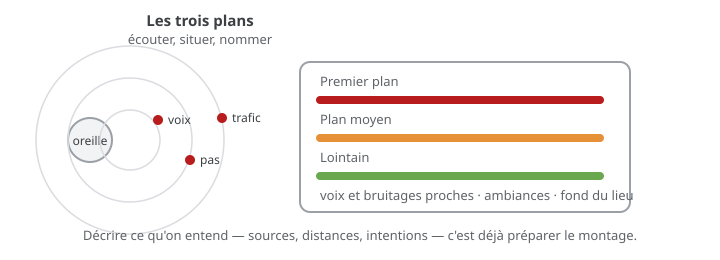

# Exercice — Écoute critique

> **Concept** : Décrire une scène sonore : plans, sources, intentions — l'oreille qui analyse.

Écouter un lieu ou une œuvre du [corpus sonore](../../corpus-sonore/), puis **décrire** ce qu'on entend : les sources, leur distance, ce qu'elles racontent. Pas d'enregistrement, pas de montage : seulement l'oreille et le carnet.

**Pourquoi ?** On ne peut pas monter ce qu'on n'entend pas. Avant de choisir un son, il faut savoir l'écouter : le distinguer du fond, le situer dans l'espace, nommer son intention.

## L'exercice en images

*Trois plans s'organisent à l'écoute : le **premier plan** (voix, bruitages proches), le **plan moyen** (ambiances), le **lointain** (fond, ville) — les décrire, c'est déjà préparer le montage.*

## Voir aussi

- [Les principes du son](../../../../03-savoirs/01-reconnaitre/04-outils-processus-creation/03-son/01-principes-son/) — numérisation, écoute, paysage sonore.
- [Le paysage sonore](../../../../03-savoirs/01-reconnaitre/04-outils-processus-creation/03-son/05-paysage-sonore/) — construire un lieu par couches.

## Documentation

Lire et écouter **avant de commencer** — le concept passe avant l'outil.

| Documentation | Support | Langue |
|---|---|---|
| <!-- start-replace-cite key="livres/schafer-le-paysage-sonore-le-monde-comme-musique" -->[Le paysage sonore : le monde comme musique](../../../../05-mediagraphie/livres/schafer-le-paysage-sonore-le-monde-comme-musique/ "L'écoute du monde comme composition — le concept de paysage sonore (soundscape), fondement du module sur le son. Édition française : Wildproject ; l'édition an…")<!-- end-replace-cite --> | — | FR |
| [Le corpus sonore — montage et audio](../../corpus-sonore/) | — | FR |
| [Écouter — Freesound, filtrer par licence](https://freesound.org) | — | FR |

## Logiciels

- Aucun logiciel : une oreille, un carnet, le [journal de bord](../../../../07-journal-de-bord/)
- Optionnel : téléphone (enregistrer une ambiance pour la réécouter)

## Autovalidation

- [ ] Un lieu ou une œuvre est choisi et écouté **sans image**, deux fois
- [ ] Au moins trois **sources** sont nommées et situées (proche, moyen, lointain)
- [ ] Les **plans sonores** sont décrits (premier plan, plan moyen, fond)
- [ ] Une intention est notée : que raconte cette scène ? qu'est-ce qui porte le sens ?
- [ ] Documenté au [journal de bord](../../../../07-journal-de-bord/) : la description, les captures d'écoute.

## Corpus d'œuvres

-  <!-- start-replace-cite key="videos/synchromy" -->[Synchromie](../../../../05-mediagraphie/videos/synchromy/ "Expérience fondatrice de musique visuelle : McLaren dessine le son directement sur la pellicule — image et son ne font qu'un.")<!-- end-replace-cite --> — la **musique visuelle** : image et son ne font qu'un ; écouter les couches et le rythme.
-  <!-- start-replace-cite key="videos/mary-ellen-bute-synchromy-no-2" -->[Synchromy No. 2](../../../../05-mediagraphie/videos/mary-ellen-bute-synchromy-no-2/ "Musique visuelle : des formes abstraites composées en rythme sur la « Romance à l'étoile » de Tannhäuser de Wagner — l'une des premières images animées électro…")<!-- end-replace-cite --> — les **formes abstraites** composées sur Wagner : suivre la partition à l'oreille.

## Pour aller plus loin

Écouter le **même lieu à deux moments** (matin et soir, pluie et sec) : ce qui change, ce qui reste — la signature sonore d'un lieu.

## Références

<!-- start-replace-cite-page -->
- [Bute, Mary Ellen (1935) - Synchromy No. 2](../../../../05-mediagraphie/videos/mary-ellen-bute-synchromy-no-2/ "Musique visuelle : des formes abstraites composées en rythme sur la « Romance à l'étoile » de Tannhäuser de Wagner — l'une des premières images animées électro…") [Internet Archive](https://archive.org/details/1936MaryEllenButteSynchromyN2)
- [McLaren, Norman (1971) - Synchromie](../../../../05-mediagraphie/videos/synchromy/ "Expérience fondatrice de musique visuelle : McLaren dessine le son directement sur la pellicule — image et son ne font qu'un.") [Onf](https://www.onf.ca/film/synchromie/)
- [Schafer, R. Murray (1977) - Le paysage sonore : le monde comme musique](../../../../05-mediagraphie/livres/schafer-le-paysage-sonore-le-monde-comme-musique/ "L'écoute du monde comme composition — le concept de paysage sonore (soundscape), fondement du module sur le son. Édition française : Wildproject ; l'édition an…") [Internet Archive](https://archive.org/details/tuningofworldtow0000scha)
<!-- end-replace-cite-page -->
