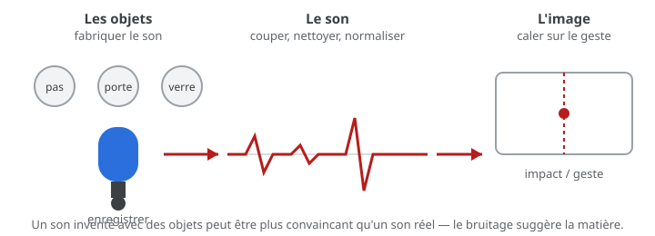

# Exercice — Bruitage : sonoriser un geste

> **Concept** : Créer un effet sonore avec des objets — le son qui donne du corps à l'image.

Choisir trois gestes simples — un pas, une porte, un verre posé — et les **enregistrer avec des objets** (gravier, carton, clés), puis les caler sur une image ou un court extrait d'animation.

**Pourquoi ?** Le bruitage (*Foley*) donne matière et poids : un son inventé avec des objets est souvent plus convaincant qu'un son réel. C'est le premier pas vers la sonorisation.

## L'exercice en images

*On fabrique le son avec des objets, on l'enregistre, puis on le cale sur le geste — le son donne du corps à l'image.*

## Voir aussi

- [L'enregistrement](../../../../03-savoirs/01-reconnaitre/04-outils-processus-creation/03-son/02-enregistrement/) — capter propre : la fonction avant le logiciel.
- [La synchronisation son/image](../09-synchronisation-son-image/) — caler le son sur l'image.

## Documentation

Lire la documentation **avant de commencer** — le concept passe avant l'outil.

| Documentation | Support | Langue |
|---|---|---|
| <!-- start-replace-cite key="sites/freesound-filtrer-cc0-by-by-sa" -->[Freesound — banque de sons libres](../../../../05-mediagraphie/sites/freesound-filtrer-cc0-by-by-sa/ "Des centaines de milliers d'échantillons sonores sous licences Creative Commons — filtrer par CC0, BY et BY-SA.")<!-- end-replace-cite --> | — | FR |
| [Shotcut — documentation](https://www.shotcut.org/help/) | Shotcut | EN |
| [Kdenlive — le montage et la synchronisation](https://userbase.kde.org/Kdenlive/Manual/fr) | Kdenlive | FR |

## Logiciels

- Téléphone (prise de son)
- Kdenlive ou Shotcut (nettoyage, coupe, synchronisation à l'image)

## Autovalidation

- [ ] Trois gestes sont choisis et **enregistrés avec des objets** (pas un son de banque)
- [ ] Chaque son est nettoyé : bruit de fond coupé, niveau normalisé
- [ ] Les sons sont **calés sur l'image** (le geste tombe juste)
- [ ] Un même geste est essayé avec **deux matières** différentes — comparaison notée
- [ ] Documenté au [journal de bord](../../../../07-journal-de-bord/) : les objets utilisés, les captures.

## Corpus d'œuvres

-  <!-- start-replace-cite key="videos/cat-came-back" -->[The Cat Came Back](../../../../05-mediagraphie/videos/cat-came-back/ "Chanson reprise en animation 2D : un chat qui revient toujours — timing, gags et rythme comique, jusqu'au désastre final.")<!-- end-replace-cite --> — les **gags sonores** : le bruitage participe au rythme comique.
-  <!-- start-replace-cite key="videos/steamboat-willie" -->[Steamboat Willie](../../../../05-mediagraphie/videos/steamboat-willie/ "Jalon du cinéma d'animation sonore : le son y est synchronisé à l'action image par image (1928) — entré dans le domaine public en 2024.")<!-- end-replace-cite --> — le **son synchronisé à l'action**, image par image.

## Pour aller plus loin

Sonoriser un même geste avec **trois matières** (métal, bois, tissu) : laquelle raconte le mieux l'objet ? Le son ne reproduit pas toujours la réalité — il la suggère. Et pour un effet qui n'existe pas encore : le **générer** avec <!-- start-replace-cite key="logiciels/son/jsfxr" -->[jsfxr — générateur de sons 8 bits](../../../../05-mediagraphie/logiciels/son/jsfxr/ "Générateur de sons 8 bits dans le navigateur (portage web de SFXR, domaine public) : forme d'onde, enveloppe et bruit pour créer des effets rétro — export WAV.")<!-- end-replace-cite --> ou <!-- start-replace-cite key="logiciels/son/bfxr" -->[Bfxr — générateur d'effets sonores](../../../../05-mediagraphie/logiciels/son/bfxr/ "Générateur d'effets sonores pour jeux, héritier de SFXR : formes d'onde, enveloppes, arpèges et presets — export WAV, dans le navigateur.")<!-- end-replace-cite -->, puis le retravailler.

## Références

<!-- start-replace-cite-page -->
- [Barker, Cordell (1988) - The Cat Came Back](../../../../05-mediagraphie/videos/cat-came-back/ "Chanson reprise en animation 2D : un chat qui revient toujours — timing, gags et rythme comique, jusqu'au désastre final.") [ONF](https://www.nfb.ca/film/the-cat-came-back/)
- [Disney, Walt (1928) - Steamboat Willie](../../../../05-mediagraphie/videos/steamboat-willie/ "Jalon du cinéma d'animation sonore : le son y est synchronisé à l'action image par image (1928) — entré dans le domaine public en 2024.") [Wikimedia Commons](https://commons.wikimedia.org/wiki/File:Steamboat_Willie.webm)
- [Freesound (2026) - Freesound — banque de sons libres](../../../../05-mediagraphie/sites/freesound-filtrer-cc0-by-by-sa/ "Des centaines de milliers d'échantillons sonores sous licences Creative Commons — filtrer par CC0, BY et BY-SA.") [Freesound](https://freesound.org)
- [jsfxr — générateur de sons 8 bits](../../../../05-mediagraphie/logiciels/son/jsfxr/ "Générateur de sons 8 bits dans le navigateur (portage web de SFXR, domaine public) : forme d'onde, enveloppe et bruit pour créer des effets rétro — export WAV.")
- [Bfxr — générateur d'effets sonores](../../../../05-mediagraphie/logiciels/son/bfxr/ "Générateur d'effets sonores pour jeux, héritier de SFXR : formes d'onde, enveloppes, arpèges et presets — export WAV, dans le navigateur.")
<!-- end-replace-cite-page -->
