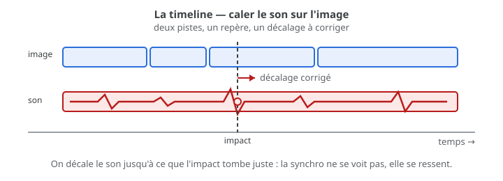

# Exercice — Synchronisation son/image

> **Concept** : Caler le son sur l'image : repères, décalage, et la sensation de justesse.

Importer une animation (celle de l'EVS 2 ou un extrait) dans **Kdenlive ou Shotcut**, poser un son sur un impact, vérifier la synchronisation image par image, puis corriger le décalage.

**Pourquoi ?** Un son en avance ou en retard casse l'illusion. La synchronisation ne se voit pas : elle se **ressent** — au point que le son et l'image semblent n'être qu'un.

## L'exercice en images

*Deux pistes, un repère : on décale le son jusqu'à ce que l'impact tombe juste — l'image et le son s'alignent.*

## Voir aussi

- [L'intégration — Kdenlive, Shotcut…](../../../../03-savoirs/02-utiliser/04-exploitation-logiciels/04-integration/) — monter et exporter.
-  <!-- start-replace-cite key="tutoriels/krita/krita-audio-animation" -->[Krita — l'audio pour l'animation](../../../../05-mediagraphie/tutoriels/krita/krita-audio-animation/ "Importer une bande sonore dans Krita pour synchroniser l'animation : dialogue ou musique, lecture pendant la scrutation, volume et export avec audio.")<!-- end-replace-cite --> — l'audio dans la chronologie de Krita (et pourquoi un éditeur vidéo pour la synchro).

## Documentation

Lire la documentation **avant de commencer** — le concept passe avant l'outil.

| Documentation | Support | Langue |
|---|---|---|
| [Manuel Kdenlive (français)](https://userbase.kde.org/Kdenlive/Manual/fr) | Kdenlive | FR |
| [Shotcut — documentation](https://www.shotcut.org/help/) | Shotcut | EN |
| [La remise — publier l'animation](../../../../03-savoirs/01-reconnaitre/03-criteres-qualite-fichiers/02-video-animation/03-remise/) | — | FR |

## Logiciels

- Kdenlive ou Shotcut (pistes image et son, repères, filtres audio)

## Autovalidation

- [ ] L'animation est importée dans **Kdenlive** ou **Shotcut** (piste image)
- [ ] Un son est posé sur un **impact précis** (piste son)
- [ ] La synchronisation est vérifiée **image par image** (lecture au ralenti)
- [ ] Un **décalage volontaire** est essayé (trop tôt / trop tard), puis corrigé
- [ ] Le résultat est exporté et visionné de bout en bout
- [ ] Documenté au [journal de bord](../../../../07-journal-de-bord/) : captures de la timeline, réglages.

## Corpus d'œuvres

-  <!-- start-replace-cite key="videos/steamboat-willie" -->[Steamboat Willie](../../../../05-mediagraphie/videos/steamboat-willie/ "Jalon du cinéma d'animation sonore : le son y est synchronisé à l'action image par image (1928) — entré dans le domaine public en 2024.")<!-- end-replace-cite --> — le **son synchronisé à l'action**, image par image.
-  <!-- start-replace-cite key="videos/synchromy" -->[Synchromie](../../../../05-mediagraphie/videos/synchromy/ "Expérience fondatrice de musique visuelle : McLaren dessine le son directement sur la pellicule — image et son ne font qu'un.")<!-- end-replace-cite --> — **image et son ne font qu'un** : la synchro comme écriture.

## Pour aller plus loin

Faire la même chose **sans repère visuel** : caler un son sur un mouvement à l'oreille seule — le défi de la synchro invisible.

## Références

<!-- start-replace-cite-page -->
- [Disney, Walt (1928) - Steamboat Willie](../../../../05-mediagraphie/videos/steamboat-willie/ "Jalon du cinéma d'animation sonore : le son y est synchronisé à l'action image par image (1928) — entré dans le domaine public en 2024.") [Wikimedia Commons](https://commons.wikimedia.org/wiki/File:Steamboat_Willie.webm)
- [Documentation Krita (2026) - Krita — l'audio pour l'animation](../../../../05-mediagraphie/tutoriels/krita/krita-audio-animation/ "Importer une bande sonore dans Krita pour synchroniser l'animation : dialogue ou musique, lecture pendant la scrutation, volume et export avec audio.") [Docs](https://docs.krita.org/fr/reference_manual/audio_for_animation.html)
- [McLaren, Norman (1971) - Synchromie](../../../../05-mediagraphie/videos/synchromy/ "Expérience fondatrice de musique visuelle : McLaren dessine le son directement sur la pellicule — image et son ne font qu'un.") [Onf](https://www.onf.ca/film/synchromie/)
<!-- end-replace-cite-page -->
