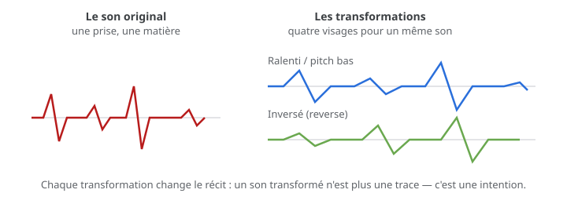

# Exercice — Transformer un son

> **Concept** : Pitch, reverse, filtres, réverbération : sculpter un son pour l'image.

Partir d'un son enregistré, le **transformer** — ralentir, inverser, filtrer, réverbérer — et l'utiliser comme effet dans une courte séquence. Le son devient une matière, pas seulement une trace.

**Pourquoi ?** Le *sound design* fabrique des sons impossibles : un son transformé raconte autre chose que ce qu'il était. C'est là que l'oreille devient créative.

## L'exercice en images

*Une même prise, quatre visages : l'original, le ralenti, l'inversé, le filtré — chaque transformation change le récit.*

## Voir aussi

- [Les principes du son](../../../../03-savoirs/01-reconnaitre/04-outils-processus-creation/03-son/01-principes-son/) — le son comme matière.
- [Le mixage multipiste](../07-mixage-multipiste/) — équilibrer les couches transformées.

## Documentation

Lire la documentation **avant de commencer** — le concept passe avant l'outil.

| Documentation | Support | Langue |
|---|---|---|
| [Manuel Kdenlive (français)](https://userbase.kde.org/Kdenlive/Manual/fr) | Kdenlive | FR |
| [Shotcut — documentation](https://www.shotcut.org/help/) | Shotcut | EN |
| [Le corpus sonore — montage et audio](../../corpus-sonore/) | — | FR |

## Logiciels

- Kdenlive ou Shotcut (filtres audio : pitch, inversion, réverbération)

## Autovalidation

- [ ] Un son source est choisi et **dupliqué** avant transformation
- [ ] Au moins **trois transformations** sont réalisées (ralenti/baisse de pitch, inversion, filtre)
- [ ] Un son devient **méconnaissable** — et sert un effet dans une courte séquence
- [ ] La transformation est **documentée** : réglages, captures, intention
- [ ] Documenté au [journal de bord](../../../../07-journal-de-bord/) : le son avant/après, le rôle dans la séquence.

## Corpus d'œuvres

-  <!-- start-replace-cite key="videos/aphasie" -->[Aphasie](../../../../05-mediagraphie/videos/aphasie/ "Expérience sensorielle sur la maladie d'Alzheimer et la perte du langage : le premier court métrage d'animation de Marielle Dalpé (ONF, 3 min).")<!-- end-replace-cite --> — le **design sonore** au service du récit : la perte du langage comme matière.
-  <!-- start-replace-cite key="videos/synchromy" -->[Synchromie](../../../../05-mediagraphie/videos/synchromy/ "Expérience fondatrice de musique visuelle : McLaren dessine le son directement sur la pellicule — image et son ne font qu'un.")<!-- end-replace-cite --> — le son **sculpté** directement sur la pellicule.

## Pour aller plus loin

Créer un **son hybride** : superposer deux sources transformées (une voix ralentie + un métal filtré) pour fabriquer un son qui n'existe pas dans la nature.

## Références

<!-- start-replace-cite-page -->
- [Dalpé, Marielle (2023) - Aphasie](../../../../05-mediagraphie/videos/aphasie/ "Expérience sensorielle sur la maladie d'Alzheimer et la perte du langage : le premier court métrage d'animation de Marielle Dalpé (ONF, 3 min).") [Onf](https://www.onf.ca/film/aphasie/)
- [McLaren, Norman (1971) - Synchromie](../../../../05-mediagraphie/videos/synchromy/ "Expérience fondatrice de musique visuelle : McLaren dessine le son directement sur la pellicule — image et son ne font qu'un.") [Onf](https://www.onf.ca/film/synchromie/)
<!-- end-replace-cite-page -->
