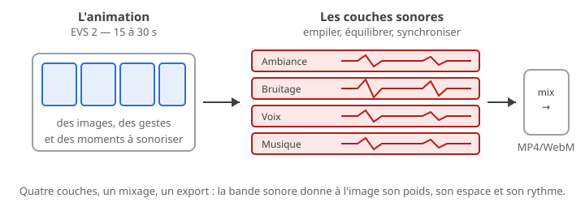

# Exercice — Sonoriser une animation

> **Concept** : Voix, ambiances, bruitages et musique : construire la bande sonore d'une animation — le capstone de l'EVS 3.

Prendre l'animation livrée à l'**EVS 2** (15 à 30 s) et construire sa **bande sonore complète** : au moins trois couches — ambiance, bruitage, voix et/ou musique —, synchronisées à l'image, mixées et exportées avec la vidéo.

**Pourquoi ?** C'est le livrable de l'**option A de l'EVS 3** : tout se rejoint — enregistrer, nettoyer, monter, synchroniser, mixer. L'animation sonorisée entre ensuite dans l'essai audiovisuel.

## L'exercice en images

*L'image appelle plusieurs couches : ambiance, bruitage, voix, musique — on les empile, on équilibre, on exporte.*

## Voir aussi

- [L'intégration — Kdenlive, Shotcut…](../../../../03-savoirs/02-utiliser/04-exploitation-logiciels/04-integration/) — monter et exporter l'ensemble.
- [La remise — publier l'animation](../../../../03-savoirs/01-reconnaitre/03-criteres-qualite-fichiers/02-video-animation/03-remise/) — dossier `tp3-son/`, README et tableau partagé.
-  <!-- start-replace-cite key="tutoriels/krita/krita-audio-animation" -->[Krita — l'audio pour l'animation](../../../../05-mediagraphie/tutoriels/krita/krita-audio-animation/ "Importer une bande sonore dans Krita pour synchroniser l'animation : dialogue ou musique, lecture pendant la scrutation, volume et export avec audio.")<!-- end-replace-cite --> — l'audio dans Krita (et pourquoi l'éditeur vidéo pour la synchro).

## Documentation

Lire la documentation **avant de commencer** — le concept passe avant l'outil.

| Documentation | Support | Langue |
|---|---|---|
| [Manuel Kdenlive (français)](https://userbase.kde.org/Kdenlive/Manual/fr) | Kdenlive | FR |
| [Shotcut — documentation](https://www.shotcut.org/help/) | Shotcut | EN |

## Logiciels

- Kdenlive ou Shotcut (enregistrement, nettoyage, mixage, synchronisation, export)
- Optionnel : MuseScore (musique originale) ou Bosca Ceoil

## Autovalidation

- [ ] L'animation de l'**EVS 2** est utilisée (ou un extrait de 15 à 30 s)
- [ ] Au moins **trois couches** sonores sont présentes (ambiance, bruitage, voix, musique)
- [ ] Chaque son est **synchronisé** à l'image (vérifié image par image)
- [ ] Les niveaux sont équilibrés, sans clipping ; panoramique travaillé
- [ ] L'export **MP4/WebM avec audio** est visionné de bout en bout
- [ ] La page de remise (`tp3-son/`) est testée et l'URL inscrite au **tableau partagé**
- [ ] Documenté au [journal de bord](../../../../07-journal-de-bord/) : couches, réglages, problème → solution.

## Corpus d'œuvres

-  <!-- start-replace-cite key="videos/synchromy" -->[Synchromie](../../../../05-mediagraphie/videos/synchromy/ "Expérience fondatrice de musique visuelle : McLaren dessine le son directement sur la pellicule — image et son ne font qu'un.")<!-- end-replace-cite --> — **image et son ne font qu'un** : le modèle de la bande sonore qui épouse l'image.
-  <!-- start-replace-cite key="videos/begone-dull-care" -->[Begone Dull Care — Norman McLaren & Evelyn Lambart](../../../../05-mediagraphie/videos/begone-dull-care/ "Film direct et jazz : Evelyn Lambart et Norman McLaren peignent et grattent la pellicule au rythme de l'orchestre d'Oscar Peterson — son et image ne font qu'un.")<!-- end-replace-cite --> — **film direct et jazz** : la pellicule au rythme de la musique.
-  <!-- start-replace-cite key="videos/steamboat-willie" -->[Steamboat Willie](../../../../05-mediagraphie/videos/steamboat-willie/ "Jalon du cinéma d'animation sonore : le son y est synchronisé à l'action image par image (1928) — entré dans le domaine public en 2024.")<!-- end-replace-cite --> — le **son synchronisé à l'action**, image par image.
-  <!-- start-replace-cite key="videos/gloria-victoria" -->[Gloria Victoria](../../../../05-mediagraphie/videos/gloria-victoria/ "Collage constructiviste de Theodore Ushev : un boléro de Chostakovitch porte le film, avec une conception sonore d'Olivier Calvert — musique et montage au serv…")<!-- end-replace-cite --> — **musique et conception sonore** : un boléro de Chostakovitch porte le collage constructiviste *(Theodore Ushev, ONF, 2013)*.
-  <!-- start-replace-cite key="videos/la-rue" -->[La rue](../../../../05-mediagraphie/videos/la-rue/ "D'après Mordecai Richler : une rue montréalaise racontée par les voix, les effets sonores et le montage sonore — le son porte le drame (Caroline Leaf, 1976).")<!-- end-replace-cite --> — **voix et effets sonores** : le son porte le drame d'une rue *(Caroline Leaf, ONF, 1976)*.

## Pour aller plus loin

Comparer avec l'**option B** : le même travail sans image, en paysage sonore — qu'est-ce que l'image change à l'écoute ? Voir [Paysage sonore](../08-paysage-sonore/).

## Références

<!-- start-replace-cite-page -->
- [Disney, Walt (1928) - Steamboat Willie](../../../../05-mediagraphie/videos/steamboat-willie/ "Jalon du cinéma d'animation sonore : le son y est synchronisé à l'action image par image (1928) — entré dans le domaine public en 2024.") [Wikimedia Commons](https://commons.wikimedia.org/wiki/File:Steamboat_Willie.webm)
- [Documentation Krita (2026) - Krita — l'audio pour l'animation](../../../../05-mediagraphie/tutoriels/krita/krita-audio-animation/ "Importer une bande sonore dans Krita pour synchroniser l'animation : dialogue ou musique, lecture pendant la scrutation, volume et export avec audio.") [Docs](https://docs.krita.org/fr/reference_manual/audio_for_animation.html)
- [Leaf, Caroline (1976) - La rue](../../../../05-mediagraphie/videos/la-rue/ "D'après Mordecai Richler : une rue montréalaise racontée par les voix, les effets sonores et le montage sonore — le son porte le drame (Caroline Leaf, 1976).") [Onf](https://www.onf.ca/film/rue/)
- [McLaren, Norman; Lambart, Evelyn (1949) - Begone Dull Care — Norman McLaren & Evelyn Lambart](../../../../05-mediagraphie/videos/begone-dull-care/ "Film direct et jazz : Evelyn Lambart et Norman McLaren peignent et grattent la pellicule au rythme de l'orchestre d'Oscar Peterson — son et image ne font qu'un.") [ONF](https://www.nfb.ca/film/begone_dull_care/)
- [McLaren, Norman (1971) - Synchromie](../../../../05-mediagraphie/videos/synchromy/ "Expérience fondatrice de musique visuelle : McLaren dessine le son directement sur la pellicule — image et son ne font qu'un.") [Onf](https://www.onf.ca/film/synchromie/)
- [Ushev, Theodore (2013) - Gloria Victoria](../../../../05-mediagraphie/videos/gloria-victoria/ "Collage constructiviste de Theodore Ushev : un boléro de Chostakovitch porte le film, avec une conception sonore d'Olivier Calvert — musique et montage au serv…") [Onf](https://www.onf.ca/film/gloria-victoria/)
<!-- end-replace-cite-page -->
