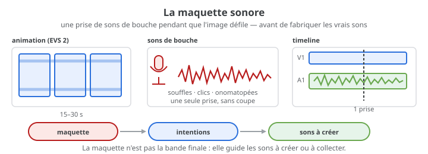

# Exercice — Maquette sonore (sons de bouche)

> **Concept** : Une maquette sonore jouée en direct — des sons de bouche qui donnent le rythme, les impacts et l'énergie avant de fabriquer les vrais sons.

Importer l'animation de l'[EVS 2](../../../../04-evaluations/sommatives/02/) (ou un extrait) dans **Kdenlive ou Shotcut**, lancer la lecture et enregistrer **en une seule prise** une piste de sons de bouche : souffles, clics, bruits de bouche, onomatopées, rythmes. Cette piste n'est pas la bande sonore finale : c'est une **maquette** (*scratch track*) qui fixe les intentions et inspirera les sons à créer ou à collecter.

**Pourquoi ?** La maquette rend audibles les intentions avant le travail de fabrication : elle guide le choix des sons, le rythme et les priorités. Les sons de bouche sont immédiats, sans matériel, et forcent à penser en termes d'actions et d'impacts plutôt que de bibliothèques.

## L'exercice en images

## Voir aussi

- [L'enregistrement](../../../../03-savoirs/01-reconnaitre/04-outils-processus-creation/03-son/02-enregistrement/) — capter propre : la fonction avant le logiciel.
- [La synchronisation son/image](../09-synchronisation-son-image/) — caler le son sur l'image, image par image.
- [Sonoriser une animation](../11-sonoriser-une-animation/) — fabriquer et poser la bande sonore finale.
- [Enregistrer sa voix](../02-enregistrement-voix/) — le micro, le niveau et la distance.

## Documentation

Lire la documentation **avant de commencer** — le concept passe avant l'outil.

| Documentation | Support | Langue |
|---|---|---|
| [Kdenlive — capturer l'audio](../../../../05-mediagraphie/tutoriels/kdenlive/kdenlive-capturing-audio/) | Kdenlive | FR |
| [Kdenlive — enregistrement audio](../../../../05-mediagraphie/tutoriels/kdenlive/kdenlive-audio-recording/) | Kdenlive | FR |
| [Kdenlive — la timeline](../../../../05-mediagraphie/tutoriels/kdenlive/kdenlive-timeline/) | Kdenlive | FR |
| [Shotcut — documentation](https://www.shotcut.org/help/) | Shotcut | EN |

## Logiciels

- **Kdenlive** (enregistrement pendant la lecture) ou **Shotcut** (lecture + import de la piste enregistrée)
- Micro-casque ou téléphone + casque (pour éviter le larsen)
- L'animation de l'EVS 2 (15–30 s) ou un extrait

## Déroulement

1. **Préparer** — importer l'animation dans un projet, placer la tête de lecture au début et brancher un casque.
2. **Armer la piste** — ajouter une piste audio, afficher les contrôles d'enregistrement (clic droit sur l'en-tête de piste → **Afficher les contrôles d'enregistrement**), vérifier l'entrée du micro et régler le niveau sans atteindre le rouge.
3. **Lancer la lecture** — **Espace** pour lire la timeline ; **R** (ou le bouton d'enregistrement) pour passer en enregistrement ; **Espace** pour lancer la prise. Selon le réglage, un décompte précède l'enregistrement.
4. **Jouer** — une seule prise, sans arrêter : suivre l'image et produire les sons de bouche (souffle, clic, impact, voix, rythme). Les imperfections font partie de la maquette.
5. **Réécouter** — noter ce qui fonctionne, les moments à renforcer et les sons à créer ou à collecter. Garder la maquette de côté (la désactiver ou la muter) pour ne pas la confondre avec la bande finale.
6. **Exporter la maquette** — WAV ou FLAC séparé + projet Kdenlive/Shotcut conservé ; noter les trois sons à fabriquer dans le [journal de bord](../../../../07-journal-de-bord/).

> **Avec Shotcut** — si l'enregistrement pendant la lecture n'est pas disponible, jouez l'animation et enregistrez au téléphone (ou avec un micro-casque), puis importez la piste dans le projet.

## Contraintes

- **Une seule prise continue**, sans coupe ni montage : la maquette garde l'énergie du direct.
- **Sons de bouche uniquement** : souffles, clics de langue, lèvres, onomatopées, fredonnement. Pas de musique ni d'extraits.
- **Durée** : celle de l'animation (15–30 s) ; la synchronisation démarre et se termine avec l'image.
- **Niveau propre** : casque, pas de clipping, silence autour.
- La maquette est **temporaire** : elle inspire, elle ne remplace pas la bande sonore finale (exercice 11 et [TP3](../../)).

## Autovalidation

- [ ] L'animation est importée et la piste audio est armée
- [ ] Le casque est branché et le niveau du micro est vérifié (pas de rouge)
- [ ] La prise est continue et couvre toute l'animation
- [ ] Au moins trois familles de sons de bouche sont utilisées (souffle, impact, voix/rythme)
- [ ] La maquette est réécoutée et trois sons à créer ou à collecter sont notés
- [ ] La maquette est exportée (WAV/FLAC) et le projet est conservé
- [ ] Documenté au journal de bord : captures de la piste, réglages, intentions

## Corpus d'œuvres

-  <!-- start-replace-cite key="videos/la-rue" -->[La rue](../../../../05-mediagraphie/videos/la-rue/ "D'après Mordecai Richler : une rue montréalaise racontée par les voix, les effets sonores et le montage sonore — le son porte le drame (Caroline Leaf, 1976).")<!-- end-replace-cite --> — **voix et effets** : une rue racontée par ses habitants, où le son porte le récit.
-  <!-- start-replace-cite key="videos/ryan" -->[Ryan](../../../../05-mediagraphie/videos/ryan/ "Portrait 3D : les blessures intérieures du cinéaste Ryan Larkin rendues visibles — la voix de Larkin et une conception sonore qui portent le « psychoréalisme »…")<!-- end-replace-cite --> — **la voix de Ryan Larkin** : le portrait et la conception sonore portent le film *(Chris Landreth, ONF, 2004)*.
-  <!-- start-replace-cite key="videos/matrescence" -->[Matrescence](../../../../05-mediagraphie/videos/matrescence/ "Un message vocal ouvre une plongée dans la matrescence : animation traditionnelle, collage et pellicule pour donner forme à la métamorphose.")<!-- end-replace-cite --> — un **message vocal** qui ouvre le récit et donne le ton de l'animation.

## Pour aller plus loin

Refaire la prise avec une intention différente — réaliste, comique, abstraite — et comparer. Utiliser ensuite la maquette comme guide pour l'[exercice 11](../11-sonoriser-une-animation/) : fabriquer ou collecter les sons entendus, en gardant le rythme et les priorités de la prise.

## Références

<!-- start-replace-cite-page -->
- [Documentation Kdenlive (2026) - Kdenlive — enregistrement audio](../../../../05-mediagraphie/tutoriels/kdenlive/kdenlive-audio-recording/ "Enregistrement audio dans Kdenlive : activer les contrôles d'enregistrement d'une piste, surveiller le niveau du micro, enregistrer pendant la lecture ou en di…") [Docs](https://docs.kdenlive.org/en/effects_and_filters/audio.html#audio-recording)
- [Documentation Kdenlive (2026) - Kdenlive — capturer l'audio](../../../../05-mediagraphie/tutoriels/kdenlive/kdenlive-capturing-audio/ "Capturer l'audio dans Kdenlive : enregistrer une voix off au micro pendant la lecture du projet, configurer la capture et choisir le dossier cible des enregist…") [Docs](https://docs.kdenlive.org/en/project_and_asset_management/capturing_audio.html)
- [Documentation Kdenlive (2026) - Kdenlive — la timeline](../../../../05-mediagraphie/tutoriels/kdenlive/kdenlive-timeline/ "La timeline de Kdenlive : zones, règle, barre d'outils, pistes, en-têtes, menus contextuels, redimensionnement, défilement et lecture en boucle.") [Docs](https://docs.kdenlive.org/en/user_interface/timeline.html)
- [Laferrière, Elizabeth (2026) - Matrescence](../../../../05-mediagraphie/videos/matrescence/ "Un message vocal ouvre une plongée dans la matrescence : animation traditionnelle, collage et pellicule pour donner forme à la métamorphose.") [Onf](https://www.onf.ca/film/matrescence-alambic-2/)
- [Landreth, Chris (2004) - Ryan](../../../../05-mediagraphie/videos/ryan/ "Portrait 3D : les blessures intérieures du cinéaste Ryan Larkin rendues visibles — la voix de Larkin et une conception sonore qui portent le « psychoréalisme »…") [Onf](https://www.onf.ca/film/ryan-fr/)
- [Leaf, Caroline (1976) - La rue](../../../../05-mediagraphie/videos/la-rue/ "D'après Mordecai Richler : une rue montréalaise racontée par les voix, les effets sonores et le montage sonore — le son porte le drame (Caroline Leaf, 1976).") [Onf](https://www.onf.ca/film/rue/)
<!-- end-replace-cite-page -->
