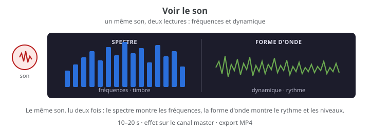

# Exercice — Voir le son

> **Concept** : Rendre le son visible — spectre, forme d'onde, niveau — pour écouter autrement et composer une image qui suit le son.

Choisir un son de 10 à 20 secondes, puis dessiner sa présence à l'image avec les **effets de visualisation audio** de Kdenlive : **spectre audio**, **forme d'onde**, **niveau audio** ou **onde audio**. Le même son est lu deux fois : une visualisation qui montre les **fréquences** et une qui montre la **dynamique**.

**Pourquoi ?** Voir le son révèle ce que l'oreille perçoit : le timbre (fréquences), le rythme et les niveaux (dynamique), l'énergie. Ces visualisations servent autant à **analyser** qu'à **créer** : générique, clip, installation, essai audiovisuel.

## L'exercice en images

## Voir aussi

- [Le spectre audio](../../../../05-mediagraphie/tutoriels/kdenlive/kdenlive-audio-spectrum/) — les fréquences, le timbre.
- [La forme d'onde audio](../../../../05-mediagraphie/tutoriels/kdenlive/kdenlive-audio-waveform/) — le rythme, les niveaux.
- [La visualisation du niveau audio](../../../../05-mediagraphie/tutoriels/kdenlive/kdenlive-audio-level-visualization/) — l'énergie, les crêtes.
- [L'onde audio](../../../../05-mediagraphie/tutoriels/kdenlive/kdenlive-audio-wave/) — la forme d'onde brute, en surimpression.

## Documentation

Lire la documentation **avant de commencer** — le concept passe avant l'outil.

| Documentation | Support | Langue |
|---|---|---|
| [Kdenlive — spectre audio](../../../../05-mediagraphie/tutoriels/kdenlive/kdenlive-audio-spectrum/) | Kdenlive | FR |
| [Kdenlive — forme d'onde audio](../../../../05-mediagraphie/tutoriels/kdenlive/kdenlive-audio-waveform/) | Kdenlive | FR |
| [Kdenlive — visualisation du niveau audio](../../../../05-mediagraphie/tutoriels/kdenlive/kdenlive-audio-level-visualization/) | Kdenlive | FR |
| [Kdenlive — onde audio](../../../../05-mediagraphie/tutoriels/kdenlive/kdenlive-audio-wave/) | Kdenlive | FR |
| [Kdenlive — liste des effets audio](../../../../05-mediagraphie/tutoriels/kdenlive/kdenlive-audio-effects-list/) | Kdenlive | FR |
| [Kdenlive — la timeline](../../../../05-mediagraphie/tutoriels/kdenlive/kdenlive-timeline/) | Kdenlive | FR |

## Logiciels

- **Kdenlive** (les effets de visualisation sont sur le canal **Master** (table de mixage)
- Un son de 10 à 20 s : un enregistrement, une voix, un extrait musical ou un bruitage
- Une image ou un clip de couleur pour le fond

## Déroulement

1. **Choisir le son** — 10 à 20 s avec du contraste : une voix qui varie, une musique avec des attaques, un bruitage avec des silences.
2. **Préparer l'image** — un clip de couleur ou une image de fond, à la durée du son. Le son reste la matière principale : l'image ne doit pas le masquer.
3. **Appliquer l'effet sur Master** — ouvrir la **table de mixage audio**, sélectionner le canal **Master**, ouvrir sa pile d'effets et ajouter **Spectre audio**, **Forme d'onde audio**, **Visualisation du niveau audio** ou **Onde audio**. Ces effets sont marqués « maître seulement » : ils voient tout le mixage.
4. **Régler la visualisation** — type de graphique, couleurs de fond et de premier plan, épaisseur, position, miroir. Choisir un réglage lisible : contraste, place, taille.
5. **Animer** — poser au moins une **image clé** sur un paramètre (angle, couleur ou position) pour que la visualisation évolue avec le son.
6. **Comparer** — exporter une première version, puis remplacer l'effet par un autre et exporter la seconde. Noter ce que chaque visualisation révèle du même son.
7. **Exporter** — MP4 1080p, 10–20 s ; conserver le projet Kdenlive et les captures au [journal de bord](../../../../07-journal-de-bord/).

## Contraintes

- **10 à 20 secondes**, un seul son, un seul fond.
- **Au moins un effet de visualisation** ; deux si vous comparez les lectures.
- **Au moins une image clé** sur un effet animable.
- **Lisibilité** : contraste, pas de surcharge, le son reste reconnaissable.
- **Export MP4** et projet conservé ; les visualisations ne remplacent pas le montage sonore.

## Autovalidation

- [ ] Le son est audible et l'effet de visualisation réagit à ses variations
- [ ] L'effet est appliqué sur le canal **Master**
- [ ] Les couleurs et la position rendent la visualisation lisible
- [ ] Au moins une image clé anime un paramètre
- [ ] Deux visualisations ont été comparées, ou le choix d'une seule est justifié
- [ ] Le fichier MP4 est exporté et visionné de bout en bout
- [ ] Documenté au journal de bord : captures, réglages, ce que la visualisation révèle

## Corpus d'œuvres

-  <!-- start-replace-cite key="videos/synchromy" -->[Synchromie](../../../../05-mediagraphie/videos/synchromy/ "Expérience fondatrice de musique visuelle : McLaren dessine le son directement sur la pellicule — image et son ne font qu'un.")<!-- end-replace-cite --> — **le son dessiné** : la visualisation comme écriture, pas comme décor.
-  <!-- start-replace-cite key="videos/gloria-victoria" -->[Gloria Victoria](../../../../05-mediagraphie/videos/gloria-victoria/ "Collage constructiviste de Theodore Ushev : un boléro de Chostakovitch porte le film, avec une conception sonore d'Olivier Calvert — musique et montage au serv…")<!-- end-replace-cite --> — **musique et image** : le montage visuel épouse la partition.
-  <!-- start-replace-cite key="videos/boogie-doodle" -->[Boogie-Doodle](../../../../05-mediagraphie/videos/boogie-doodle/ "Film sans caméra : le boogie d'Albert Ammons dessine les formes de McLaren — le jazz structure l'image, image par image (1940).")<!-- end-replace-cite --> — **le rythme musical** devient forme et mouvement.

## Pour aller plus loin

Créer une **boucle de 3 secondes** avec une visualisation, puis l'utiliser comme fond de générique. Essayer **Onde audio** (qui se superpose à tout) et comparer avec **Forme d'onde audio** (qui se place dans un rectangle) : mêmes données, deux écritures.

## Références

<!-- start-replace-cite-page -->
- [Documentation Kdenlive (2026) - Kdenlive — liste des effets audio](../../../../05-mediagraphie/tutoriels/kdenlive/kdenlive-audio-effects-list/ "Liste alphabétique des effets audio de Kdenlive : familles, noms d'interface et descriptions, dépendant des greffons installés.") [Docs](https://docs.kdenlive.org/en/effects_and_filters/lists/audio_effects_list.html)
- [Documentation Kdenlive (2026) - Kdenlive — visualisation du niveau audio](../../../../05-mediagraphie/tutoriels/kdenlive/kdenlive-audio-level-visualization/ "L'effet de visualisation du niveau audio dans Kdenlive : vumètre dessiné sur l'image, types de graphique, couleurs, orientation et paramètres.") [Docs](https://docs.kdenlive.org/en/effects_and_filters/video_effects/on_master/audio_level_visualization_filter.html)
- [Documentation Kdenlive (2026) - Kdenlive — spectre audio](../../../../05-mediagraphie/tutoriels/kdenlive/kdenlive-audio-spectrum/ "L'effet spectre audio de Kdenlive : analyse FFT, graphique en ligne ou barres, fréquences, seuil et couleurs.") [Docs](https://docs.kdenlive.org/en/effects_and_filters/video_effects/on_master/audio_spectrum_filter.html)
- [Documentation Kdenlive (2026) - Kdenlive — onde audio](../../../../05-mediagraphie/tutoriels/kdenlive/kdenlive-audio-wave/ "L'effet onde audio de Kdenlive : afficher la forme d'onde à la place de la vidéo, en surimpression.") [Docs](https://docs.kdenlive.org/en/effects_and_filters/video_effects/on_master/audio_wave.html)
- [Documentation Kdenlive (2026) - Kdenlive — forme d'onde audio](../../../../05-mediagraphie/tutoriels/kdenlive/kdenlive-audio-waveform/ "L'effet forme d'onde audio de Kdenlive : dessiner la forme d'onde sur l'image, canaux, couleurs et remplissage.") [Docs](https://docs.kdenlive.org/en/effects_and_filters/video_effects/on_master/audio_waveform_filter.html)
- [Documentation Kdenlive (2026) - Kdenlive — la timeline](../../../../05-mediagraphie/tutoriels/kdenlive/kdenlive-timeline/ "La timeline de Kdenlive : zones, règle, barre d'outils, pistes, en-têtes, menus contextuels, redimensionnement, défilement et lecture en boucle.") [Docs](https://docs.kdenlive.org/en/user_interface/timeline.html)
- [McLaren, Norman (1940) - Boogie-Doodle](../../../../05-mediagraphie/videos/boogie-doodle/ "Film sans caméra : le boogie d'Albert Ammons dessine les formes de McLaren — le jazz structure l'image, image par image (1940).") [Onf](https://www.onf.ca/film/boogie-doodle/)
- [McLaren, Norman (1971) - Synchromie](../../../../05-mediagraphie/videos/synchromy/ "Expérience fondatrice de musique visuelle : McLaren dessine le son directement sur la pellicule — image et son ne font qu'un.") [Onf](https://www.onf.ca/film/synchromie/)
- [Ushev, Theodore (2013) - Gloria Victoria](../../../../05-mediagraphie/videos/gloria-victoria/ "Collage constructiviste de Theodore Ushev : un boléro de Chostakovitch porte le film, avec une conception sonore d'Olivier Calvert — musique et montage au serv…") [Onf](https://www.onf.ca/film/gloria-victoria/)
<!-- end-replace-cite-page -->
