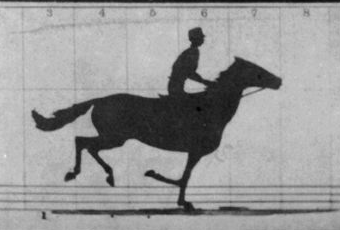
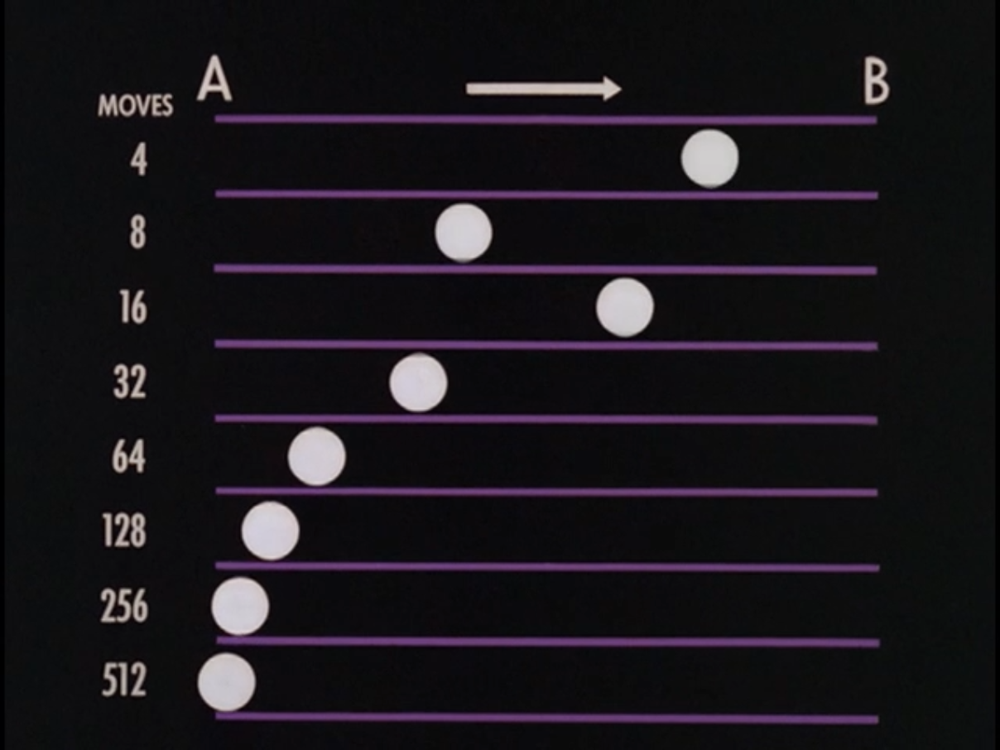

# L'image en mouvement — du cinéma expérimental à l'animation

> Vertov, Deren, McLaren, Whitney : le mouvement comme médium.

## Oeuvres de référence

Pour plus de références d'animation, vous pouvez utiliser la liste commentée dans [Corpus- Animation](../../../../02-activites/02/animation-corpus/).

- Le cinéma expérimental : <!-- start-replace-cite key="sites/l-homme-a-la-camera" -->[L'Homme à la caméra](../../../../05-mediagraphie/sites/l-homme-a-la-camera/ "École de montage rythmique et de cinéma-document, source incontournable pour la vidéo.")<!-- end-replace-cite -->, <!-- start-replace-cite key="personnes/maya-deren/oeuvres/meshes-of-the-afternoon" -->[Meshes of the Afternoon](../../../../05-mediagraphie/personnes/maya-deren/oeuvres/meshes-of-the-afternoon/ "Chef-d'œuvre du cinéma expérimental — modèle pour l'exercice du montage poétique.")<!-- end-replace-cite -->.
- L'animation : <!-- start-replace-cite key="sites/mclaren-processus-creatif" -->[Creative Process: Norman McLaren — ONF](../../../../05-mediagraphie/sites/mclaren-processus-creatif/ "Plongée dans le processus d'un maître de l'animation image par image.")<!-- end-replace-cite -->, <!-- start-replace-cite key="personnes/john-whitney" -->[John Whitney](../../../../05-mediagraphie/personnes/john-whitney/ "Pionnier de l'animation par ordinateur — ordinateur analogique, générique de Vertigo, artiste en résidence chez IBM.")<!-- end-replace-cite -->, <!-- start-replace-cite key="sites/films-lillian-schwartz" -->[30 films des années 1970](../../../../05-mediagraphie/sites/films-lillian-schwartz/ "Pionnière de l'art informatique : ce qu'on faisait déjà avec du code et des pixels dans les années 1970.")<!-- end-replace-cite -->.
- Le montage comme écriture : <!-- start-replace-cite key="livres/murch-en-un-clin-d-il" -->[En un clin d'œil](../../../../05-mediagraphie/livres/murch-en-un-clin-d-il/ "Le montage par un maître du cinéma — le regard, le rythme et la coupe, expliqués en quelques pages lumineuses. Édition française : Capricci ; l'édition anglais…")<!-- end-replace-cite -->, <!-- start-replace-cite key="livres/bordwell-thompson-l-art-du-film" -->[L'art du film : une introduction — David Bordwell & Kristin Thompson](../../../../05-mediagraphie/livres/bordwell-thompson-l-art-du-film/ "Le manuel de référence pour analyser un film — narration, mise en scène, montage, son ; la grille de lecture du module vidéo.")<!-- end-replace-cite -->.

## Tempo et cadence

La vidéo, le cinéma et l'animation sont des arts fortement liés au passage du temps. Même si ces formes sont basées sur des cadres statiques, on a la perception du mouvement et de la fluidité à cause du changement rapide d'images dans un même endroit et notre mémoire visuelle. On appelle cadence ce taux d'images (ou cadres) par seconde (aussi connu comme *ips* ou *i/s* en français ou *fps* en anglais). Les valeurs le plus fréquentes pour les vidéos et l'animation sont de 12, 24 ou 30 images par seconde.

Séquence d'animation et de photographies montrant un cheval de course au galop. Photos prises par [Eadweard Muybridge](https://fr.wikipedia.org/wiki/Eadweard_Muybridge "fr:Eadweard Muybridge") (mort en 1904), publiés en 1878.

Démonstration de différents tempos pour un déplacement simple (Norman McLaren, «Le mouvement image par image» - partie 1, 8:21, 1978).

## Déplacement

Démonstration de déplacement cadre à cadre accéléré et ralenti (Norman McLaren, «Le mouvement image par image», 1978).

Diagramme conceptuel pour les connexions entre déplacement, changement et tempo (Norman McLaren, «Le mouvement image par image», 1978).

## Cadrage et plan

On peut penser les plans comme la relation entre la **taille de nos sujets** et l'ensemble de l'image où comme une **approximation de la distance entre nos sujets et la caméra**.  L'ensemble des plans situés dans un même contexte et une séquence chronologique et/ou thématique forment une **scène**. Quelques caractéristiques importantes de plans sont : la taille des sujets, la [position de la caméra/point de vue](https://human.libretexts.org/Bookshelves/Theater_Film_and_Storytelling/Video_Production_Handbook/08%3A_Video_Aesthetics/8.02%3A_Camera_Position) et son [déplacement](https://human.libretexts.org/Bookshelves/Theater_Film_and_Storytelling/Video_Production_Handbook/08%3A_Video_Aesthetics/8.03%3A_Camera_Movements).

La liste de taille de plans suivante est adaptée du livre [Video Production Handbook](https://human.libretexts.org/Bookshelves/Theater_Film_and_Storytelling/Video_Production_Handbook) (CC-BY-NC).

### Plan d'ensemble

(Justin W. via [Unsplash](https://unsplash.com/s/photos/san-francisco-state-university?utm_source=unsplash&utm_medium=referral&utm_content=creditCopyText))

### Plan moyen

([CC BY-NC 4.0](https://creativecommons.org/licenses/by-nc/4.0); Shelley Ho via San Francisco State University)

### Plan américain

([CC BY-NC 4.0](https://creativecommons.org/licenses/by-nc/4.0); Shelley Ho via San Francisco State University)

### Plan mi-moyen (PMM) ou plan rapproché taille (PRT)

([CC BY-NC 4.0](https://creativecommons.org/licenses/by-nc/4.0); Shelley Ho via San Francisco State University)

### Plan rapproché (PR) ou plan rapproché poitrine (PRP)

([CC BY-NC 4.0](https://creativecommons.org/licenses/by-nc/4.0); Shelley Ho via San Francisco State University)

### Gros plan et très gros plan

Gros plan. ([CC BY-NC 4.0](https://creativecommons.org/licenses/by-nc/4.0); Shelley Ho via San Francisco State University)

Très gros plan. (CC BY-NC 4.0; Shelley Ho via San Francisco State University)

## Montage

Diagrammes de montage pour le film «Alexandr Nevski» de Sergei Eisenstein, 1938.

Édition de film en pellicule (Faculty of Dramatic Arts in Belgrade, CC BY-SA 4.0, via Wikimedia Commons).

Interface d'une application d'édition de vidéo numérique et non linéaire ([Misha Antonich](https://human.libretexts.org/Bookshelves/Theater_Film_and_Storytelling/Video_Production_Handbook/16%3A_The_Finishing_Process/16.01%3A_Steps_of_the_Finishing_Process), CC BY-SA 3.0).

## Dans le cours

- Visionnées à la séance [S4 — amorce du bloc vidéo](../../../../01-deroulement/04/) et discutés à la séance [S5](../../../../01-deroulement/05/).

## Références

<!-- start-replace-cite-page -->
- [Bordwell, David; Thompson, Kristin (2019) - L'art du film : une introduction — David Bordwell & Kristin Thompson](../../../../05-mediagraphie/livres/bordwell-thompson-l-art-du-film/ "Le manuel de référence pour analyser un film — narration, mise en scène, montage, son ; la grille de lecture du module vidéo.") [De Boeck](https://www.deboecksuperieur.com/ouvrage/9782807336995-l-art-du-film-une-introduction)
- [Dziga Vertov (1929) - L'Homme à la caméra](../../../../05-mediagraphie/sites/l-homme-a-la-camera/ "École de montage rythmique et de cinéma-document, source incontournable pour la vidéo.") [Open Culture](https://www.openculture.com/2014/02/watch-dziga-vertovs-a-man-with-a-movie-camera-named-the-8th-best-film-ever-made.html)
- [Lillian F. Schwartz (2016) - 30 films des années 1970](../../../../05-mediagraphie/sites/films-lillian-schwartz/ "Pionnière de l'art informatique : ce qu'on faisait déjà avec du code et des pixels dans les années 1970.") [Open Culture](https://www.openculture.com/2016/03/watch-30-films-from-the-1970s-by-computer-animation-pioneer-lillian-f-schwartz.html)
- [Murch, Walter (1995) - En un clin d'œil](../../../../05-mediagraphie/livres/murch-en-un-clin-d-il/ "Le montage par un maître du cinéma — le regard, le rythme et la coupe, expliqués en quelques pages lumineuses. Édition française : Capricci ; l'édition anglais…") [Internet Archive](https://archive.org/details/inblinkofeye00murc)
- [Office national du film (2019) - Creative Process: Norman McLaren — ONF](../../../../05-mediagraphie/sites/mclaren-processus-creatif/ "Plongée dans le processus d'un maître de l'animation image par image.") [ONF](https://www.nfb.ca/film/creative_process_norman_mclaren)
- [John Whitney](../../../../05-mediagraphie/personnes/john-whitney/ "Pionnier de l'animation par ordinateur — ordinateur analogique, générique de Vertigo, artiste en résidence chez IBM.")
- [Meshes of the Afternoon — Maya Deren (1943)](../../../../05-mediagraphie/personnes/maya-deren/oeuvres/meshes-of-the-afternoon/ "Chef-d'œuvre du cinéma expérimental — modèle pour l'exercice du montage poétique.")
<!-- end-replace-cite-page -->
