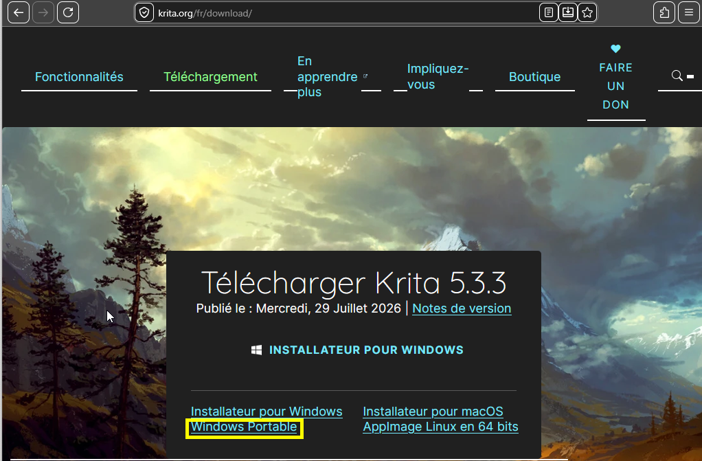
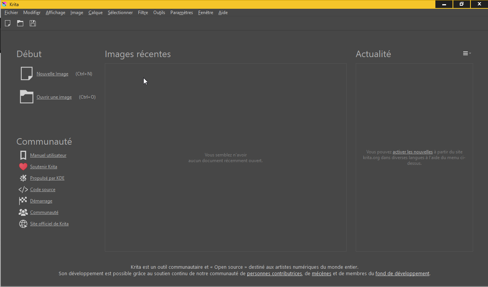

# Installation Krita

Cette page couvre l'installation de la version **portable (Windows)** de Krita — pas d'installation système, une simple décompression.

## Téléchargement

Récupérer la version compatible Windows sur la [page de téléchargement de Krita](https://krita.org/fr/download/).

## Décompression

Extraire l'archive, puis déplacer le dossier extrait à un **endroit stable** où vous saurez retrouver l'exécutable (par exemple `C:\outils\`). Ne le laissez pas dans Téléchargements : vous devrez le retrouver à chaque lancement.

## Lancer l'application

Ouvrir le dossier extrait et double-cliquer `krita.exe` (l'exécutable du programme).

## Écran d'accueil

Il est normal que le premier lancement prenne **un peu de temps**. Vous devriez ensuite tomber sur l'écran d'accueil.

