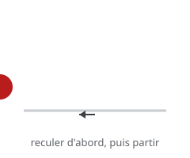

# Anticipation

> Avant d'agir, on prépare : un léger mouvement **dans le sens opposé** annonce l'action et lui donne de l'élan. C'est l'**anticipation**.

## En pratique

- On recule avant de partir, on se baisse avant de sauter, on inspire avant de parler.
- L'anticipation **prépare le spectateur** : il sait ce qui va se passer.
- Elle donne de la **force** : le mouvement qui suit paraît plus grand.
- Trop longue, elle casse le rythme ; trop courte, elle ne se lit pas.

## Où l'appliquer

- [La tête qui se tourne](../../../../../02-activites/02/exercices/05-tete-qui-se-tourne/)
- [Le cycle de course](../../../../../02-activites/02/exercices/14-cycle-de-course/)
- [Lever une charge](../../../../../02-activites/02/exercices/10-lever-une-charge/)

## Sources

-  <!-- start-replace-cite key="sites/principes-animation-wikilivres" -->[Les principes de l'animation traditionnelle (dessin animé)](../../../../../05-mediagraphie/sites/principes-animation-wikilivres/ "Le livre libre des douze principes de l'animation traditionnelle : squash & stretch, anticipation, staging, timing et spacing, exagération, trajectoire arquée,…")<!-- end-replace-cite --> — chapitre « Anticipation ».
-  <!-- start-replace-cite key="sites/wikipedia-12-principes-animation" -->[12 principes de base de l'animation](../../../../../05-mediagraphie/sites/wikipedia-12-principes-animation/ "Les douze principes de base de l'animation (d'après Thomas et Johnston) : squash & stretch, anticipation, staging, timing, exagération… — la synthèse de référe…")<!-- end-replace-cite -->.

## Références

<!-- start-replace-cite-page -->
- [Wikilivres (2026) - Les principes de l'animation traditionnelle (dessin animé)](../../../../../05-mediagraphie/sites/principes-animation-wikilivres/ "Le livre libre des douze principes de l'animation traditionnelle : squash & stretch, anticipation, staging, timing et spacing, exagération, trajectoire arquée,…") [Fr](https://fr.wikibooks.org/wiki/Les_principes_de_l%27animation_traditionnelle_(dessin_anim%C3%A9))
- [Wikipédia (2026) - 12 principes de base de l'animation](../../../../../05-mediagraphie/sites/wikipedia-12-principes-animation/ "Les douze principes de base de l'animation (d'après Thomas et Johnston) : squash & stretch, anticipation, staging, timing, exagération… — la synthèse de référe…") [Wikipédia](https://fr.wikipedia.org/wiki/12_principes_de_base_de_l%27animation)
<!-- end-replace-cite-page -->
