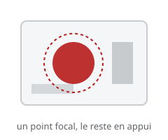

# Mise en scène (staging)

> La **mise en scène** compose l'image pour qu'une idée se lise **d'un seul regard** : un point focal clair, un arrière-plan discret, une silhouette lisible.

## En pratique

- **Un point focal** : ce que le spectateur doit voir — le reste appuie.
- **Lisibilité** : l'idée se comprend même en noir et blanc, même de loin.
- **Caméra** : placer la « caméra » au bon endroit, au bon moment.
- **Silhouette** : une pose qui se lit dans le contour.
- Ne pas tout montrer à la fois : guider l'œil.

## Où l'appliquer

- [Le storyboard d'une séquence](../../../../../02-activites/02/exercices/01-storyboard/)
- [Les titres et transitions](../../../../../02-activites/02/exercices/06-titres-transitions/)
- [La tête qui se tourne](../../../../../02-activites/02/exercices/05-tete-qui-se-tourne/)

## Sources

-  <!-- start-replace-cite key="sites/principes-animation-wikilivres" -->[Les principes de l'animation traditionnelle (dessin animé)](../../../../../05-mediagraphie/sites/principes-animation-wikilivres/ "Le livre libre des douze principes de l'animation traditionnelle : squash & stretch, anticipation, staging, timing et spacing, exagération, trajectoire arquée,…")<!-- end-replace-cite --> — chapitre « Staging ».
-  <!-- start-replace-cite key="sites/wikipedia-12-principes-animation" -->[12 principes de base de l'animation](../../../../../05-mediagraphie/sites/wikipedia-12-principes-animation/ "Les douze principes de base de l'animation (d'après Thomas et Johnston) : squash & stretch, anticipation, staging, timing, exagération… — la synthèse de référe…")<!-- end-replace-cite -->.

## Références

<!-- start-replace-cite-page -->
- [Wikilivres (2026) - Les principes de l'animation traditionnelle (dessin animé)](../../../../../05-mediagraphie/sites/principes-animation-wikilivres/ "Le livre libre des douze principes de l'animation traditionnelle : squash & stretch, anticipation, staging, timing et spacing, exagération, trajectoire arquée,…") [Fr](https://fr.wikibooks.org/wiki/Les_principes_de_l%27animation_traditionnelle_(dessin_anim%C3%A9))
- [Wikipédia (2026) - 12 principes de base de l'animation](../../../../../05-mediagraphie/sites/wikipedia-12-principes-animation/ "Les douze principes de base de l'animation (d'après Thomas et Johnston) : squash & stretch, anticipation, staging, timing, exagération… — la synthèse de référe…") [Wikipédia](https://fr.wikipedia.org/wiki/12_principes_de_base_de_l%27animation)
<!-- end-replace-cite-page -->
