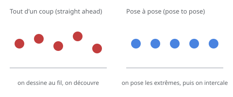

# Tout d'un coup / pose à pose

> Deux manières de construire une animation : **tout d'un coup** (*straight ahead*), on dessine au fil du geste et on découvre ; **pose à pose** (*pose to pose*), on pose d'abord les poses clés, puis on intercale.

## En pratique

- **Tout d'un coup** : spontané, imprévisible — idéal pour les mouvements fluides, les effets, la matière.
- **Pose à pose** : structuré, contrôlé — idéal quand la pose finale et le timing comptent.
- Les deux se **combinent** : on pose les extrêmes (pose à pose), puis on cherche le détail (tout d'un coup).
- C'est aussi la logique des **images clés et de l'interpolation** dans un logiciel.

## Où l'appliquer

- [Animation image par image](../../../../../02-activites/02/exercices/02-image-par-image/)
- [La boucle de chargement](../../../../../02-activites/02/exercices/11-boucle-spinner/)
- [La balle rebondissante](../../../../../02-activites/02/exercices/04-balle-rebondissante/)

## Sources

-  <!-- start-replace-cite key="sites/principes-animation-wikilivres" -->[Les principes de l'animation traditionnelle (dessin animé)](../../../../../05-mediagraphie/sites/principes-animation-wikilivres/ "Le livre libre des douze principes de l'animation traditionnelle : squash & stretch, anticipation, staging, timing et spacing, exagération, trajectoire arquée,…")<!-- end-replace-cite --> — chapitre « Toute l'action d'un coup : partie par partie ».
-  <!-- start-replace-cite key="sites/wikipedia-12-principes-animation" -->[12 principes de base de l'animation](../../../../../05-mediagraphie/sites/wikipedia-12-principes-animation/ "Les douze principes de base de l'animation (d'après Thomas et Johnston) : squash & stretch, anticipation, staging, timing, exagération… — la synthèse de référe…")<!-- end-replace-cite -->.

## Références

<!-- start-replace-cite-page -->
- [Wikilivres (2026) - Les principes de l'animation traditionnelle (dessin animé)](../../../../../05-mediagraphie/sites/principes-animation-wikilivres/ "Le livre libre des douze principes de l'animation traditionnelle : squash & stretch, anticipation, staging, timing et spacing, exagération, trajectoire arquée,…") [Fr](https://fr.wikibooks.org/wiki/Les_principes_de_l%27animation_traditionnelle_(dessin_anim%C3%A9))
- [Wikipédia (2026) - 12 principes de base de l'animation](../../../../../05-mediagraphie/sites/wikipedia-12-principes-animation/ "Les douze principes de base de l'animation (d'après Thomas et Johnston) : squash & stretch, anticipation, staging, timing, exagération… — la synthèse de référe…") [Wikipédia](https://fr.wikipedia.org/wiki/12_principes_de_base_de_l%27animation)
<!-- end-replace-cite-page -->
