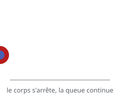

# Retards et chevauchement (follow through &amp; overlapping)

> Rien ne s'arrête d'un bloc : les éléments **attachés** au corps (cheveux, vêtement, queue) continuent sur leur élan, dépassent, puis reviennent. C'est le **follow through** et l'**overlapping action**.

## En pratique

- Le **corps** s'arrête, mais les **extrémités** continuent : elles ont leur propre élan.
- Les différents éléments arrivent **les uns après les autres** (d'où « overlapping »).
- Donne de la vie et de la matière : rien n'est rigide.
- S'applique au corps (bras, tête) comme aux accessoires (chapeau, écharpe).

## Où l'appliquer

- [Le sac de farine](../../../../../02-activites/02/exercices/07-sac-de-farine/)
- [Le cycle de marche](../../../../../02-activites/02/exercices/08-cycle-de-marche/)
- [Le changement d'émotion](../../../../../02-activites/02/exercices/09-changement-emotion/)

## Sources

-  <!-- start-replace-cite key="sites/principes-animation-wikilivres" -->[Les principes de l'animation traditionnelle (dessin animé)](../../../../../05-mediagraphie/sites/principes-animation-wikilivres/ "Le livre libre des douze principes de l'animation traditionnelle : squash & stretch, anticipation, staging, timing et spacing, exagération, trajectoire arquée,…")<!-- end-replace-cite --> — chapitre « Retards (overlap et follow-through) ».
-  <!-- start-replace-cite key="sites/wikipedia-12-principes-animation" -->[12 principes de base de l'animation](../../../../../05-mediagraphie/sites/wikipedia-12-principes-animation/ "Les douze principes de base de l'animation (d'après Thomas et Johnston) : squash & stretch, anticipation, staging, timing, exagération… — la synthèse de référe…")<!-- end-replace-cite -->.

## Références

<!-- start-replace-cite-page -->
- [Wikilivres (2026) - Les principes de l'animation traditionnelle (dessin animé)](../../../../../05-mediagraphie/sites/principes-animation-wikilivres/ "Le livre libre des douze principes de l'animation traditionnelle : squash & stretch, anticipation, staging, timing et spacing, exagération, trajectoire arquée,…") [Fr](https://fr.wikibooks.org/wiki/Les_principes_de_l%27animation_traditionnelle_(dessin_anim%C3%A9))
- [Wikipédia (2026) - 12 principes de base de l'animation](../../../../../05-mediagraphie/sites/wikipedia-12-principes-animation/ "Les douze principes de base de l'animation (d'après Thomas et Johnston) : squash & stretch, anticipation, staging, timing, exagération… — la synthèse de référe…") [Wikipédia](https://fr.wikipedia.org/wiki/12_principes_de_base_de_l%27animation)
<!-- end-replace-cite-page -->
