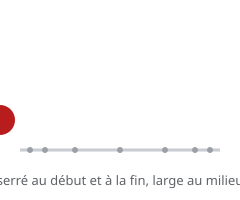

# Accélération et ralentissement (slow in / slow out)

> Un mouvement ne démarre pas et ne s'arrête pas à vitesse constante : il **accélère** au départ et **ralentit** à l'arrivée. Dans le dessin, cela se traduit par l'**espacement des images**.

## En pratique

- **Serre** les images au début et à la fin (slow in / slow out), **écarte**-les au milieu (vitesse maximale).
- Plus un objet est **lourd**, plus le départ est lent.
- Le rythme se règle au **timing** (nombre d'images) et au **spacing** (espacement).
- Dans un logiciel : courbes d'interpolation (ease-in / ease-out).

## Où l'appliquer

- [La brique qui tombe](../../../../../02-activites/02/exercices/03-brique-qui-tombe/)
- [La balle rebondissante](../../../../../02-activites/02/exercices/04-balle-rebondissante/)
- [Lever une charge](../../../../../02-activites/02/exercices/10-lever-une-charge/)

## Sources

-  <!-- start-replace-cite key="sites/principes-animation-wikilivres" -->[Les principes de l'animation traditionnelle (dessin animé)](../../../../../05-mediagraphie/sites/principes-animation-wikilivres/ "Le livre libre des douze principes de l'animation traditionnelle : squash & stretch, anticipation, staging, timing et spacing, exagération, trajectoire arquée,…")<!-- end-replace-cite --> — chapitre « Accélération et ralentissement ».
-  <!-- start-replace-cite key="sites/wikipedia-12-principes-animation" -->[12 principes de base de l'animation](../../../../../05-mediagraphie/sites/wikipedia-12-principes-animation/ "Les douze principes de base de l'animation (d'après Thomas et Johnston) : squash & stretch, anticipation, staging, timing, exagération… — la synthèse de référe…")<!-- end-replace-cite -->.

## Références

<!-- start-replace-cite-page -->
- [Wikilivres (2026) - Les principes de l'animation traditionnelle (dessin animé)](../../../../../05-mediagraphie/sites/principes-animation-wikilivres/ "Le livre libre des douze principes de l'animation traditionnelle : squash & stretch, anticipation, staging, timing et spacing, exagération, trajectoire arquée,…") [Fr](https://fr.wikibooks.org/wiki/Les_principes_de_l%27animation_traditionnelle_(dessin_anim%C3%A9))
- [Wikipédia (2026) - 12 principes de base de l'animation](../../../../../05-mediagraphie/sites/wikipedia-12-principes-animation/ "Les douze principes de base de l'animation (d'après Thomas et Johnston) : squash & stretch, anticipation, staging, timing, exagération… — la synthèse de référe…") [Wikipédia](https://fr.wikipedia.org/wiki/12_principes_de_base_de_l%27animation)
<!-- end-replace-cite-page -->
