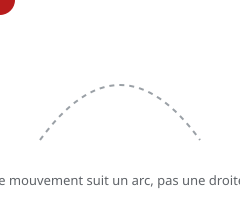

# Trajectoire arquée (arcs)

> Presque tout mouvement naturel suit un **arc** : le bras se lève en courbe, la balle décrit une parabole, la tête tourne en arc. Tracer des **trajectoires droites** donne un mouvement mécanique.

## En pratique

- Repérer l'**arc** avant de dessiner : où va le mouvement, par quelle courbe ?
- Les arcs donnent la **fluidité** et le **naturel**.
- Un mouvement **mécanique** (robot, machine) peut au contraire être linéaire — c'est un choix.
- Vérifier les arcs au **pelures d'oignon** (voir la fiche Krita).

## Où l'appliquer

- [La balle rebondissante](../../../../../02-activites/02/exercices/04-balle-rebondissante/)
- [Le cycle de marche](../../../../../02-activites/02/exercices/08-cycle-de-marche/)
- [Lever une charge](../../../../../02-activites/02/exercices/10-lever-une-charge/)

## Sources

-  <!-- start-replace-cite key="sites/principes-animation-wikilivres" -->[Les principes de l'animation traditionnelle (dessin animé)](../../../../../05-mediagraphie/sites/principes-animation-wikilivres/ "Le livre libre des douze principes de l'animation traditionnelle : squash & stretch, anticipation, staging, timing et spacing, exagération, trajectoire arquée,…")<!-- end-replace-cite --> — chapitre « Trajectoire arquée ».
-  <!-- start-replace-cite key="sites/wikipedia-12-principes-animation" -->[12 principes de base de l'animation](../../../../../05-mediagraphie/sites/wikipedia-12-principes-animation/ "Les douze principes de base de l'animation (d'après Thomas et Johnston) : squash & stretch, anticipation, staging, timing, exagération… — la synthèse de référe…")<!-- end-replace-cite -->.

## Références

<!-- start-replace-cite-page -->
- [Wikilivres (2026) - Les principes de l'animation traditionnelle (dessin animé)](../../../../../05-mediagraphie/sites/principes-animation-wikilivres/ "Le livre libre des douze principes de l'animation traditionnelle : squash & stretch, anticipation, staging, timing et spacing, exagération, trajectoire arquée,…") [Fr](https://fr.wikibooks.org/wiki/Les_principes_de_l%27animation_traditionnelle_(dessin_anim%C3%A9))
- [Wikipédia (2026) - 12 principes de base de l'animation](../../../../../05-mediagraphie/sites/wikipedia-12-principes-animation/ "Les douze principes de base de l'animation (d'après Thomas et Johnston) : squash & stretch, anticipation, staging, timing, exagération… — la synthèse de référe…") [Wikipédia](https://fr.wikipedia.org/wiki/12_principes_de_base_de_l%27animation)
<!-- end-replace-cite-page -->
