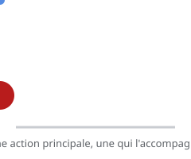

# Actions secondaires

> À côté de l'**action principale**, une **action secondaire** ajoute du détail et de la vie — sans jamais distraire du propos principal.

## En pratique

- L'action principale **domine** ; la secondaire **appuie** (un geste, un regard, un objet qui bouge).
- Elle enrichit le personnage et la scène : c'est ce qui rend vivant.
- Elle ne doit pas **voler la vedette** ni contredire l'action principale.
- Utile pour l'**acting** : un personnage qui parle peut jouer avec ses mains.

## Où l'appliquer

- [Le changement d'émotion](../../../../../02-activites/02/exercices/09-changement-emotion/)
- [Le sac de farine](../../../../../02-activites/02/exercices/07-sac-de-farine/)
- [La tête qui se tourne](../../../../../02-activites/02/exercices/05-tete-qui-se-tourne/)

## Sources

-  <!-- start-replace-cite key="sites/principes-animation-wikilivres" -->[Les principes de l'animation traditionnelle (dessin animé)](../../../../../05-mediagraphie/sites/principes-animation-wikilivres/ "Le livre libre des douze principes de l'animation traditionnelle : squash & stretch, anticipation, staging, timing et spacing, exagération, trajectoire arquée,…")<!-- end-replace-cite --> — chapitre « Actions secondaires ».
-  <!-- start-replace-cite key="sites/wikipedia-12-principes-animation" -->[12 principes de base de l'animation](../../../../../05-mediagraphie/sites/wikipedia-12-principes-animation/ "Les douze principes de base de l'animation (d'après Thomas et Johnston) : squash & stretch, anticipation, staging, timing, exagération… — la synthèse de référe…")<!-- end-replace-cite -->.

## Références

<!-- start-replace-cite-page -->
- [Wikilivres (2026) - Les principes de l'animation traditionnelle (dessin animé)](../../../../../05-mediagraphie/sites/principes-animation-wikilivres/ "Le livre libre des douze principes de l'animation traditionnelle : squash & stretch, anticipation, staging, timing et spacing, exagération, trajectoire arquée,…") [Fr](https://fr.wikibooks.org/wiki/Les_principes_de_l%27animation_traditionnelle_(dessin_anim%C3%A9))
- [Wikipédia (2026) - 12 principes de base de l'animation](../../../../../05-mediagraphie/sites/wikipedia-12-principes-animation/ "Les douze principes de base de l'animation (d'après Thomas et Johnston) : squash & stretch, anticipation, staging, timing, exagération… — la synthèse de référe…") [Wikipédia](https://fr.wikipedia.org/wiki/12_principes_de_base_de_l%27animation)
<!-- end-replace-cite-page -->
