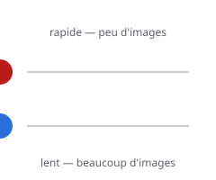

# Timing

> Le **timing**, c'est le nombre d'images consacré à un mouvement : peu d'images = rapide, beaucoup d'images = lent. C'est lui qui donne le **rythme**, la **vitesse** et le **poids**.

## En pratique

- **Peu d'images** entre deux poses = mouvement rapide et sec.
- **Beaucoup d'images** = mouvement lent, posé, lourd.
- Le timing crée le **poids** : un objet lourd prend plus de temps.
- Le timing crée aussi la **comédie** : un temps d'arrêt avant la chute, une accélération soudaine.
- Dans un logiciel : le nombre d'images entre les images clés, et la cadence.

## Où l'appliquer

- [La brique qui tombe](../../../../../02-activites/02/exercices/03-brique-qui-tombe/)
- [Montage simple](../../../../../02-activites/02/exercices/12-montage-simple/)
- [Le changement d'émotion](../../../../../02-activites/02/exercices/09-changement-emotion/)

## Sources

-  <!-- start-replace-cite key="sites/principes-animation-wikilivres" -->[Les principes de l'animation traditionnelle (dessin animé)](../../../../../05-mediagraphie/sites/principes-animation-wikilivres/ "Le livre libre des douze principes de l'animation traditionnelle : squash & stretch, anticipation, staging, timing et spacing, exagération, trajectoire arquée,…")<!-- end-replace-cite --> — chapitre « Timing et spacing ».
-  <!-- start-replace-cite key="sites/wikipedia-12-principes-animation" -->[12 principes de base de l'animation](../../../../../05-mediagraphie/sites/wikipedia-12-principes-animation/ "Les douze principes de base de l'animation (d'après Thomas et Johnston) : squash & stretch, anticipation, staging, timing, exagération… — la synthèse de référe…")<!-- end-replace-cite -->.

## Références

<!-- start-replace-cite-page -->
- [Wikilivres (2026) - Les principes de l'animation traditionnelle (dessin animé)](../../../../../05-mediagraphie/sites/principes-animation-wikilivres/ "Le livre libre des douze principes de l'animation traditionnelle : squash & stretch, anticipation, staging, timing et spacing, exagération, trajectoire arquée,…") [Fr](https://fr.wikibooks.org/wiki/Les_principes_de_l%27animation_traditionnelle_(dessin_anim%C3%A9))
- [Wikipédia (2026) - 12 principes de base de l'animation](../../../../../05-mediagraphie/sites/wikipedia-12-principes-animation/ "Les douze principes de base de l'animation (d'après Thomas et Johnston) : squash & stretch, anticipation, staging, timing, exagération… — la synthèse de référe…") [Wikipédia](https://fr.wikipedia.org/wiki/12_principes_de_base_de_l%27animation)
<!-- end-replace-cite-page -->
