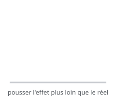

# Exagération

> L'**exagération** pousse le mouvement, la pose ou l'expression **plus loin que le réel** — non pour mentir, mais pour rendre l'idée plus **lisible** et plus forte.

## En pratique

- Exagérer l'**intention** : la peur est plus grande, la joie plus large, l'effort plus dur.
- Exagérer le **mouvement** et les **déformations** (squash & stretch poussé).
- Rester **crédible** : l'exagération sert le propos, elle ne le noie pas.
- Un léger excès suffit souvent ; c'est une question de dosage.

## Où l'appliquer

- [La balle rebondissante](../../../../../02-activites/02/exercices/04-balle-rebondissante/)
- [Le changement d'émotion](../../../../../02-activites/02/exercices/09-changement-emotion/)
- [Lever une charge](../../../../../02-activites/02/exercices/10-lever-une-charge/)

## Sources

-  <!-- start-replace-cite key="sites/principes-animation-wikilivres" -->[Les principes de l'animation traditionnelle (dessin animé)](../../../../../05-mediagraphie/sites/principes-animation-wikilivres/ "Le livre libre des douze principes de l'animation traditionnelle : squash & stretch, anticipation, staging, timing et spacing, exagération, trajectoire arquée,…")<!-- end-replace-cite --> — chapitre « Exagération ».
-  <!-- start-replace-cite key="sites/wikipedia-12-principes-animation" -->[12 principes de base de l'animation](../../../../../05-mediagraphie/sites/wikipedia-12-principes-animation/ "Les douze principes de base de l'animation (d'après Thomas et Johnston) : squash & stretch, anticipation, staging, timing, exagération… — la synthèse de référe…")<!-- end-replace-cite -->.

## Références

<!-- start-replace-cite-page -->
- [Wikilivres (2026) - Les principes de l'animation traditionnelle (dessin animé)](../../../../../05-mediagraphie/sites/principes-animation-wikilivres/ "Le livre libre des douze principes de l'animation traditionnelle : squash & stretch, anticipation, staging, timing et spacing, exagération, trajectoire arquée,…") [Fr](https://fr.wikibooks.org/wiki/Les_principes_de_l%27animation_traditionnelle_(dessin_anim%C3%A9))
- [Wikipédia (2026) - 12 principes de base de l'animation](../../../../../05-mediagraphie/sites/wikipedia-12-principes-animation/ "Les douze principes de base de l'animation (d'après Thomas et Johnston) : squash & stretch, anticipation, staging, timing, exagération… — la synthèse de référe…") [Wikipédia](https://fr.wikipedia.org/wiki/12_principes_de_base_de_l%27animation)
<!-- end-replace-cite-page -->
