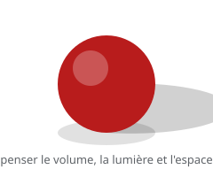

# Dessin solide

> Le **dessin solide** consiste à donner à chaque dessin un **volume** et une **structure** : on pense en trois dimensions, avec la lumière, l'ombre et l'espace.

## En pratique

- Penser en **volumes** simples (sphère, cube, cylindre) avant le détail.
- La **ligne de construction** aide à garder le volume d'une image à l'autre.
- La **lumière** et l'**ombre** donnent le relief et l'orientation.
- En animation, un volume constant évite que le personnage « fonde » d'une image à l'autre.

## Où l'appliquer

- [Animation image par image](../../../../../02-activites/02/exercices/02-image-par-image/)
- [La tête qui se tourne](../../../../../02-activites/02/exercices/05-tete-qui-se-tourne/)
- [Le sac de farine](../../../../../02-activites/02/exercices/07-sac-de-farine/)

## Sources

-  <!-- start-replace-cite key="sites/principes-animation-wikilivres" -->[Les principes de l'animation traditionnelle (dessin animé)](../../../../../05-mediagraphie/sites/principes-animation-wikilivres/ "Le livre libre des douze principes de l'animation traditionnelle : squash & stretch, anticipation, staging, timing et spacing, exagération, trajectoire arquée,…")<!-- end-replace-cite --> — chapitre « Dessin solide ».
-  <!-- start-replace-cite key="sites/wikipedia-12-principes-animation" -->[12 principes de base de l'animation](../../../../../05-mediagraphie/sites/wikipedia-12-principes-animation/ "Les douze principes de base de l'animation (d'après Thomas et Johnston) : squash & stretch, anticipation, staging, timing, exagération… — la synthèse de référe…")<!-- end-replace-cite -->.

## Références

<!-- start-replace-cite-page -->
- [Wikilivres (2026) - Les principes de l'animation traditionnelle (dessin animé)](../../../../../05-mediagraphie/sites/principes-animation-wikilivres/ "Le livre libre des douze principes de l'animation traditionnelle : squash & stretch, anticipation, staging, timing et spacing, exagération, trajectoire arquée,…") [Fr](https://fr.wikibooks.org/wiki/Les_principes_de_l%27animation_traditionnelle_(dessin_anim%C3%A9))
- [Wikipédia (2026) - 12 principes de base de l'animation](../../../../../05-mediagraphie/sites/wikipedia-12-principes-animation/ "Les douze principes de base de l'animation (d'après Thomas et Johnston) : squash & stretch, anticipation, staging, timing, exagération… — la synthèse de référe…") [Wikipédia](https://fr.wikipedia.org/wiki/12_principes_de_base_de_l%27animation)
<!-- end-replace-cite-page -->
