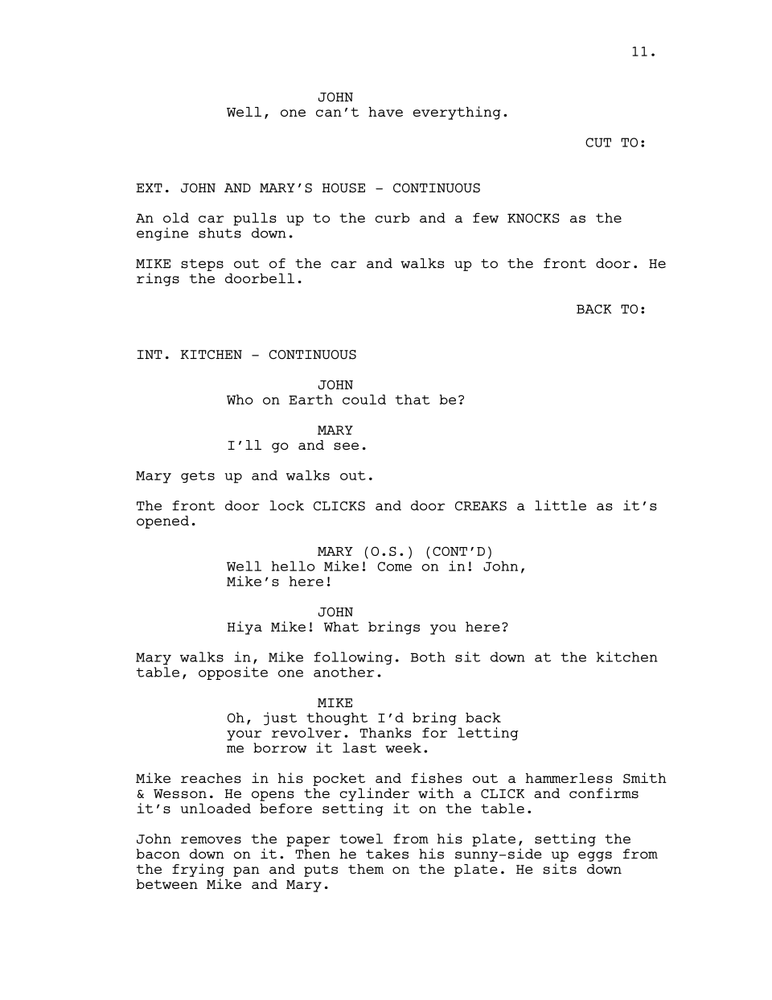
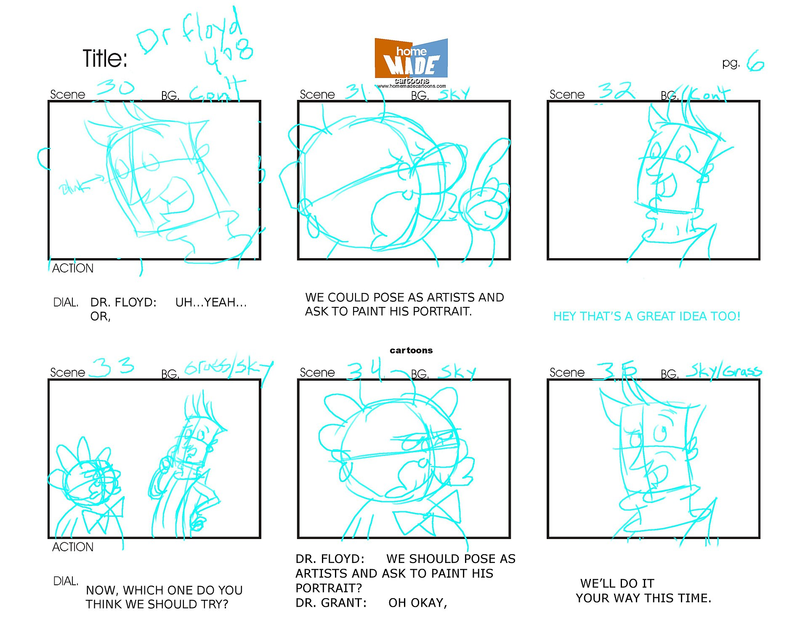

# Le storyboard — de l'idée aux plans

> Le scénario court, le storyboard et le plan de tournage, pour la vidéo et l'animation.

- **Le scénario court** : une idée, un fil, une fin — en quelques lignes.
- **Le storyboard** : découper l'idée en plans (dessins sommaires, photo, collage) — chaque case = un plan, avec le son et le mouvement. Gabarit de [storyboard de 6 cases](storyboard-6-paysage.pdf) et de [12 cases](storyboard-12-portrait.pdf) pour impression.
- **Le plan de tournage** : lieux, prises, matériel, les gens impliqués.

### Scénario classique

<a href="https://commons.wikimedia.org/wiki/File:Screenplay_example.svg">Mendaliv</a>, Public domain, via Wikimedia Commons

### Scénarimage ou storyboard

<a href="https://commons.wikimedia.org/wiki/File:Storyboard_for_The_Radio_Adventures_of_Dr._Floyd.jpg">https://www.flickr.com/photos/tmray02/</a>, <a href="https://creativecommons.org/licenses/by-sa/2.0">CC BY-SA 2.0</a>, via Wikimedia Commons

## Références

<!-- start-replace-cite-page -->
_Aucune référence citée dans cette page._
<!-- end-replace-cite-page -->
## Dans le cours

- Séance [S5 — scénarisation et storyboard](../../../../01-deroulement/05/) ; le storyboard est remis avec l'[EVS 2](../../../../04-evaluations/sommatives/02/).
