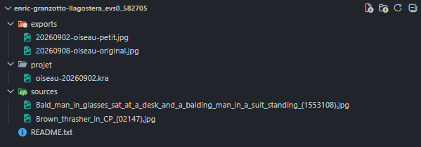

# EVS 1 — Production image + journal de bord v1

<!-- %: SEANCE_EVS_1 -->
[**Séance 4**](/01-deroulement/04/)
<!-- %; -->

## <!-- %: PONDERATION_EVS_1 -->15%<!-- %; -->

### Description

<!-- %: DESCRIPTION_EVS_1 -->
Production en image numérique (journal de bord intégré)
<!-- %; -->

Réaliser une production en image numérique (affiche, illustration, collage ou image de synthèse) avec un logiciel libre, et publier la première version du journal de bord.

**Pondération détaillée** — la note globale couvre la production **et** le journal de bord intégré (pas de note spécifique pour le journal).

### Remise en classe

À la remise, la classe regarde les projets ensemble : le professeur ouvre l'URL du journal, navigue dans la page du projet, commente et échange rapidement avec les personnes concernées. On apprend ensemble, en partageant.

### Grille d'évaluation

- [Grille de l'EVS 01](./grille/) — les critères distribués sur les éléments de compétence et les savoirs essentiels (D.I.).

#### Forme de l'évaluation

* [x] Individuel
* [ ] Équipe

### Savoirs essentiels

- [Critères de qualité des fichiers](../../../03-savoirs/01-reconnaitre/03-criteres-qualite-fichiers/01-image/)
- [Outils et processus de création](../../../03-savoirs/01-reconnaitre/04-outils-processus-creation/01-image/)
- [Exploitation des logiciels](../../../03-savoirs/02-utiliser/04-exploitation-logiciels/01-image/)
- [Respect des critères de qualité](../../../03-savoirs/02-utiliser/08-respect-criteres-qualite/01-liste-de-verification/)

### Principaux critères d'évaluation

Les critères sont détaillés et distribués sur les éléments de compétence dans la [grille d'évaluation](./grille/).

### Remise

- Production : créer un dossier compressé `.zip`, déposés selon les [règles d'identification](../../../00-plan-de-cours/) (ex. `nom-de-famille_prénom_identification-du-travail_cours.zip`).
  - Dans ce dossier, utiliser l'**arborescence de projet** : `sources/` (matériaux, images de référence), `exports/` (les versions exportées), `projet/` (les fichiers de logiciels, ex. .kra), fichier `README.md ou README.txt` avec le nom complet, la description du sujet choisi et les crédits (licences et provenances) des ressources externes utilisées.
  - Des versions datées : `essai-v1-2026-11-25.png`, jamais de « final2 définitif ».
- Envoyer le `.zip` dans le devoir Teams.
- **Journal de bord v1**: lien au document Word fourni au professeur dans  l'annuaire. Il doit contenier les entrées des séances 1 à 3 avec les captures d'écran, discussion de problèmes et solutions, inspirations liées à la médiagraphie.

#### Exemple d'arborescence de projet



#### Exemple de README.txt

```txt
# Nom du projet: « très bien! »

Créé par Enric Granzotto Llagostera.

## Crédits

- <https://commons.wikimedia.org/wiki/File:Bald_man_in_glasses_sat_at_a_desk_and_a_balding_man_in_a_suit_standing_(1553108).jpg> - Geoff Charles, CC BY-SA 4.0 <https://creativecommons.org/licenses/by-sa/4.0>, via Wikimedia Commons
- <https://commons.wikimedia.org/wiki/File:Brown_thrasher_in_CP_(02147).jpg> - Rhododendrites, CC BY-SA 4.0 <https://creativecommons.org/licenses/by-sa/4.0>, via Wikimedia Commons.

```

