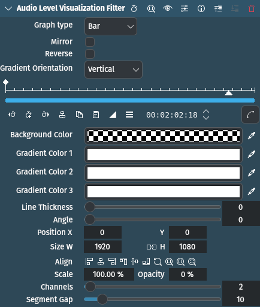

<!-- start-replace-fm field="title" -->
# Kdenlive — visualisation du niveau audio
<!-- end-replace-fm -->
<!-- start-replace-fm field="description" format="blockquote" -->
> L'effet de visualisation du niveau audio dans Kdenlive : vumètre dessiné sur l'image, types de graphique, couleurs, orientation et paramètres.
<!-- end-replace-fm -->

<!-- start-replace-mediagraphie-fiche -->
> **Référence** — Documentation Kdenlive (2026). Kdenlive — visualisation du niveau audio.. https://docs.kdenlive.org/en/effects_and_filters/video_effects/on_master/audio_level_visualization_filter.html. [↗](https://docs.kdenlive.org/en/effects_and_filters/video_effects/on_master/audio_level_visualization_filter.html)
>
> | **Type** | webpage |
> | **Auteur·e** | Documentation Kdenlive |
> | **Date** | 2026 |
> | **Statut** | stable |
> | **Mots-clés** | audio, visualisation, kdenlive, effet, tutoriel, cours |

**Citation (copier-coller)**

```citation
Documentation Kdenlive (2026). Kdenlive — visualisation du niveau audio.. https://docs.kdenlive.org/en/effects_and_filters/video_effects/on_master/audio_level_visualization_filter.html.
```
<!-- end-replace-mediagraphie-fiche -->

## Cité par

<!-- start-replace-mediagraphie-cited-by -->
- [Kdenlive — liste des effets audio](../kdenlive-audio-effects-list/)
- [Kdenlive — spectre audio](../kdenlive-audio-spectrum/)
- [Kdenlive — onde audio](../kdenlive-audio-wave/)
- [Kdenlive — forme d'onde audio](../kdenlive-audio-waveform/)
- [Exercice — Voir le son](../../../../02-activites/03/exercices/14-visualiser-le-son/)
<!-- end-replace-mediagraphie-cited-by -->

---

> 🇫🇷 **Traduction française** de la page officielle [Audio Level Visualization Filter](https://docs.kdenlive.org/en/effects_and_filters/video_effects/on_master/audio_level_visualization_filter.html) — la page source n'est pas encore traduite. Adaptation : A26. Images : documentation officielle Kdenlive (interface anglaise).



| Champ | Valeur |
|---|---|
| Statut | Maintenu |
| Images clés | Oui |
| Bibliothèque source | MLT |
| Filtre source | `audiolevelgraph` |
| Maître seulement | Oui |
| Bogues connus | Aucun |

## Description

Effet de visualisation audio qui **dessine un vumètre de niveau** sur l'image. Il se contrôle directement dans le moniteur.

## Paramètres

| Paramètre | Valeur | Description |
|---|---|---|
| Type de graphique | Sélection | Type de graphique affichant les niveaux |
| Miroir | Interrupteur | Reflète le spectre sur la ligne centrale du rectangle |
| Inverser | Interrupteur | Dessine les points en commençant par le canal droit |
| Orientation du dégradé | Sélection | Direction du dégradé de couleurs |
| Couleur de fond | Sélecteur | Couleur appliquée à toute l'image |
| Couleurs du dégradé 1 / 2 / 3 | Sélecteur | Couleur du dégradé de la forme d'onde : 1 en haut, 2 au milieu, 3 en bas |
| Épaisseur de ligne | Entier | Épaisseur des barres ou segments, en pixels |
| Angle | Entier | Angle de rotation appliqué à la forme d'onde |
| X / Y / L / H / Taille / Opacité |  | Coordonnées, largeur, hauteur, taille et opacité du rectangle dans lequel la forme d'onde est dessinée ; les icônes aident à l'aligner |
| Canaux | Entier | Nombre de canaux à afficher |
| Espace entre segments | Entier | Espace, en pixels, entre les segments |

**Type de graphique** : Barres (par défaut), Segments.

**Orientation du dégradé** : Vertical (par défaut), Horizontal.

## Exemple


- Épaisseur de ligne réglée à 8.
- Couleurs du dégradé 1 / 2 / 3 réglées sur des couleurs différentes pour la démonstration.

## Voir aussi

- [Kdenlive — spectre audio](../kdenlive-audio-spectrum/)
- [Kdenlive — forme d'onde audio](../kdenlive-audio-waveform/)
- [Kdenlive — onde audio](../kdenlive-audio-wave/)
