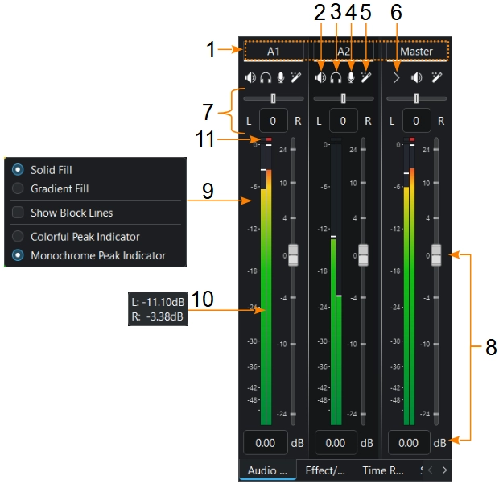
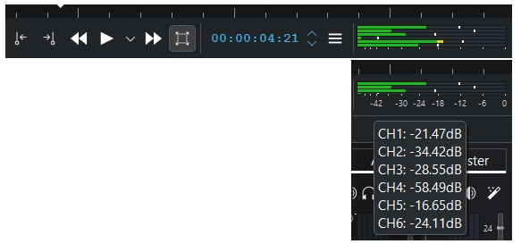

<!-- start-replace-fm field="title" -->
# Kdenlive — la table de mixage audio
<!-- end-replace-fm -->
<!-- start-replace-fm field="description" format="blockquote" -->
> La table de mixage audio de Kdenlive : muet, solo, balance, volume et crête par canal, affichage des niveaux et indicateur de clipping — la console du mixage multipiste.
<!-- end-replace-fm -->

<!-- start-replace-mediagraphie-fiche -->
> **Référence** — Documentation Kdenlive (2026). Kdenlive — la table de mixage audio.. https://docs.kdenlive.org/en/effects_and_filters/audio.html#audio-mixer. [↗](https://docs.kdenlive.org/en/effects_and_filters/audio.html#audio-mixer)
>
> | **Type** | webpage |
> | **Auteur·e** | Documentation Kdenlive |
> | **Date** | 2026 |
> | **Statut** | stable |
> | **Mots-clés** | video, montage, kdenlive, audio, mixage, tutoriel, cours |

**Citation (copier-coller)**

```citation
Documentation Kdenlive (2026). Kdenlive — la table de mixage audio.. https://docs.kdenlive.org/en/effects_and_filters/audio.html#audio-mixer.
```
<!-- end-replace-mediagraphie-fiche -->

## Cité par

<!-- start-replace-mediagraphie-cited-by -->
- [Kdenlive — effets audio : catégorie Audio](../kdenlive-audio-effects/)
- [Kdenlive — liste des effets audio](../kdenlive-audio-effects-list/)
- [Kdenlive — compresseur/expandeur](../kdenlive-compressor-expander/)
<!-- end-replace-mediagraphie-cited-by -->

---

> 🇫🇷 **Traduction française** de la section [Audio Mixer](https://docs.kdenlive.org/en/effects_and_filters/audio.html#audio-mixer) de la page *Audio Tools* — la page source n'est pas encore traduite. Adaptation : A26. Images : documentation officielle Kdenlive (interface anglaise).

La **table de mixage audio** (*Audio Mixer*) rassemble en un seul panneau le réglage de chaque piste : muet, solo, volume, balance, niveau et enregistrement. C'est un panneau comme les autres : on l'affiche depuis le menu **Affichage** et on l'ancre dans l'espace de travail.

Chaque canal de la table correspond à une **piste audio** de la timeline, plus un canal **Master** qui règle le niveau de sortie de l'ensemble.



## Les contrôles d'un canal

1. **Numéro de canal** (numéro ou nom de la piste audio) — et **canal Master**.
2. **Muet** — couper un canal.
3. **Solo** — isoler un canal. Un clic seul rend le solo **exclusif** ; **Maj+clic** ajoute le canal au solo (solo additif).
4. **Enregistrer** — enregistrer de l'audio directement sur la piste du canal (voir [Kdenlive — enregistrement audio](../kdenlive-audio-recording/)).
5. **Pile d'effets** — ouvrir la pile d'effets du canal.
6. **Contrôles de piste** — afficher ou masquer les contrôles de la piste audio.
7. **Balance** — déplacer le canal dans la largeur stéréo (curseur ou valeur saisie).
8. **Volume** — régler le volume du canal. Réinitialiser la valeur par défaut : **clic milieu** (molette enfoncée) ou **clic droit** sur le curseur ou sur le niveau.
9. **Clic droit sur le niveau** — menu d'apparence des niveaux ; ces réglages valent à la fois pour le moniteur de clip et le moniteur de projet.
10. **Survol du niveau** — affiche la valeur en dB de chaque canal.
11. **Indicateur de crête** (*clipping*) — dès qu'un signal atteint 0 dB ou plus, un point rouge apparaît et reste au-dessus de 0 dB ; il se réinitialise après quelques secondes (4 à 5 s) sans crête.

## Le niveau du moniteur



Quand **six canaux** jouent en même temps, les valeurs en dB sont masquées. Avec **plus de deux canaux** audio, la valeur en dB n'est plus affichée (les graduations restent) : survoler le vumètre affiche le niveau et la valeur en dB de chaque canal.

## Flux audio multiples

Un clip vidéo peut contenir **plusieurs flux audio** : l'onglet **Audio** des propriétés du clip permet de les régler et de les traiter un par un.

## À retenir pour le mixage

- **Un canal par piste** : voix, ambiances, musique — la table rend la hiérarchie visible d'un coup d'œil.
- **Solo pour écouter une couche**, muet pour l'isoler du reste : le solo exclusif (un clic) est le plus rapide.
- **Surveiller l'indicateur de crête** : un point rouge signale un dépassement — baisser le volume du canal, pas celui du Master.
- **Vérifier sur un autre système** : la table règle les niveaux relatifs, l'écoute au casque et sur haut-parleurs valide l'équilibre.

## Voir aussi

- [Kdenlive — enregistrement audio](../kdenlive-audio-recording/) — armer une piste et enregistrer.
- [Kdenlive — la timeline](../kdenlive-timeline/) — les pistes, les coupes et la lecture.
- [Kdenlive — démarrage rapide](../kdenlive-quickstart/) — le projet, les clips et le rendu.
- [Exercice — Mixage multipiste](../../../../02-activites/03/exercices/07-mixage-multipiste/) — équilibrer voix, ambiance et musique.
- [Exercice — Sonoriser une animation](../../../../02-activites/03/exercices/11-sonoriser-une-animation/) — la bande sonore complète, mixée.
- [Le mixage multipiste](../../../../03-savoirs/01-reconnaitre/04-outils-processus-creation/03-son/04-mixage-multipiste/) — le concept : niveaux, panoramique, espace.
