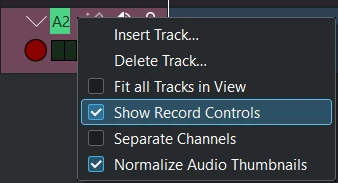
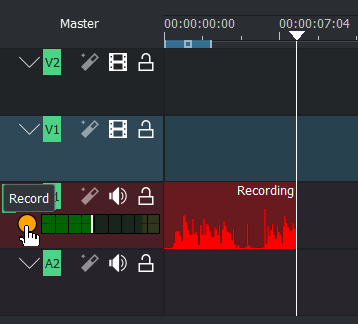
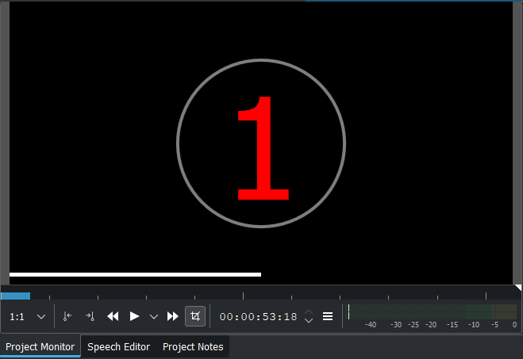

<!-- start-replace-fm field="title" -->
# Kdenlive — enregistrement audio
<!-- end-replace-fm -->
<!-- start-replace-fm field="description" format="blockquote" -->
> Enregistrement audio dans Kdenlive : activer les contrôles d'enregistrement d'une piste, surveiller le niveau du micro, enregistrer pendant la lecture ou en direct, et retrouver le clip dans la timeline.
<!-- end-replace-fm -->

<!-- start-replace-mediagraphie-fiche -->
> **Référence** — Documentation Kdenlive (2026). Kdenlive — enregistrement audio.. https://docs.kdenlive.org/en/effects_and_filters/audio.html#audio-recording. [↗](https://docs.kdenlive.org/en/effects_and_filters/audio.html#audio-recording)
>
> | **Type** | webpage |
> | **Auteur·e** | Documentation Kdenlive |
> | **Date** | 2026 |
> | **Statut** | stable |
> | **Mots-clés** | video, montage, kdenlive, audio, enregistrement, tutoriel, cours |

**Citation (copier-coller)**

```citation
Documentation Kdenlive (2026). Kdenlive — enregistrement audio.. https://docs.kdenlive.org/en/effects_and_filters/audio.html#audio-recording.
```
<!-- end-replace-mediagraphie-fiche -->

## Cité par

<!-- start-replace-mediagraphie-cited-by -->
- [Kdenlive — effets audio : catégorie Audio](../kdenlive-audio-effects/)
- [Kdenlive — liste des effets audio](../kdenlive-audio-effects-list/)
- [Kdenlive — la table de mixage audio](../kdenlive-audio-mixer/)
- [Kdenlive — capturer l'audio](../kdenlive-capturing-audio/)
- [Kdenlive — propriétés du clip](../kdenlive-clip-properties/)
- [Kdenlive — compresseur/expandeur](../kdenlive-compressor-expander/)
- [Kdenlive — configuration : capture](../kdenlive-configuration-capture/)
- [Kdenlive — copier les canaux vers stéréo](../kdenlive-copy-channels-to-stereo/)
- [Exercice — Maquette sonore (sons de bouche)](../../../../02-activites/03/exercices/13-maquette-sonore/)
<!-- end-replace-mediagraphie-cited-by -->

---

> 🇫🇷 **Traduction française** de la section [Audio recording](https://docs.kdenlive.org/en/effects_and_filters/audio.html#audio-recording) de la page *Audio Tools* — la page source n'est pas encore traduite. Adaptation : A26. Images : documentation officielle Kdenlive (interface anglaise).

La page **Audio Tools** du manuel Kdenlive couvre aussi la table de mixage et les flux audio multiples. Cette fiche traduit la section **Audio recording** ; voir [la page source](https://docs.kdenlive.org/en/effects_and_filters/audio.html#audio-recording).



Clic droit sur l'en-tête de piste → **Afficher les contrôles d'enregistrement**, ou le bouton micro de la table de mixage (repère 4 ci-dessus), affiche le contrôle d'enregistrement de la piste, qui se colore. La piste passe en **mode monitoring audio** : les niveaux affichent l'entrée du micro et le curseur de volume règle le niveau du micro.



Pendant l'enregistrement, une forme d'onde apparaît en direct dans la timeline.



Désactiver le décompte dans **Configurer Kdenlive ‣ Capture**.

## Enregistrer pendant la lecture de la timeline

- **Espace** lance la lecture de la timeline en monitoring.
- **R** ou le bouton d'enregistrement met la lecture en pause ; **Espace** lance l'enregistrement.

## Enregistrement direct

- **Démarrer** : **R** ou le bouton d'enregistrement de l'en-tête de piste. Un décompte démarre dans le moniteur de projet (désactivable dans **Configurer Kdenlive ‣ Capture**).
- **Pause** : **Espace**.
- **Reprendre** : **Espace** à nouveau.
- **Arrêter** : **Échap** ou le bouton d'enregistrement. Le clip audio est ajouté à la timeline et au bac à projets.

Une fois l'enregistrement terminé, le fichier audio est créé et stocké dans le bac à projets ou le dossier défini. Le focus reste sur la timeline : on peut continuer à utiliser les raccourcis pour se déplacer dans le nouvel enregistrement (début, fin, clip suivant).

## Notes

- **Clic milieu** = molette enfoncée ; **clic droit** = bouton droit de la souris.
- Pour enregistrer une voix off pendant la lecture du projet, voir [Kdenlive — capturer l'audio](../kdenlive-capturing-audio/).

## Voir aussi

- [Kdenlive — capturer l'audio](../kdenlive-capturing-audio/)
- [Kdenlive — la timeline](../kdenlive-timeline/)
- [Kdenlive — démarrage rapide](../kdenlive-quickstart/)
