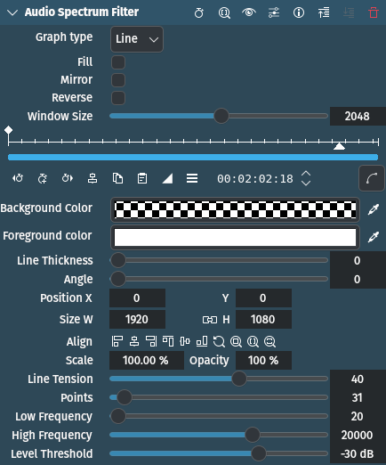

<!-- start-replace-fm field="title" -->
# Kdenlive — spectre audio
<!-- end-replace-fm -->
<!-- start-replace-fm field="description" format="blockquote" -->
> L'effet spectre audio de Kdenlive : analyse FFT, graphique en ligne ou barres, fréquences, seuil et couleurs.
<!-- end-replace-fm -->

<!-- start-replace-mediagraphie-fiche -->
> **Référence** — Documentation Kdenlive (2026). Kdenlive — spectre audio.. https://docs.kdenlive.org/en/effects_and_filters/video_effects/on_master/audio_spectrum_filter.html. [↗](https://docs.kdenlive.org/en/effects_and_filters/video_effects/on_master/audio_spectrum_filter.html)
>
> | **Type** | webpage |
> | **Auteur·e** | Documentation Kdenlive |
> | **Date** | 2026 |
> | **Statut** | stable |
> | **Mots-clés** | audio, visualisation, spectre, kdenlive, effet, tutoriel, cours |

**Citation (copier-coller)**

```citation
Documentation Kdenlive (2026). Kdenlive — spectre audio.. https://docs.kdenlive.org/en/effects_and_filters/video_effects/on_master/audio_spectrum_filter.html.
```
<!-- end-replace-mediagraphie-fiche -->

## Cité par

<!-- start-replace-mediagraphie-cited-by -->
- [Kdenlive — liste des effets audio](../kdenlive-audio-effects-list/)
- [Kdenlive — visualisation du niveau audio](../kdenlive-audio-level-visualization/)
- [Kdenlive — onde audio](../kdenlive-audio-wave/)
- [Kdenlive — forme d'onde audio](../kdenlive-audio-waveform/)
- [Exercice — Voir le son](../../../../02-activites/03/exercices/14-visualiser-le-son/)
<!-- end-replace-mediagraphie-cited-by -->

---

> 🇫🇷 **Traduction française** de la page officielle [Audio Spectrum Filter](https://docs.kdenlive.org/en/effects_and_filters/video_effects/on_master/audio_spectrum_filter.html) — la page source n'est pas encore traduite. Adaptation : A26. Images : documentation officielle Kdenlive (interface anglaise).



| Champ | Valeur |
|---|---|
| Statut | Maintenu |
| Images clés | Oui |
| Bibliothèque source | MLT |
| Filtre source | `audiospectrum` |
| Maître seulement | Oui |
| Bogues connus | Aucun |

## Description

Effet de visualisation audio qui **dessine un spectre audio** sur l'image. Il se contrôle directement dans le moniteur.

## Paramètres

| Paramètre | Valeur | Description |
|---|---|---|
| Type de graphique | Sélection | Type de graphique affichant les niveaux |
| Remplir | Interrupteur | Remplit la zone sous le graphique (type Ligne seulement) |
| Miroir | Interrupteur | Reflète le spectre sur la ligne centrale du rectangle |
| Inverser | Interrupteur | Dessine les points en commençant par la fréquence la plus haute |
| Taille de fenêtre | Entier | Nombre d'échantillons traités par la FFT (transformée de Fourier rapide) ; les échantillons excédentaires sont ignorés ou mis en tampon glissant |
| Couleur de fond | Sélecteur | Couleur appliquée à toute l'image |
| Couleur de premier plan | Sélecteur | Couleur de la forme d'onde ; son alpha règle la transparence |
| Épaisseur de ligne | Entier | Épaisseur des barres ou de la ligne, en pixels |
| Angle | Entier | Angle de rotation appliqué à la forme d'onde |
| X / Y / L / H / Taille / Opacité |  | Coordonnées, largeur, hauteur, taille et opacité du rectangle de dessin ; les icônes aident à l'aligner |
| Courbure de la ligne | Entier | Courbure de l'interpolation : 0 = ligne droite, 100 = très courbe ; hors de 0–100, la ligne boucle (type Ligne seulement) |
| Points | Entier | Nombre de bandes du spectre ; chaque bande est un point de données |
| Fréquence basse | Entier | Bas de la plage de fréquences du graphique (Hz) |
| Fréquence haute | Entier | Haut de la plage de fréquences du graphique (Hz) |
| Seuil de niveau | Entier | Amplitude minimale, dans la plage de fréquences, pour appliquer la valeur (dB) |

**Type de graphique** : Ligne, Barres.

> **Note** — L'effet n'est pas mis à jour dans le moniteur de projet pendant le scrubbing : il faut lire le projet pour le voir.

> **Astuce** — L'opacité est fixée à 100 %. On contrôle la transparence en réglant le canal alpha de la couleur de premier plan.

## Exemple


- Épaisseur de ligne réglée à 4.


## Voir aussi

- [Kdenlive — visualisation du niveau audio](../kdenlive-audio-level-visualization/)
- [Kdenlive — forme d'onde audio](../kdenlive-audio-waveform/)
- [Kdenlive — onde audio](../kdenlive-audio-wave/)
