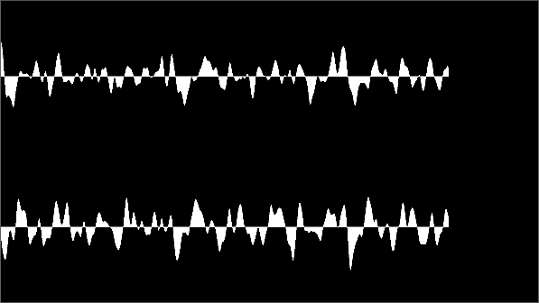

<!-- start-replace-fm field="title" -->
# Kdenlive — onde audio
<!-- end-replace-fm -->
<!-- start-replace-fm field="description" format="blockquote" -->
> L'effet onde audio de Kdenlive : afficher la forme d'onde à la place de la vidéo, en surimpression.
<!-- end-replace-fm -->

<!-- start-replace-mediagraphie-fiche -->
> **Référence** — Documentation Kdenlive (2026). Kdenlive — onde audio.. https://docs.kdenlive.org/en/effects_and_filters/video_effects/on_master/audio_wave.html. [↗](https://docs.kdenlive.org/en/effects_and_filters/video_effects/on_master/audio_wave.html)
>
> | **Type** | webpage |
> | **Auteur·e** | Documentation Kdenlive |
> | **Date** | 2026 |
> | **Statut** | stable |
> | **Mots-clés** | audio, visualisation, kdenlive, effet, tutoriel, cours |

**Citation (copier-coller)**

```citation
Documentation Kdenlive (2026). Kdenlive — onde audio.. https://docs.kdenlive.org/en/effects_and_filters/video_effects/on_master/audio_wave.html.
```
<!-- end-replace-mediagraphie-fiche -->

## Cité par

<!-- start-replace-mediagraphie-cited-by -->
- [Kdenlive — liste des effets audio](../kdenlive-audio-effects-list/)
- [Kdenlive — visualisation du niveau audio](../kdenlive-audio-level-visualization/)
- [Kdenlive — spectre audio](../kdenlive-audio-spectrum/)
- [Kdenlive — forme d'onde audio](../kdenlive-audio-waveform/)
- [Exercice — Voir le son](../../../../02-activites/03/exercices/14-visualiser-le-son/)
<!-- end-replace-mediagraphie-cited-by -->

---

> 🇫🇷 **Traduction française** de la page officielle [Audio Wave](https://docs.kdenlive.org/en/effects_and_filters/video_effects/on_master/audio_wave.html) — la page source n'est pas encore traduite. Adaptation : A26. Images : documentation officielle Kdenlive (interface anglaise).


| Champ | Valeur |
|---|---|
| Statut | Maintenu |
| Images clés | Non |
| Bibliothèque source | MLT |
| Filtre source | `audiowave` |
| Maître seulement | Oui |
| Bogues connus | Aucun |

## Description

Effet de visualisation audio qui affiche la **forme d'onde à la place de la vidéo**.

> **Attention** — Cet effet se superpose à tout le reste de l'image.

## Exemple



## Voir aussi

- [Kdenlive — spectre audio](../kdenlive-audio-spectrum/)
- [Kdenlive — forme d'onde audio](../kdenlive-audio-waveform/)
- [Kdenlive — visualisation du niveau audio](../kdenlive-audio-level-visualization/)
