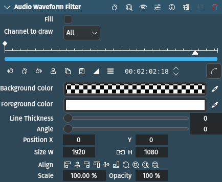
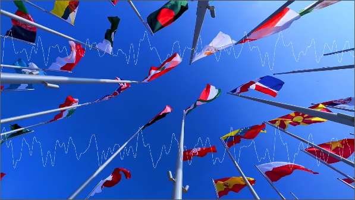

<!-- start-replace-fm field="title" -->
# Kdenlive — forme d'onde audio
<!-- end-replace-fm -->
<!-- start-replace-fm field="description" format="blockquote" -->
> L'effet forme d'onde audio de Kdenlive : dessiner la forme d'onde sur l'image, canaux, couleurs et remplissage.
<!-- end-replace-fm -->

<!-- start-replace-mediagraphie-fiche -->
> **Référence** — Documentation Kdenlive (2026). Kdenlive — forme d'onde audio.. https://docs.kdenlive.org/en/effects_and_filters/video_effects/on_master/audio_waveform_filter.html. [↗](https://docs.kdenlive.org/en/effects_and_filters/video_effects/on_master/audio_waveform_filter.html)
>
> | **Type** | webpage |
> | **Auteur·e** | Documentation Kdenlive |
> | **Date** | 2026 |
> | **Statut** | stable |
> | **Mots-clés** | audio, visualisation, kdenlive, effet, tutoriel, cours |

**Citation (copier-coller)**

```citation
Documentation Kdenlive (2026). Kdenlive — forme d'onde audio.. https://docs.kdenlive.org/en/effects_and_filters/video_effects/on_master/audio_waveform_filter.html.
```
<!-- end-replace-mediagraphie-fiche -->

## Cité par

<!-- start-replace-mediagraphie-cited-by -->
- [Kdenlive — liste des effets audio](../kdenlive-audio-effects-list/)
- [Kdenlive — visualisation du niveau audio](../kdenlive-audio-level-visualization/)
- [Kdenlive — spectre audio](../kdenlive-audio-spectrum/)
- [Kdenlive — onde audio](../kdenlive-audio-wave/)
- [Exercice — Voir le son](../../../../02-activites/03/exercices/14-visualiser-le-son/)
<!-- end-replace-mediagraphie-cited-by -->

---

> 🇫🇷 **Traduction française** de la page officielle [Audio Waveform Filter](https://docs.kdenlive.org/en/effects_and_filters/video_effects/on_master/audio_waveform_filter.html) — la page source n'est pas encore traduite. Adaptation : A26. Images : documentation officielle Kdenlive (interface anglaise).



| Champ | Valeur |
|---|---|
| Statut | Maintenu |
| Images clés | Oui |
| Bibliothèque source | MLT |
| Filtre source | `audiowaveform` |
| Maître seulement | Oui |
| Bogues connus | Aucun |

## Description

Effet de visualisation audio qui **dessine une forme d'onde** sur l'image. Il se contrôle directement dans le moniteur.

## Paramètres

| Paramètre | Valeur | Description |
|---|---|---|
| Remplir | Interrupteur | Remplit la zone sous la ligne avec la couleur de premier plan |
| Canal à dessiner | Sélection | Canaux de la piste audio à dessiner |
| Couleur de fond | Sélecteur | Couleur appliquée à toute l'image |
| Couleur de premier plan | Sélecteur | Couleur de la forme d'onde |
| Épaisseur de ligne | Entier | Épaisseur de la ligne, en pixels |
| Angle | Entier | Angle de rotation appliqué à la forme d'onde |
| X / Y / L / H / Taille / Opacité |  | Coordonnées, largeur, hauteur, taille et opacité du rectangle de dessin ; l'opacité ne peut pas être modifiée |

**Canal à dessiner** : Tous (par défaut), Fusion, 1 à 10.

> **Astuce** — L'opacité est fixée à 100 %. On contrôle la transparence en réglant le canal alpha de la couleur de premier plan.

## Exemple



## Voir aussi

- [Kdenlive — spectre audio](../kdenlive-audio-spectrum/)
- [Kdenlive — onde audio](../kdenlive-audio-wave/)
- [Kdenlive — visualisation du niveau audio](../kdenlive-audio-level-visualization/)
