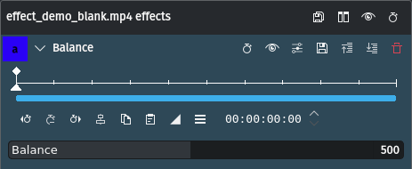

<!-- start-replace-fm field="title" -->
# Kdenlive — balance audio
<!-- end-replace-fm -->
<!-- start-replace-fm field="description" format="blockquote" -->
> L'effet balance audio de Kdenlive : régler la balance gauche/droite avec une valeur animable.
<!-- end-replace-fm -->

<!-- start-replace-mediagraphie-fiche -->
> **Référence** — Documentation Kdenlive (2026). Kdenlive — balance audio.. https://docs.kdenlive.org/en/effects_and_filters/audio_effects/channels/balance.html. [↗](https://docs.kdenlive.org/en/effects_and_filters/audio_effects/channels/balance.html)
>
> | **Type** | webpage |
> | **Auteur·e** | Documentation Kdenlive |
> | **Date** | 2026 |
> | **Statut** | stable |
> | **Mots-clés** | audio, balance, kdenlive, effet, tutoriel, cours |

**Citation (copier-coller)**

```citation
Documentation Kdenlive (2026). Kdenlive — balance audio.. https://docs.kdenlive.org/en/effects_and_filters/audio_effects/channels/balance.html.
```
<!-- end-replace-mediagraphie-fiche -->

## Cité par

<!-- start-replace-mediagraphie-cited-by -->
- [Kdenlive — liste des effets audio](../kdenlive-audio-effects-list/)
- [Kdenlive — panoramique audio](../kdenlive-audio-pan/)
<!-- end-replace-mediagraphie-cited-by -->

---

> 🇫🇷 **Traduction française** de la page officielle [Balance](https://docs.kdenlive.org/en/effects_and_filters/audio_effects/channels/balance.html) — la page source n'est pas encore traduite. Adaptation : A26. Images : documentation officielle Kdenlive (interface anglaise).



| Champ | Valeur |
|---|---|
| Statut | Maintenu |
| Images clés | Oui |
| Bibliothèque source | avfilter |
| Maître seulement | Non |
| Bogues connus | Aucun |

## Description

Règle la **balance gauche/droite**.

## Paramètres

| Paramètre | Valeur | Description |
|---|---|---|
| Balance | Entier | 0 = gauche ; 500 = centre ; 1000 = droite |

## Voir aussi

- [Kdenlive — liste des effets audio](../kdenlive-audio-effects-list/)
- [Kdenlive — panoramique audio](../kdenlive-audio-pan/)
- [Kdenlive — copier les canaux vers stéréo](../kdenlive-copy-channels-to-stereo/)
