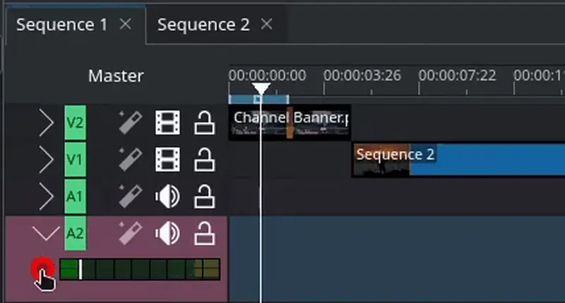
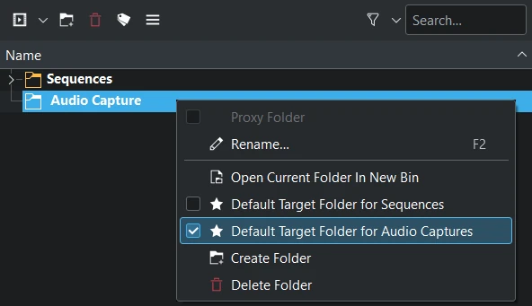

<!-- start-replace-fm field="title" -->
# Kdenlive — capturer l'audio
<!-- end-replace-fm -->
<!-- start-replace-fm field="description" format="blockquote" -->
> Capturer l'audio dans Kdenlive : enregistrer une voix off au micro pendant la lecture du projet, configurer la capture et choisir le dossier cible des enregistrements.
<!-- end-replace-fm -->

<!-- start-replace-mediagraphie-fiche -->
> **Référence** — Documentation Kdenlive (2026). Kdenlive — capturer l'audio.. https://docs.kdenlive.org/en/project_and_asset_management/capturing_audio.html. [↗](https://docs.kdenlive.org/en/project_and_asset_management/capturing_audio.html)
>
> | **Type** | webpage |
> | **Auteur·e** | Documentation Kdenlive |
> | **Date** | 2026 |
> | **Statut** | stable |
> | **Mots-clés** | video, montage, kdenlive, audio, voix-off, enregistrement, tutoriel, cours |

**Citation (copier-coller)**

```citation
Documentation Kdenlive (2026). Kdenlive — capturer l'audio.. https://docs.kdenlive.org/en/project_and_asset_management/capturing_audio.html.
```
<!-- end-replace-mediagraphie-fiche -->

## Cité par

<!-- start-replace-mediagraphie-cited-by -->
- [Kdenlive — enregistrement audio](../kdenlive-audio-recording/)
- [Kdenlive — configuration : capture](../kdenlive-configuration-capture/)
- [Exercice — Maquette sonore (sons de bouche)](../../../../02-activites/03/exercices/13-maquette-sonore/)
<!-- end-replace-mediagraphie-cited-by -->

---

> 🇫🇷 **Traduction française** de la page officielle [Capturing Audio](https://docs.kdenlive.org/en/project_and_asset_management/capturing_audio.html) — la page source n'est pas encore traduite. Adaptation : A26. Images : documentation officielle Kdenlive (interface anglaise ; GIF converti en WebP animé).

On peut utiliser Kdenlive pour **capturer l'audio au microphone pendant que le projet est lu dans le moniteur de projet** — par exemple pour enregistrer une voix off. Pour le détail du fonctionnement, voir [Kdenlive — enregistrement audio](../kdenlive-audio-recording/).

La capture se configure dans **Menu ‣ Paramètres ‣ Configurer Kdenlive ‣ Capture**. Le dossier de destination des captures se définit dans **Menu ‣ Paramètres ‣ Configurer Kdenlive ‣ Environnement ‣ Dossiers par défaut**.

## Enregistrer une voix off



L'enregistrement est placé dans la timeline à l'endroit où se trouvait la tête de lecture au moment où la capture a commencé.

> **Astuce** — Selon le périphérique d'enregistrement, la capture peut être en stéréo. On peut la ramener en mono avec l'effet audio **Copy Channels to Stereo** (copier les canaux vers stéréo).

Par défaut, le fichier `.wav` de l'enregistrement est placé dans le **bac à projets principal**. Pour regrouper les enregistrements au même endroit, on peut désigner un dossier du bac à projets comme cible des captures.



Clic droit sur le dossier concerné dans le bac à projets, puis activer **Default Target Folder for Audio Captures** (dossier cible par défaut pour les captures audio).

> **Note** — Ce dossier est un dossier du **bac à projets**, pas un dossier du système de fichiers. On peut toutefois définir un dossier du système où sont stockés tous les enregistrements (vidéo et audio) dans **Menu ‣ Paramètres ‣ Configurer Kdenlive ‣ Environnement ‣ Dossiers par défaut**.

## Voir aussi

- [Kdenlive — enregistrement audio](../kdenlive-audio-recording/)
- [Kdenlive — l'interface](../kdenlive-user-interface/)
- [Kdenlive — la timeline](../kdenlive-timeline/)
- [Kdenlive — démarrage rapide](../kdenlive-quickstart/)
