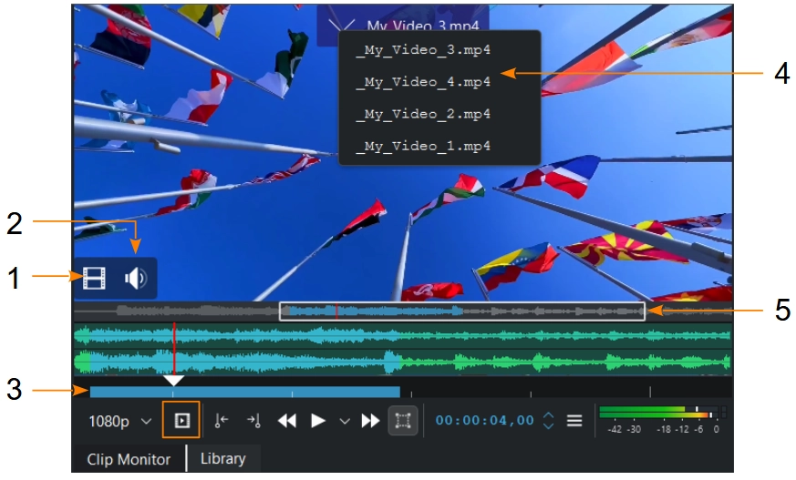
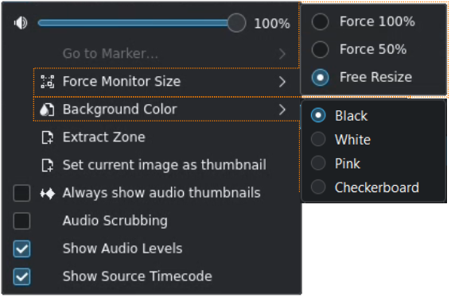
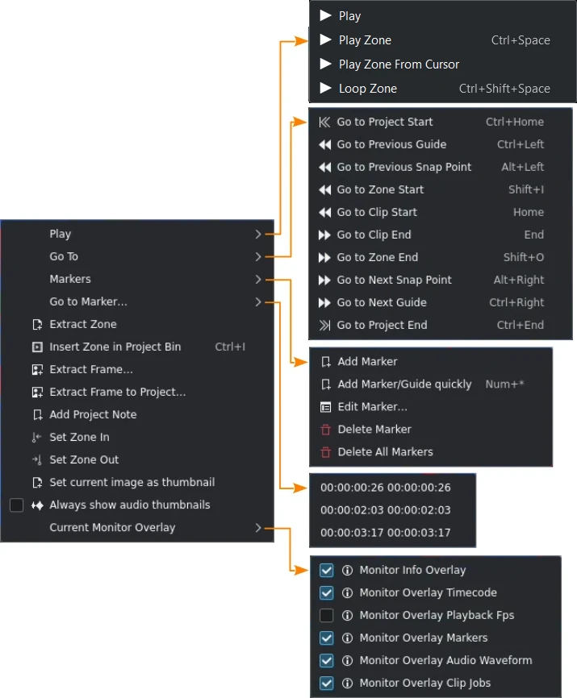
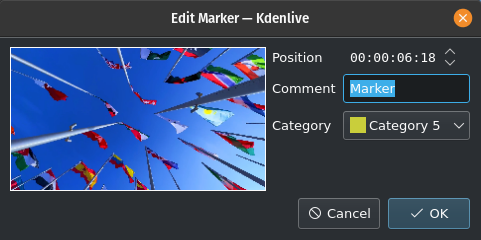
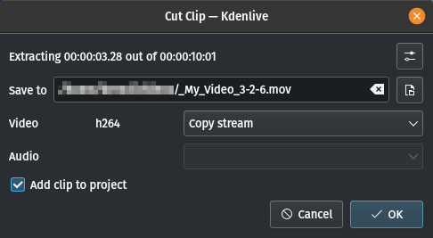
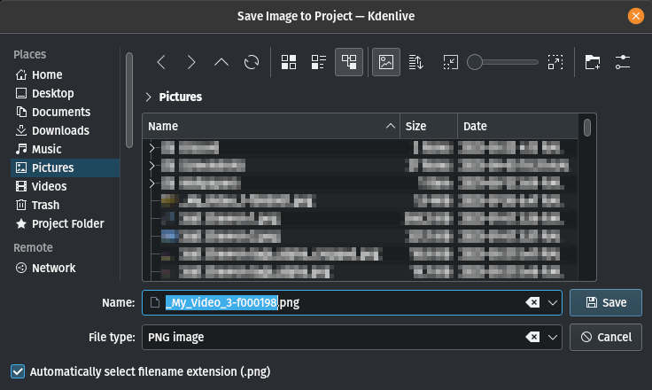
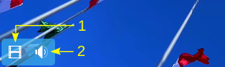

<!-- start-replace-fm field="title" -->
# Kdenlive — le moniteur de clip
<!-- end-replace-fm -->
<!-- start-replace-fm field="description" format="blockquote" -->
> Le moniteur de clip de Kdenlive : zones, menu hamburger, menu contextuel, extraction d'images et glisser-déposer séparé de l'audio et de la vidéo.
<!-- end-replace-fm -->

<!-- start-replace-mediagraphie-fiche -->
> **Référence** — Documentation Kdenlive (2026). Kdenlive — le moniteur de clip.. https://docs.kdenlive.org/en/user_interface/monitors/clip_monitor.html. [↗](https://docs.kdenlive.org/en/user_interface/monitors/clip_monitor.html)
>
> | **Type** | webpage |
> | **Auteur·e** | Documentation Kdenlive |
> | **Date** | 2026 |
> | **Statut** | stable |
> | **Mots-clés** | video, montage, kdenlive, interface, moniteur, tutoriel, cours |

**Citation (copier-coller)**

```citation
Documentation Kdenlive (2026). Kdenlive — le moniteur de clip.. https://docs.kdenlive.org/en/user_interface/monitors/clip_monitor.html.
```
<!-- end-replace-mediagraphie-fiche -->

## Cité par

<!-- start-replace-mediagraphie-cited-by -->
- [Kdenlive — le moniteur de projet](../kdenlive-project-monitor/)
- [Kdenlive — démarrage rapide](../kdenlive-quickstart/)
- [Kdenlive — l'interface](../kdenlive-user-interface/)
<!-- end-replace-mediagraphie-cited-by -->

---

> 🇫🇷 **Traduction française** de la page officielle [Clip Monitor](https://docs.kdenlive.org/en/user_interface/monitors/clip_monitor.html) — la page source n'est pas encore traduite. Adaptation : A26. Images : documentation officielle Kdenlive (interface anglaise).



Le **moniteur de clip** affiche le clip non monté (sans coupes) sélectionné dans le bac à projets. Il possède les mêmes fonctions que le moniteur de projet, à l'exception de l'icône qui ajoute la zone du clip au bac à projets, où elle apparaît comme clip enfant. Voir **Créer des zones**.

1. **Indicateur de flux vidéo.** Saisissez l'icône pour ne placer que la partie vidéo du clip dans la timeline.
2. **Indicateur de flux audio.** Saisissez l'icône pour ne placer que la partie audio dans la timeline.
3. **Indicateur de zone de clip.** Voir **Créer des zones**.
4. **Liste des derniers clips ouverts.** Survolez le haut du moniteur : la liste apparaît ; sélectionnez un clip pour l'afficher.
5. **Mini-carte pour zoomer le flux audio.** L'action dépend de la position de la souris : vue principale (vidéo) ou vue audio/mini-carte.

| Action | Audio / mini-carte | Vue principale |
|---|---|---|
| Simple clic | Défiler | Se positionner |
| Double-clic | Plein écran | Plein écran |
| Glisser | Défiler | Se positionner |
| Molette | Défiler | Se positionner |
| Ctrl+molette | Zoomer | Zoomer |

## Menu hamburger



- **Volume** — règle le volume de lecture du moniteur de clip, sans toucher au volume principal.
- **Aller au marqueur** — si le clip a des marqueurs, la liste s'affiche ; en choisir un place la tête de lecture à son timecode.
- **Forcer la taille du moniteur** — affiche la vidéo à 100 % (taille d'origine), à 50 %, ou ajuste à la taille du widget (redimensionnement libre).
- **Couleur d'arrière-plan** — couleur de fond du moniteur.
- **Extraire la zone** — enregistre la zone courante en `.mlt` et l'ajoute au bac à projets si **Ajouter le clip au projet** est coché. Voir aussi **Extraire la zone** dans le menu contextuel.
- **Définir l'image courante comme vignette** — utilise l'image courante comme vignette du clip.
- **Toujours afficher les vignettes audio** — affiche en permanence la forme d'onde audio.
- **Audio au défilement** — lit l'audio pendant le défilement ; à désactiver pour améliorer la fluidité ou éviter le bruit.
- **Afficher les niveaux audio** — affiche la courbe de fréquences de l'audio principal dans le moniteur de projet.
- **Afficher le timecode source** — affiche le timecode de la source.

## Créer des zones

Les **zones** sont des régions définies d'un clip, indiquées par une section colorée dans la timeline du moniteur (élément 3 ci-dessus). Le début se pose avec un clic ou **I**, la fin avec un clic ou **O**.

## Menu contextuel



Ces actions concernent le clip sélectionné dans le bac à projets. Le moniteur de projet propose des actions semblables, mais elles concernent le clip sélectionné dans la timeline.

| Élément | Raccourci | Description |
|---|---|---|
| Lire | `Espace` ou clic dans le moniteur | Lit le clip sélectionné (désactivable dans les réglages). |
| Lire la zone | `Ctrl+Espace` | Lit la zone courante et s'arrête. |
| Lire la zone depuis le curseur |  | Lit la zone du curseur jusqu'à sa fin. |
| Boucler la zone | `Ctrl+Shift+Espace` | Lit la zone en boucle. |
| Aller au début du projet | `Ctrl+Origine` | Début du clip. |
| Aller au repère précédent | `Ctrl+Gauche` | Repère ou marqueur de timeline précédent. |
| Aller au point d'accroche précédent | `Alt+Gauche` |  |
| Aller au début de la zone | `Shift+I` |  |
| Aller au début du clip | `Origine` |  |
| Aller à la fin du clip | `Fin` |  |
| Aller à la fin de la zone | `Shift+O` |  |
| Aller au point d'accroche suivant | `Alt+Droite` |  |
| Aller au repère suivant | `Ctrl+Droite` |  |
| Aller à la fin du projet | `Ctrl+Fin` | Fin du clip. |
| Ajouter un marqueur |  | Ouvre la fenêtre **Modifier le marqueur** pour ajouter un marqueur au point courant. |
| Ajouter un marqueur rapidement | `Num+*` | Ajoute un marqueur au point courant. |
| Modifier le marqueur |  | Ouvre la fenêtre d'édition du marqueur courant. |
| Supprimer le marqueur |  | Supprime le marqueur courant. |
| Supprimer tous les marqueurs |  | Supprime tous les marqueurs du clip. |
| Aller au marqueur… |  | Liste des marqueurs ; en choisir un y déplace la tête de lecture. |
| Extraire la zone |  | Ouvre la fenêtre **Couper le clip**. |
| Insérer la zone dans le bac à projets | `Ctrl+I` | Ajoute la zone comme sous-clip du clip original. |
| Extraire l'image |  | Ouvre **Enregistrer l'image** pour sauvegarder l'image courante (`.png` par défaut). |
| Extraire l'image vers le projet |  | Comme ci-dessus, et ajoute l'image au bac à projets. |
| Ajouter une note de projet |  | Ouvre les notes de projet et ajoute un lien vers l'image courante. |
| Définir le point d'entrée | `I` |  |
| Définir le point de sortie | `O` |  |
| Définir l'image courante comme vignette |  | Utilise l'image courante comme vignette du clip. |
| Toujours afficher les vignettes audio |  | Affiche ou masque la forme d'onde en permanence. |
| Surimpression du moniteur courant |  | Ouvre le menu des surimpressions disponibles. |
| Surimpression d'infos du moniteur |  | Active/désactive toutes les surimpressions. |
| Surimpression du timecode |  | Affiche/masque le timecode. |
| Surimpression des images par seconde |  | Affiche/masque la cadence. |
| Surimpression des marqueurs |  | Affiche/masque les lignes et vignettes des marqueurs. |
| Surimpression de la forme d'onde audio |  | Affiche/masque la forme d'onde. |
| Surimpression des tâches de clip |  | Affiche/masque les tâches en cours. |





La zone courante peut être enregistrée en `.mov`. Si **Ajouter le clip au projet** est coché, elle est ajoutée comme clip séparé.



## Se déplacer dans le clip

Dans le moniteur de clip : maintenez **Shift** et déplacez la souris à gauche ou à droite.

## Glisser seulement l'audio ou la vidéo

Il est possible de glisser uniquement le flux vidéo ou audio d'un clip du bac à projets ou du moniteur vers la timeline.



Déplacez la souris dans le coin inférieur gauche du moniteur pour accéder aux icônes **vidéo (1)** et **audio (2)**. Cliquez sur l'icône voulue et glissez le flux dans la timeline. Très utile lorsqu'un seul flux est nécessaire : cela évite de dégrouper le clip et de supprimer l'autre flux dans la timeline.

> **Note** — « Non monté » signifie sans coupes. Les clips du bac à projets peuvent avoir des effets et être considérés comme « montés » par certains.

## Voir aussi

- [Kdenlive — les moniteurs](../kdenlive-monitors/)
- [Kdenlive — le moniteur de projet](../kdenlive-project-monitor/)
- [Kdenlive — démarrage rapide](../kdenlive-quickstart/)
