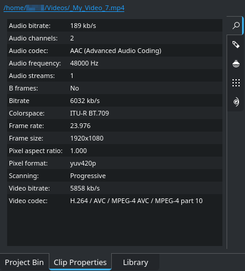
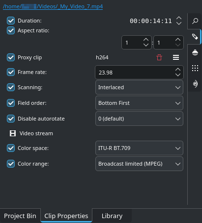
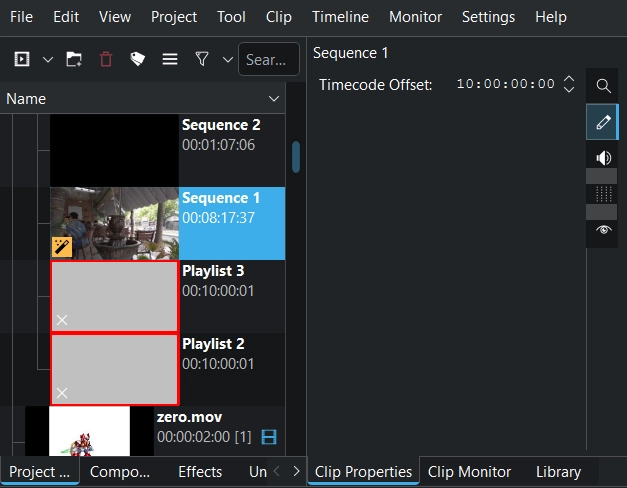
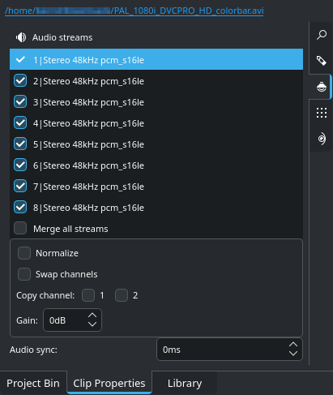

<!-- start-replace-fm field="title" -->
# Kdenlive — propriétés du clip
<!-- end-replace-fm -->
<!-- start-replace-fm field="description" format="blockquote" -->
> Les propriétés d'un clip dans Kdenlive : informations fichier, propriétés modifiables, propriétés de séquence et canaux audio.
<!-- end-replace-fm -->

<!-- start-replace-mediagraphie-fiche -->
> **Référence** — Documentation Kdenlive (2026). Kdenlive — propriétés du clip.. https://docs.kdenlive.org/en/project_and_asset_management/project_bin/clip_properties.html. [↗](https://docs.kdenlive.org/en/project_and_asset_management/project_bin/clip_properties.html)
>
> | **Type** | webpage |
> | **Auteur·e** | Documentation Kdenlive |
> | **Date** | 2026 |
> | **Statut** | stable |
> | **Mots-clés** | video, kdenlive, clip, propriétés, tutoriel, cours |

**Citation (copier-coller)**

```citation
Documentation Kdenlive (2026). Kdenlive — propriétés du clip.. https://docs.kdenlive.org/en/project_and_asset_management/project_bin/clip_properties.html.
```
<!-- end-replace-mediagraphie-fiche -->

## Cité par

<!-- start-replace-mediagraphie-cited-by -->
_Aucune citation pour l'instant._
<!-- end-replace-mediagraphie-cited-by -->

---

> 🇫🇷 **Traduction française** de la page officielle [Clip Properties](https://docs.kdenlive.org/en/project_and_asset_management/project_bin/clip_properties.html) — la page source n'est pas encore traduite. Adaptation : A26. Images : documentation officielle Kdenlive (interface anglaise).

On affiche et modifie les propriétés d'un clip en le sélectionnant dans le **bac à projets**, puis via **Menu ‣ Média ‣ Propriétés du clip**, ou par clic droit → **Propriétés du clip**.

Les propriétés s'affichent dans leur propre widget, activé par **Menu ‣ Vue ‣ Propriétés du clip**. S'il n'est pas activé, Kdenlive l'active automatiquement. Par défaut, le widget partage le dock du bac à projets ; on peut le déplacer ou le détacher.

Le widget comporte plusieurs onglets :

- **Infos fichier** — informations générales sur le fichier ;
- **Propriétés** — modification de certaines propriétés ;
- **Propriétés audio** — propriétés du flux audio.

## Infos fichier



Le premier onglet affiche les informations générales du fichier, ses flux et d'autres données techniques. En haut, le nom du fichier avec son chemin complet est un lien : un clic ouvre le gestionnaire de fichiers du système à cet emplacement.

## Propriétés



L'onglet **Propriétés** affiche les propriétés du clip que Kdenlive permet de modifier. Cochez la propriété à changer, puis saisissez ou sélectionnez la nouvelle valeur.

- **Durée** — durée d'origine du clip. Surtout utile pour les clips de couleur, les titres, les images et les séquences d'images. Pour un clip vidéo : une durée plus courte coupe le clip ; une durée plus longue répète la dernière image (image figée).
- **Format d'image** — format d'image actuel du clip.
- **Clip proxy** — si les proxys sont activés pour le projet, crée un fichier proxy pour le clip sélectionné. Si un proxy existe, la case est cochée et le format d'encodage s'affiche. **Supprimer le fichier proxy** le supprime ; une icône ouvre des options supplémentaires.
- **Cadence** — images par seconde.
- **Balayage** — entrelacé ou progressif.
- **Ordre des champs** — applicable au balayage entrelacé.
- **Désactiver la rotation automatique** — empêche la rotation selon les métadonnées intégrées à l'image (pas présentes dans toutes les images).
- **Espace colorimétrique** — espace colorimétrique du clip.
- **Plage colorimétrique** — plage du clip, surtout pertinente pour la diffusion.

## Propriétés de la séquence



Quand une séquence est sélectionnée dans le bac à projets, on peut modifier son **décalage de timecode**. Voir *Décalage du timecode d'une séquence*.

## Propriétés audio



Choisissez les canaux audio à activer ou désactiver. Renommez par double-clic. Sélectionnez un canal dans la liste pour :

- **Normaliser** le canal ;
- **Inverser les canaux** ;
- **Copier un canal** sur l'autre ;
- régler le **gain** (volume).

Le réglage de la **synchronisation audio** par pas d'une milliseconde (1 ms) s'applique à tous les canaux.

## Notes

- L'onglet **Marqueur** a été supprimé : les marqueurs de clip s'affichent dans leur propre widget **Marqueurs**, activé par **Menu ‣ Vue ‣ Marqueurs**.
- Les onglets **Métadonnées** et **Analyse** n'affichent rien pour le moment.
- Il y a une différence entre **flux audio** et **canaux audio**. Kdenlive affiche les flux dans une liste. Les caméras grand public n'ont souvent qu'un flux audio avec plusieurs canaux (par exemple 5.1) ; Kdenlive ne permet pas de manipuler les canaux audio.

## Voir aussi

- [Kdenlive — l'interface](../kdenlive-user-interface/)
- [Kdenlive — la timeline](../kdenlive-timeline/)
- [Kdenlive — enregistrement audio](../kdenlive-audio-recording/)
