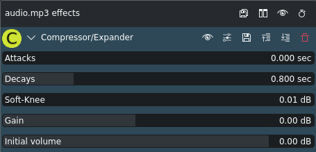

<!-- start-replace-fm field="title" -->
# Kdenlive — compresseur/expandeur
<!-- end-replace-fm -->
<!-- start-replace-fm field="description" format="blockquote" -->
> L'effet compresseur/expandeur de Kdenlive : dynamique, attaque, relâchement, soft-knee et gain pour la voix.
<!-- end-replace-fm -->

<!-- start-replace-mediagraphie-fiche -->
> **Référence** — Documentation Kdenlive (2026). Kdenlive — compresseur/expandeur.. https://docs.kdenlive.org/en/effects_and_filters/audio_effects/volume_and_dynamics/compressor_expander.html. [↗](https://docs.kdenlive.org/en/effects_and_filters/audio_effects/volume_and_dynamics/compressor_expander.html)
>
> | **Type** | webpage |
> | **Auteur·e** | Documentation Kdenlive |
> | **Date** | 2026 |
> | **Statut** | stable |
> | **Mots-clés** | audio, dynamique, kdenlive, effet, tutoriel, cours |

**Citation (copier-coller)**

```citation
Documentation Kdenlive (2026). Kdenlive — compresseur/expandeur.. https://docs.kdenlive.org/en/effects_and_filters/audio_effects/volume_and_dynamics/compressor_expander.html.
```
<!-- end-replace-mediagraphie-fiche -->

## Cité par

<!-- start-replace-mediagraphie-cited-by -->
- [Kdenlive — liste des effets audio](../kdenlive-audio-effects-list/)
<!-- end-replace-mediagraphie-cited-by -->

---

> 🇫🇷 **Traduction française** de la page officielle [Compressor/Expander](https://docs.kdenlive.org/en/effects_and_filters/audio_effects/volume_and_dynamics/compressor_expander.html) — la page source n'est pas encore traduite. Adaptation : A26. Images : documentation officielle Kdenlive (interface anglaise).



| Champ | Valeur |
|---|---|
| Statut | Maintenu |
| Images clés | Non |
| Bibliothèque source | avfilter |
| Maître seulement | Non |
| Bogues connus | Aucun |

## Description

Compresse ou étend la **plage dynamique** de l'audio.

## Paramètres

| Paramètre | Valeur | Description |
|---|---|---|
| Attaques | Décimal | Temps, en fractions de seconde, sur lequel l'augmentation de volume est déterminée |
| Relâchements | Décimal | Temps, en fractions de seconde, sur lequel la baisse de volume est déterminée |
| Soft-Knee | Décimal | Réduit les pics de volume maximaux (dB) |
| Gain | Décimal | Augmente le volume global (dB) |
| Volume initial | Décimal | Volume initial (dB) |

## Notes

Le compresseur/expandeur amplifie les signaux selon leur volume initial : les signaux faibles restent tels quels ou sont amplifiés, les signaux forts sont réduits. L'objectif est d'**égaliser les pics et les creux** de la plage de volume. On peut ensuite augmenter le volume global sans clipping ni distorsion, ce qui remonte les passages calmes.

C'est un effet important pour la **voix** : **Soft-Knee** réduit les pics et **Gain** remonte le volume global. Dans la plupart des cas, les deux valeurs sont identiques ou très proches. Des valeurs entre 4 et 10 dB sont courantes pour la voix, selon la dynamique de la personne qui parle.

## Voir aussi

- [Kdenlive — liste des effets audio](../kdenlive-audio-effects-list/)
- [Kdenlive — enregistrement audio](../kdenlive-audio-recording/)
- [Kdenlive — la table de mixage audio](../kdenlive-audio-mixer/)
