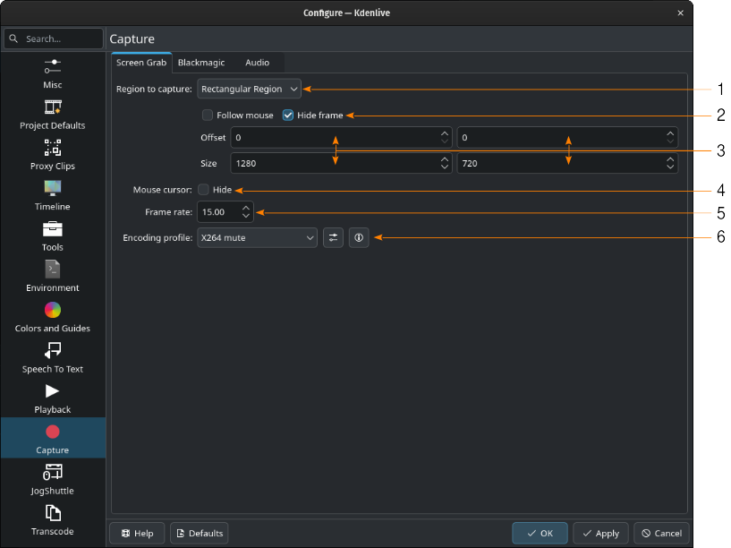
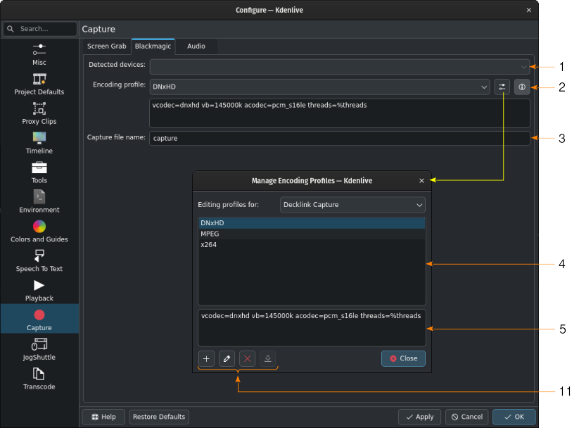
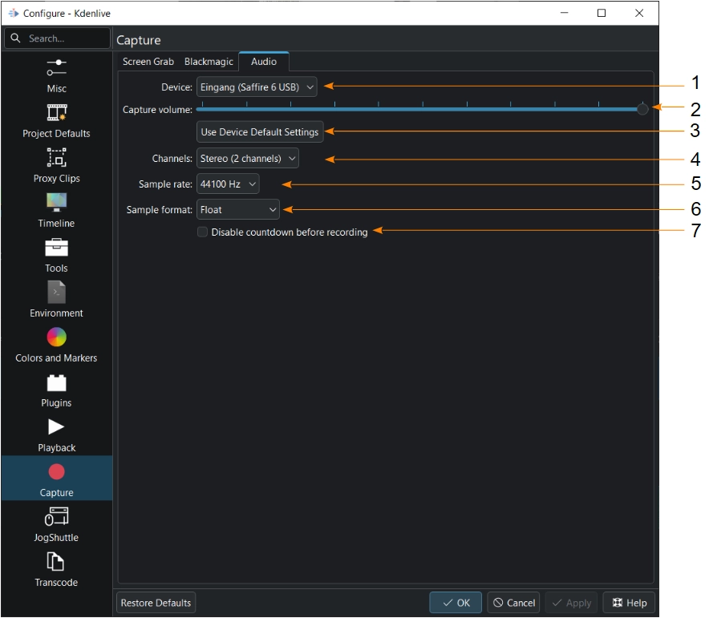

<!-- start-replace-fm field="title" -->
# Kdenlive — configuration : capture
<!-- end-replace-fm -->
<!-- start-replace-fm field="description" format="blockquote" -->
> Les réglages de capture de Kdenlive : ScreenGrab, Blackmagic DeckLink et périphérique audio, canaux, fréquence et décompte.
<!-- end-replace-fm -->

<!-- start-replace-mediagraphie-fiche -->
> **Référence** — Documentation Kdenlive (2026). Kdenlive — configuration : capture.. https://docs.kdenlive.org/en/getting_started/configure_kdenlive/configuration_capture.html. [↗](https://docs.kdenlive.org/en/getting_started/configure_kdenlive/configuration_capture.html)
>
> | **Type** | webpage |
> | **Auteur·e** | Documentation Kdenlive |
> | **Date** | 2026 |
> | **Statut** | stable |
> | **Mots-clés** | video, kdenlive, configuration, capture, audio, tutoriel, cours |

**Citation (copier-coller)**

```citation
Documentation Kdenlive (2026). Kdenlive — configuration : capture.. https://docs.kdenlive.org/en/getting_started/configure_kdenlive/configuration_capture.html.
```
<!-- end-replace-mediagraphie-fiche -->

## Cité par

<!-- start-replace-mediagraphie-cited-by -->
_Aucune citation pour l'instant._
<!-- end-replace-mediagraphie-cited-by -->

---

> 🇫🇷 **Traduction française** de la page officielle [Capture](https://docs.kdenlive.org/en/getting_started/configure_kdenlive/configuration_capture.html) — la page source n'est pas encore traduite. Adaptation : A26. Images : documentation officielle Kdenlive (interface anglaise).

Cette section configure la **capture audio et vidéo**. Kdenlive permet de capturer la vidéo avec **ScreenGrab** et une carte **Blackmagic DeckLink**, et l'audio avec les périphériques disponibles sur le système.

## ScreenGrab



1. **Région à capturer.** Par défaut, tout l'écran. **Région rectangulaire** ouvre un panneau de paramètres supplémentaires.
2. **Suivre la souris.** Si coché, le rectangle suit la souris. **Masquer le cadre** rend le cadre invisible.
3. **Décalage** — distance selon x (premier paramètre) et y (second) depuis le coin supérieur gauche. **Taille** — largeur (premier paramètre) et hauteur (second).
4. **Curseur de la souris.** Si coché, le pointeur n'est pas enregistré.
5. **Cadence.** Images par seconde de l'enregistrement.
6. **Profil d'encodage.** **Afficher les paramètres du profil** ouvre la fenêtre de gestion des profils d'encodage ; une icône affiche les paramètres ffmpeg du profil sélectionné.

## Blackmagic

Si vous avez une carte de capture vidéo **Blackmagic DeckLink**, réglez ici les paramètres d'import.



1. **Périphériques détectés.** Liste des appareils disponibles.
2. **Profil d'encodage.** Profil utilisé pour encoder l'enregistrement. **Afficher les paramètres du profil** ouvre la gestion des profils ; une icône affiche les paramètres ffmpeg du profil sélectionné.
3. **Nom du fichier de capture.** Nom sous lequel l'enregistrement est sauvegardé dans le dossier défini dans la section **Environnement**.
4. **Liste des profils d'encodage disponibles** pour la capture DeckLink.
5. **Paramètres ffmpeg** du profil sélectionné.
6. Boutons pour créer un profil à partir du profil sélectionné, le modifier ou le supprimer. Le dernier bouton n'a pas encore de fonction.

## Audio

Ces réglages configurent le **périphérique audio** utilisé pour la capture d'écran et l'enregistrement des voix off. Voir [Kdenlive — capturer l'audio](../kdenlive-capturing-audio/).



1. **Périphérique.** Sélection du périphérique d'enregistrement audio.
2. **Volume de capture.** Curseur de volume de l'enregistrement.
3. **Utiliser les réglages par défaut du périphérique.** Applique les canaux, la fréquence d'échantillonnage et le format d'échantillonnage par défaut du matériel.
4. **Canaux.** Nombre de canaux à enregistrer : **Stéréo (2 canaux)** par défaut, ou **Mono (1 canal)**. Seules les valeurs prises en charge par le matériel s'affichent.
5. **Fréquence d'échantillonnage.** 48 000 Hz (par défaut), 44 100 Hz ou 96 000 Hz, selon le matériel.
6. **Format d'échantillonnage.** 8 bits, 16 bits, 32 bits ou flottant — à essayer si l'enregistrement ne fonctionne pas correctement.
7. **Désactiver le décompte avant l'enregistrement.** Si coché, l'enregistrement démarre immédiatement au clic sur le bouton d'enregistrement de la piste audio. Par défaut, un décompte de trois secondes s'affiche dans le moniteur de projet.

## Voir aussi

- [Kdenlive — capturer l'audio](../kdenlive-capturing-audio/)
- [Kdenlive — enregistrement audio](../kdenlive-audio-recording/)
- [Kdenlive — configuration](../kdenlive-configuration/)
