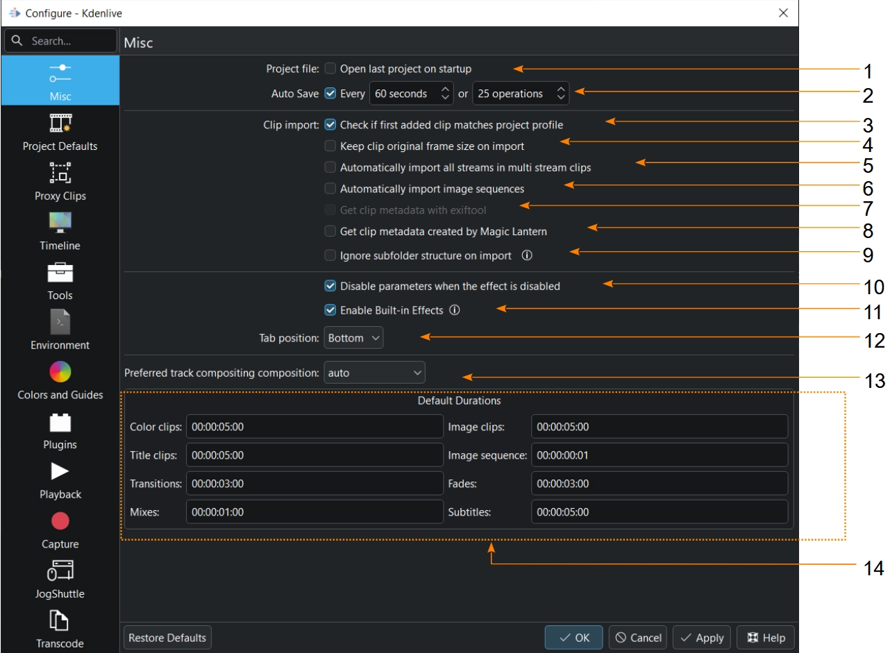

<!-- start-replace-fm field="title" -->
# Kdenlive — configuration : divers
<!-- end-replace-fm -->
<!-- start-replace-fm field="description" format="blockquote" -->
> Les réglages Divers de Kdenlive : ouverture du dernier projet, sauvegarde automatique, import des clips, effets intégrés, composition des pistes et durées par défaut.
<!-- end-replace-fm -->

<!-- start-replace-mediagraphie-fiche -->
> **Référence** — Documentation Kdenlive (2026). Kdenlive — configuration : divers.. https://docs.kdenlive.org/en/getting_started/configure_kdenlive/configuration_misc.html. [↗](https://docs.kdenlive.org/en/getting_started/configure_kdenlive/configuration_misc.html)
>
> | **Type** | webpage |
> | **Auteur·e** | Documentation Kdenlive |
> | **Date** | 2026 |
> | **Statut** | stable |
> | **Mots-clés** | video, montage, kdenlive, configuration, tutoriel, cours |

**Citation (copier-coller)**

```citation
Documentation Kdenlive (2026). Kdenlive — configuration : divers.. https://docs.kdenlive.org/en/getting_started/configure_kdenlive/configuration_misc.html.
```
<!-- end-replace-mediagraphie-fiche -->

## Cité par

<!-- start-replace-mediagraphie-cited-by -->
- [Kdenlive — configuration](../kdenlive-configuration/)
- [Kdenlive — configuration : valeurs par défaut du projet](../kdenlive-configuration-project-defaults/)
- [Kdenlive — configuration : timeline](../kdenlive-configuration-timeline/)
<!-- end-replace-mediagraphie-cited-by -->

---

> 🇫🇷 **Traduction française** de la page officielle [Misc](https://docs.kdenlive.org/en/getting_started/configure_kdenlive/configuration_misc.html) — la page source n'est pas encore traduite. Adaptation : A26. Images : documentation officielle Kdenlive (interface anglaise).

La section **Divers** (*Misc*) regroupe les réglages du comportement général de Kdenlive, de l'import des clips et des effets, ainsi que les durées par défaut des différents types de clips.



1. **Ouvrir le dernier projet au démarrage.** Si coché, Kdenlive ouvre le dernier projet édité et enregistré avant la fermeture. Sinon, il crée un nouveau projet avec les **valeurs par défaut du projet**.
2. **Sauvegarde automatique.** Si coché, Kdenlive crée une sauvegarde du projet en cours tous les *n* secondes ou toutes les *n* opérations (60 s / 25 opérations par défaut). Pendant l'enregistrement, un carré vert apparaît 2 secondes près du sélecteur de disposition (en haut à droite). Voir [Auto Save](https://docs.kdenlive.org/en/project_and_asset_management/file_management/auto_save.html).
3. **Vérifier que le premier clip ajouté correspond au profil du projet.** Si coché, Kdenlive compare les dimensions et la cadence du premier clip ajouté au bac à projets avec celles du profil du projet. En cas de différence, il propose d'ajuster les paramètres du projet.
4. **Importer automatiquement tous les flux des clips multiflux.** Si coché, tous les flux vidéo et audio d'un clip sont importés — utile pour les vidéos à plusieurs angles de caméra. Sinon, seuls le premier flux vidéo et le premier flux audio sont importés.
5. **Importer automatiquement les séquences d'images.** Si coché, plusieurs images sélectionnées sont importées comme une **séquence d'images**, et non comme des images séparées. Une séquence ne peut pas être scindée en images individuelles.
6. **Lire les métadonnées créées par Magic Lantern.** Si coché, Kdenlive lit les métadonnées produites par cet outil et les affiche dans les propriétés du clip.
7. **Ignorer la structure des sous-dossiers à l'import.** Si coché, importer un dossier complet ignore les sous-dossiers et place tous les fichiers compatibles directement dans le bac à projets. Sinon, Kdenlive recrée les dossiers et sous-dossiers dans le bac à projets pour refléter l'arborescence du disque.
8. **Désactiver les paramètres quand l'effet est désactivé.** Si coché, les paramètres ne sont pas modifiables tant que l'effet est désactivé. Sinon, on peut les modifier, mais la lecture ne change pas tant que l'effet n'est pas réactivé.
9. **Activer les effets intégrés.** Si coché, les paramètres des effets **Flip** et **Transform** sont automatiquement ajoutés aux clips et affichés dans la pile d'effets — plus besoin de les ajouter à la main.
10. **Position des onglets.** Détermine où s'affichent les onglets des widgets empilés : **Bas** (par défaut), **Haut**, **Gauche** ou **Droite**.
11. **Composition de piste préférée.** Détermine la méthode de composition des pistes, utilisée même sans composition explicite : les pistes se comportent comme des calques, les numéros faibles étant sous les numéros élevés. Options : **qtblend** (par défaut), **auto**, **frei0r.cairoblend**. Qtblend offre les meilleures performances et la meilleure stabilité.
12. **Durées par défaut.** Durée par défaut des différents types de clips à leur création. Les clips restent modifiables dans le bac à projets ou la timeline, mais on peut fixer ici une durée systématique (par exemple 10 s pour les titres). Notation : `hh:mm:ss:ff` — heures, minutes, secondes et images.

## Voir aussi

- [Kdenlive — configuration](../kdenlive-configuration/)
- [Kdenlive — configuration : valeurs par défaut du projet](../kdenlive-configuration-project-defaults/)
- [Kdenlive — démarrage rapide](../kdenlive-quickstart/)
