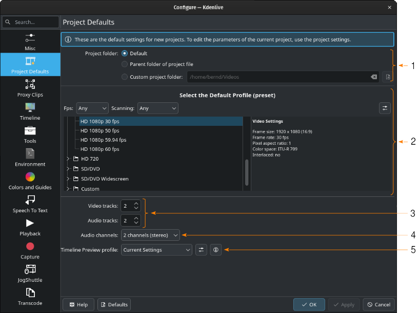
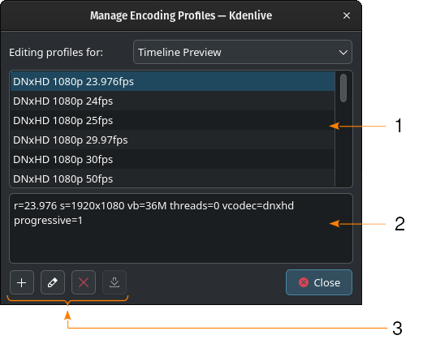

<!-- start-replace-fm field="title" -->
# Kdenlive — configuration : valeurs par défaut du projet
<!-- end-replace-fm -->
<!-- start-replace-fm field="description" format="blockquote" -->
> Les valeurs par défaut des nouveaux projets Kdenlive : dossier de projet, profil, pistes audio/vidéo, canaux et profil de prévisualisation de la timeline.
<!-- end-replace-fm -->

<!-- start-replace-mediagraphie-fiche -->
> **Référence** — Documentation Kdenlive (2026). Kdenlive — configuration : valeurs par défaut du projet.. https://docs.kdenlive.org/en/getting_started/configure_kdenlive/configuration_project_defaults.html. [↗](https://docs.kdenlive.org/en/getting_started/configure_kdenlive/configuration_project_defaults.html)
>
> | **Type** | webpage |
> | **Auteur·e** | Documentation Kdenlive |
> | **Date** | 2026 |
> | **Statut** | stable |
> | **Mots-clés** | video, montage, kdenlive, configuration, projet, tutoriel, cours |

**Citation (copier-coller)**

```citation
Documentation Kdenlive (2026). Kdenlive — configuration : valeurs par défaut du projet.. https://docs.kdenlive.org/en/getting_started/configure_kdenlive/configuration_project_defaults.html.
```
<!-- end-replace-mediagraphie-fiche -->

## Cité par

<!-- start-replace-mediagraphie-cited-by -->
- [Kdenlive — configuration](../kdenlive-configuration/)
- [Kdenlive — configuration : divers](../kdenlive-configuration-misc/)
- [Kdenlive — configuration : timeline](../kdenlive-configuration-timeline/)
<!-- end-replace-mediagraphie-cited-by -->

---

> 🇫🇷 **Traduction française** de la page officielle [Project Defaults](https://docs.kdenlive.org/en/getting_started/configure_kdenlive/configuration_project_defaults.html) — la page source n'est pas encore traduite. Adaptation : A26. Images : documentation officielle Kdenlive (interface anglaise).

Kdenlive utilise ces réglages à la création d'un nouveau projet (Menu ‣ Fichier ‣ Nouveau, ou au démarrage si l'ouverture du dernier projet n'est pas cochée). Pour modifier un projet en cours, utilisez les **Paramètres du projet** ; même si c'est possible, ce n'est pas recommandé, car cela peut casser des images clés et des coupes.



**1. Dossier du projet.** Réglage important pour garder les projets organisés et le système de fichiers en ordre. Kdenlive crée les dossiers `audiothumbs`, `sequences`, `videothumbs` et `workfiles` pour chaque projet.

- **1a. Par défaut** — Kdenlive crée ces dossiers dans un dossier spécial du chemin d'installation. Sous Linux : `/home/<utilisateur>/.var/app/org.kde.kdenlive/cache/kdenlive/<ID_projet>/`. Sous Windows : `%APPDATA%\Local\kdenlive\cache`.
- **1b. Dossier parent du fichier de projet** — les dossiers du projet sont créés dans le dossier parent du fichier de projet. Par exemple, si le projet est dans `/home/moi/projets/projet_1/`, Kdenlive crée `/home/moi/projets/projet_1/audiothumbs/`, `/home/moi/projets/projet_1/sequences/`, etc.
- **1c. Dossier de projet personnalisé** — vous choisissez le dossier qui accueillera ces dossiers de travail.

**2. Profil par défaut (préréglage).** Définit le profil utilisé pour un nouveau projet. Utilisez les filtres **Fps** et **Scanning** (balayage entrelacé ou progressif). Vous pouvez créer un profil avec l'icône de **gestion des profils de projet** ; voir [Profils de projet / préréglages](https://docs.kdenlive.org/en/project_and_asset_management/project_settings.html).

**3. Pistes vidéo/audio.** Nombre de pistes vidéo et audio d'un nouveau projet. On peut en ajouter ou en supprimer à tout moment.

**4. Canaux audio.** Nombre de canaux pris en charge par chaque piste audio : **2 canaux (stéréo)** par défaut, 4 ou 6 canaux.

**5. Profil de prévisualisation de la timeline.** Profil d'encodage utilisé pour le **rendu de prévisualisation**. Les options dépendent du matériel et des codecs installés. L'icône **Afficher les paramètres du profil** les affiche dans la zone de texte sous le champ de sélection.

### Profils d'encodage



1. Liste des profils disponibles.
2. Paramètres utilisés dans le profil sélectionné.
3. Boutons pour créer un profil à partir du profil sélectionné, le modifier ou le supprimer. Le dernier bouton n'a pas encore de fonction.

## Voir aussi

- [Kdenlive — configuration](../kdenlive-configuration/)
- [Kdenlive — configuration : divers](../kdenlive-configuration-misc/)
- [Kdenlive — démarrage rapide](../kdenlive-quickstart/)
