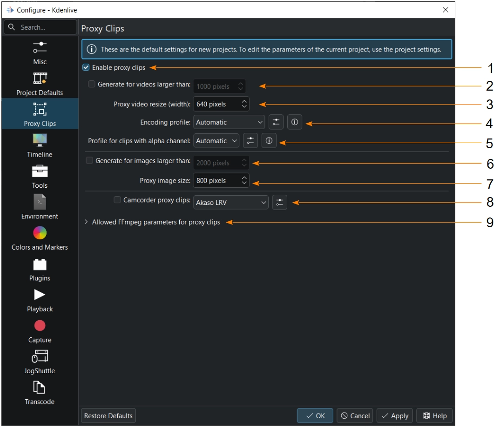
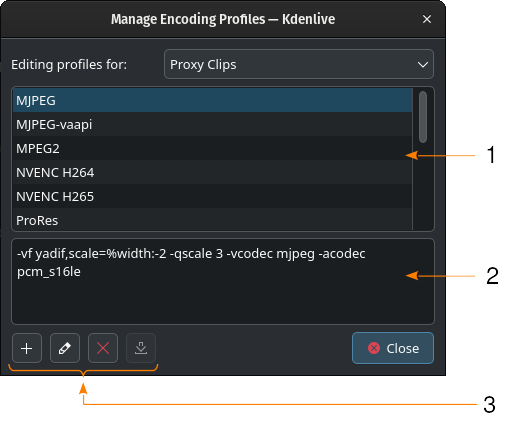

<!-- start-replace-fm field="title" -->
# Kdenlive — configuration : clips proxy
<!-- end-replace-fm -->
<!-- start-replace-fm field="description" format="blockquote" -->
> Les clips proxy dans Kdenlive : activation, génération automatique, redimensionnement, profils d'encodage et proxys externes.
<!-- end-replace-fm -->

<!-- start-replace-mediagraphie-fiche -->
> **Référence** — Documentation Kdenlive (2026). Kdenlive — configuration : clips proxy.. https://docs.kdenlive.org/en/getting_started/configure_kdenlive/configuration_proxy_clips.html. [↗](https://docs.kdenlive.org/en/getting_started/configure_kdenlive/configuration_proxy_clips.html)
>
> | **Type** | webpage |
> | **Auteur·e** | Documentation Kdenlive |
> | **Date** | 2026 |
> | **Statut** | stable |
> | **Mots-clés** | video, montage, kdenlive, configuration, proxy, tutoriel, cours |

**Citation (copier-coller)**

```citation
Documentation Kdenlive (2026). Kdenlive — configuration : clips proxy.. https://docs.kdenlive.org/en/getting_started/configure_kdenlive/configuration_proxy_clips.html.
```
<!-- end-replace-mediagraphie-fiche -->

## Cité par

<!-- start-replace-mediagraphie-cited-by -->
- [Kdenlive — configuration](../kdenlive-configuration/)
- [Kdenlive — configuration : timeline](../kdenlive-configuration-timeline/)
<!-- end-replace-mediagraphie-cited-by -->

---

> 🇫🇷 **Traduction française** de la page officielle [Proxy Clips](https://docs.kdenlive.org/en/getting_started/configure_kdenlive/configuration_proxy_clips.html) — la page source n'est pas encore traduite. Adaptation : A26. Images : documentation officielle Kdenlive (interface anglaise).



1. **Activer les clips proxy.** Pour pouvoir utiliser des clips proxy, il faut d'abord les activer.
2. **Générer pour les vidéos plus grandes que.** Si coché, des clips proxy sont générés automatiquement pour les vidéos dont la largeur dépasse la valeur choisie, dès leur ajout au bac à projets.
3. **Redimensionnement vidéo des proxys (largeur).** Largeur cible des clips proxy, en pixels.
4. **Profil d'encodage.** Profil utilisé pour créer les clips proxy. Les options dépendent du matériel ; choisissez un bon compromis entre vitesse et compression. L'icône de gestion permet d'éditer les profils.
5. **Profil pour les clips avec canal alpha.** Même chose pour les clips proxy qui conservent un canal alpha.
6. **Générer pour les images plus grandes que.** Si coché, des clips proxy sont générés automatiquement pour les images dont la largeur dépasse la valeur choisie.
7. **Redimensionnement d'image des proxys (largeur).** Largeur cible des proxys d'image, en pixels.
8. **Clips proxy externes.** Si activé, Kdenlive utilise les fichiers proxy déjà générés par certaines caméras (GoPro, Sony, drones DJI, par exemple). L'icône de gestion permet d'éditer les profils.
9. **Paramètres FFmpeg autorisés pour les clips proxy.** Liste des paramètres acceptés par FFmpeg. Si un profil contient un paramètre inattendu, Kdenlive avertit et demande s'il faut vraiment l'autoriser.

### Profils d'encodage



1. Liste des profils disponibles.
2. Paramètres utilisés dans le profil sélectionné.
3. Boutons pour créer un profil à partir du profil sélectionné, le modifier ou le supprimer. Le dernier bouton n'a pas encore de fonction.

## Voir aussi

- [Kdenlive — configuration](../kdenlive-configuration/)
- [Kdenlive — configuration : timeline](../kdenlive-configuration-timeline/)
- [Kdenlive — démarrage rapide](../kdenlive-quickstart/)
